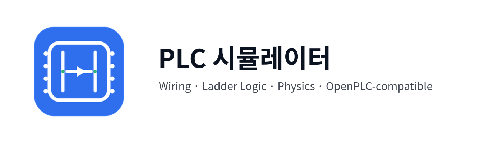
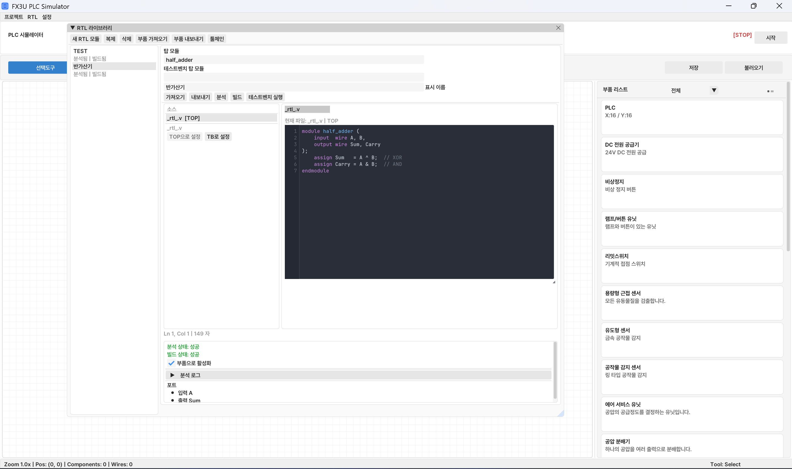
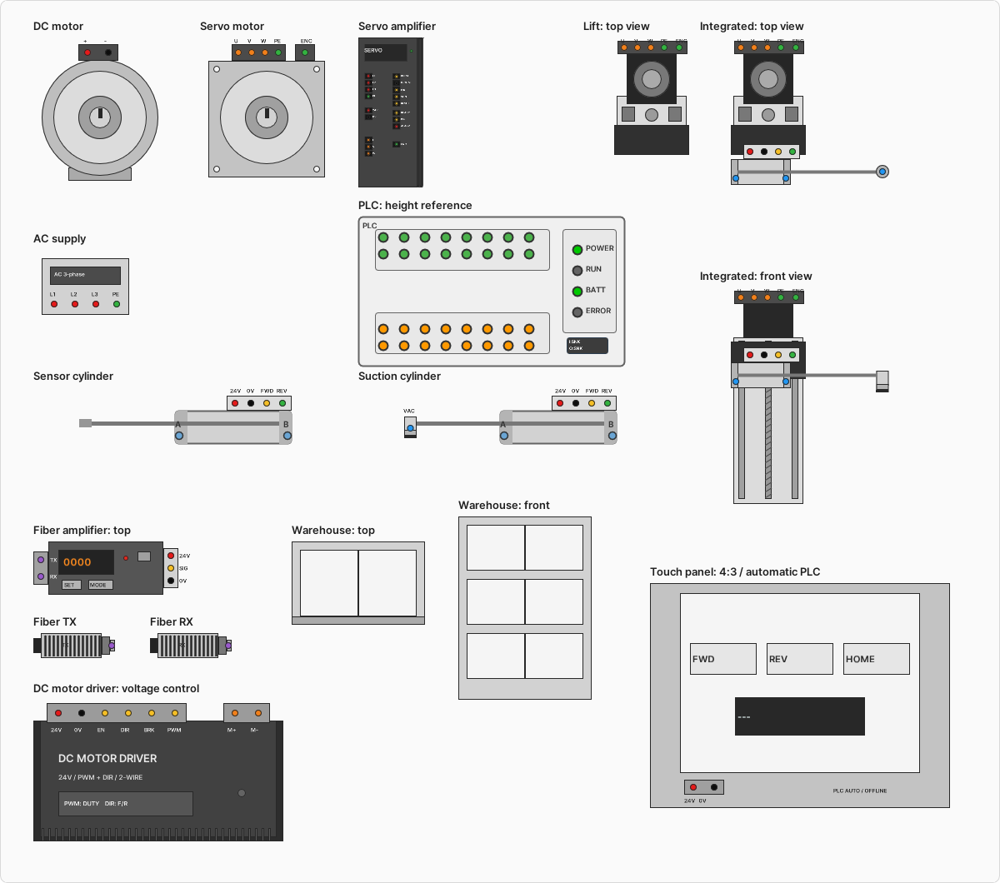
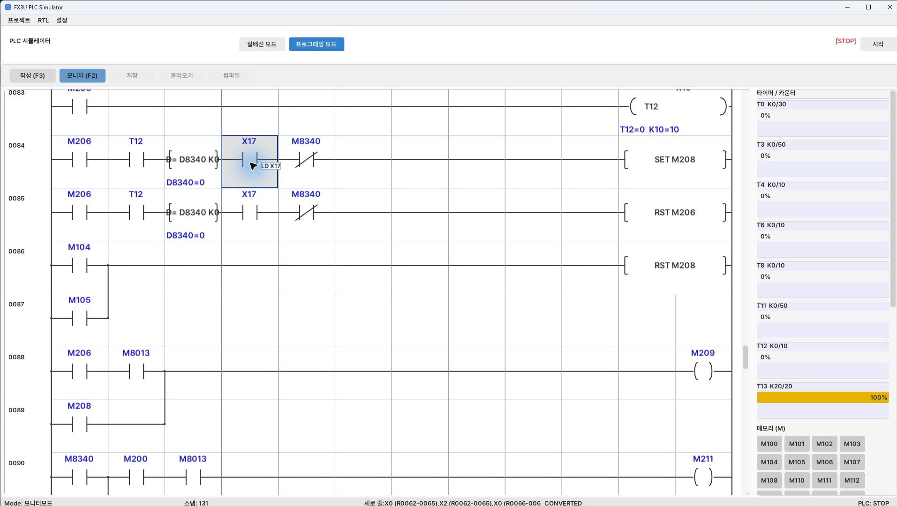
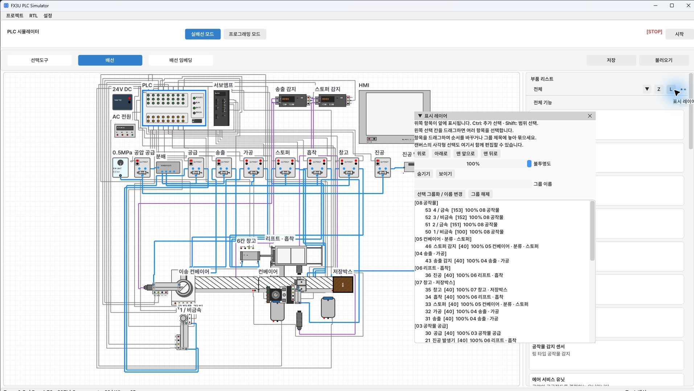
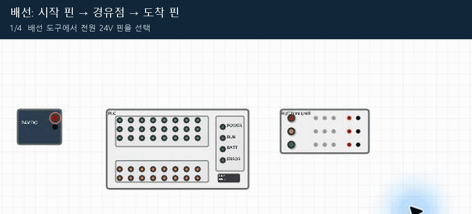
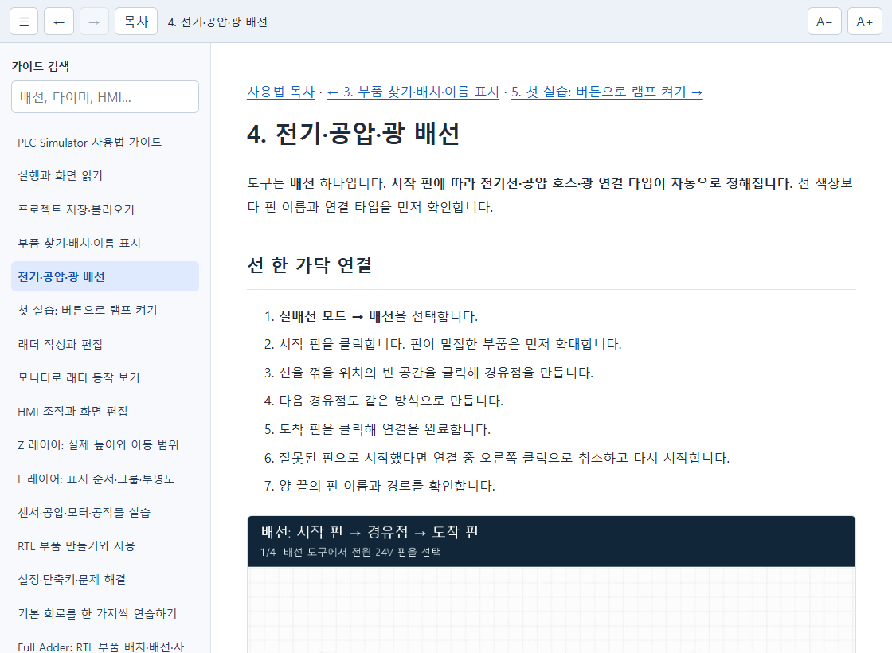
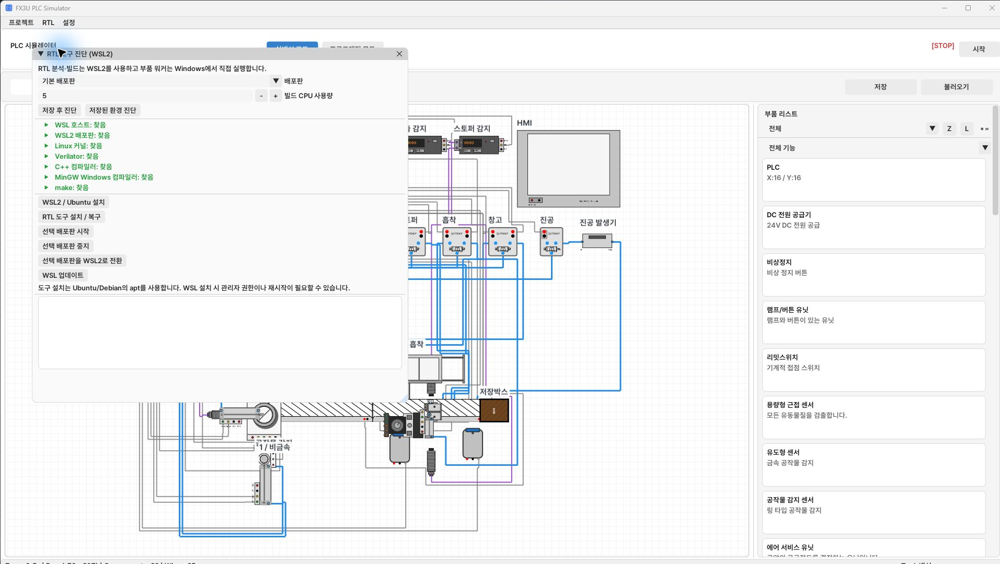

# PLC Simulator

[](https://isocpp.org/)
[](https://cmake.org/)
[](LICENSE)




Real-time PLC wiring/programming simulator with integrated physics, OpenPLC-compatible ladder execution, and RTL hardware design workflow.

[한국어](README_kr.md) · [日本語](README_ja.md)

[Project History](docs/Project_History_en.md)

## Why this project?

PLC training is often constrained by hardware accessibility, time, and cost.
This project aims to:

- provide wiring + programming + simulation in one environment
- offer a workflow close to real PLC learning
- enable fast iterative practice on a desktop simulator
- bridge PLC logic and RTL hardware design in a single tool

## Features

### Wiring mode

- interactive canvas with drag-and-drop component placement
- automatic wire routing and connection management
- smart tag labels with overlap avoidance and multi-arrow merging
- component library including PLC I/O, pneumatic (FRL, cylinder, solenoid valve, meter valve), switches, sensors, relays, and more
- sink/source wiring mode conversion
- gesture and touch support: pinch zoom, two-finger pan, rotational knob control for FRL/meter valve

### Ladder programming mode

- GX Developer–style ladder editor
- instruction support: `LD`, `LDI`, `OUT`, `SET`, `RST`, `MOV`, `BKRST`
- block selection, copy/paste, and drag-based rung reordering
- series/parallel circuit editing with `F9` horizontal lines and `Shift+F9` vertical connections
- OpenPLC-compatible LD conversion and compilation pipeline
- GX2 CSV save/load for ladder programs

### Monitor mode

- real-time I/O, timer, and counter state inspection
- live current-value and preset display synced with the active compiled ladder

### RTL mode


- integrated Verilog RTL editor with syntax highlighting
- RTL module management: create, rename, delete, and organize modules in the RTL library
- analyze, build, and testbench workflows with dedicated log panels
- `.plccomp` component packages: export/import reusable RTL modules with optional Verilog source or runtime-only bundles
- RTL runtime artifacts are bundled inside `.plcproj` project packages for cross-machine portability

### Simulation engine

- PLC design based on Mitsubishi FX3U-32M
- custom in-house multi-domain physics engine (electrical / pneumatic / mechanical)
- Box2D integration for collisions and workpiece interaction
- component input resolver for limit switch, button unit, and emergency stop state merging

### Project workflow

- unified project package format (`.plcproj`) carrying wiring, ladder, and RTL data
- `Ctrl+S` quick save in both wiring and programming modes
- NSIS installer; shared WSL distributions and tools are retained on uninstall

### Localization and help

- multi-language UI: Korean, English, Japanese (`resources/lang`)
- built-in help covering wiring, programming, RTL, shortcuts, and camera controls

## Changes in 2.0

### Additional automation components

- Double-acting and suction cylinders with sensors, stoppers, servo lifts and integrated assemblies
- DC motor drivers, servo motors/amplifiers, fiber-optic sensors and transmitter/receiver heads
- Six-slot and driven warehouses, workpiece detection, gravity feeding and box arrangement
- Plan/front representations and an automation certification component filter



### Programming mode improvements

- Instruction-span selection, row/cell copy and paste, and branch editing improvements
- Pulse/comparison contacts and clearer contact/coil monitoring states
- Improved timer/counter values and D-register presets in monitoring
- Reset of stale outputs on editing/monitoring transitions and recompilation




### HMI addition

- PLC-connected HMI without separate communication wiring
- Screen editor for buttons, indicators, numeric displays, input values and messages
- Multiple screens, screen-switch buttons and a resizable 4:3 operation window
- Pause during screen editing and restoration of the previous run state on closing


### Z and L layer additions

- **Z**: Physical height/travel ranges and interactions at different heights
- **L**: Drawing order, groups, opacity and visibility, with multiple selection and dragging
- Independent storage of physical height and rendering order




### Wiring improvements

- Unified wire tool that determines electrical, pneumatic or optical connections from pin types
- Editable component names with optional canvas labels
- Wiring and physical operation of sensor-equipped parts, motor drivers and storage



### User guide addition

- Exercises covering placement, wiring, ladder logic, monitoring, HMI, layers and RTL
- Embedded Markdown reader opened from Ctrl+? or Ctrl+, help
- Offline images, GIFs, tables, code, equations and diagrams
- Chapter navigation, search, history, image enlargement and window resizing



### RTL toolchain improvements

- Analysis, builds and testbenches moved to WSL2
- MinGW-w64 component builds still run as native Windows EXEs
- Tool Doctor distribution selection, diagnosis, installation, start/stop, WSL2 conversion and updates
- Prebuilt RTL components work without a WSL installation




## Design goals

- **A connected practice workflow**: Place components, wire them, write ladder logic, run the simulation and inspect states in one application.
- **Automation practice**: Learn control sequences by observing interactions between sensors, cylinders, motors and workpieces.
- **Iterative troubleshooting**: Change wiring or logic and repeat the simulation to identify the cause of a problem.
- **Component extension**: Register custom RTL circuits as components alongside the built-in library.

## Getting started

1. Choose a distribution format from [releases](https://github.com/ironhero1544/PLC_Simulator/releases).
2. Run `PLCSimulator.exe` and place components in **Wiring** mode.
3. Use the **Wire** tool to connect the starting pin and destination pin.
4. Enter ladder logic in **Programming → Edit (F3)**, then **Compile (F4)**.
5. Start the simulation and use **Monitor (F2)** to inspect inputs, outputs and circuit states.

Start with the [button and lamp practice](docs/guides/program/05-first-practice.en.md) if you are new to the simulator.

| Distribution | How to use it |
| --- | --- |
| Installer EXE | Install using the setup wizard |
| MSI | Install using Windows Installer |
| Portable ZIP | Extract and run the EXE from its folder |
| Single portable EXE | Extracts its payload into a user-local cache and starts the application |

## Help and user guides

Open help with **Ctrl+?** (`Ctrl+Shift+/`), **Ctrl+,** or **Ctrl+/** and select **Open user guide**.
The offline reader displays images, GIFs, tables, code, equations and diagrams.
It supports chapter navigation, search, history, image enlargement and window resizing, and stays above the PLC Simulator window.
All user and exam guides are available in Korean, English, and Japanese. The built-in reader follows the application's selected language.

- [User guide](docs/guides/program/README.en.md)
- [Automation equipment certification: public task 3](docs/guides/exam03/GUIDE.en.md)
- [Start/stop, timer and counter exercises](docs/guides/program/reference-basic-circuits.en.md)
- [Full Adder: build, wire and operate an RTL component](docs/guides/program/rtl-full-adder.en.md)

## Runtime requirements

- 64-bit Windows and a graphics driver supporting OpenGL 3.3
- Embedded guide reader: Microsoft Edge WebView2 Runtime
- RTL builds/tests: WSL2, a Linux distribution, Verilator 5.x+, g++, make and MinGW-w64 POSIX
- Automatic tool installation in Tool Doctor supports Ubuntu/Debian

## Third-party libraries

- GLFW
- GLAD
- Dear ImGui
- nlohmann/json
- miniz
- Box2D
- NanoSVG
- webview / Microsoft Edge WebView2
- marked / DOMPurify / highlight.js / KaTeX / Mermaid

## Tech Stack

| Area | Stack |
|---|---|
| Language | C++20 |
| Build | CMake, CPack (NSIS + ZIP + WiX MSI) |
| Rendering/UI | OpenGL, GLFW, GLAD, Dear ImGui |
| Physics | Custom in-house multi-domain physics engine (electrical/pneumatic/mechanical) + Box2D |
| PLC/Ladder | OpenPLC-compatible LD conversion and execution pipeline |
| RTL | verilator (external toolchain, managed from the app) |
| Data/IO | nlohmann/json, miniz, XML serializer |

This project uses a custom in-house simulation engine as its core, not a general-purpose external game engine.

## Building from source

Requires CMake 3.20+, a C++20 compiler (MSVC or MinGW), Git and Python 3.
Use Developer PowerShell for MSVC, or a terminal with the MinGW compiler on PATH.

```powershell
git clone https://github.com/ironhero1544/PLC_Simulator.git
cd PLC_Simulator
cmake -S . -B build -DCMAKE_BUILD_TYPE=Release
cmake --build build --config Release
```

The executable is `build/bin/PLCSimulator.exe` for single-configuration builds and `build/bin/Release/PLCSimulator.exe` for Visual Studio multi-configuration builds.
Guide documents and images are bundled into `resources/help` beside the executable during the build.

### Tests

```powershell
cmake -S . -B build-test -DCMAKE_BUILD_TYPE=Release -DBUILD_TESTING=ON
cmake --build build-test --config Release
ctest --test-dir build-test -C Release --output-on-failure
```

### Packaging

CPack produces NSIS installer EXEs and ZIP archives. MSI packaging additionally requires WiX 3.x.
`scripts/BuildStandalone.ps1` creates a single portable EXE from the CPack ZIP.

## Project structure

```text
include/plc_emulator/   # public headers
src/                    # active implementation
  application/          # app lifecycle, input, rendering, RTL UI
  programming/          # ladder editor, compiler, PLC executor
  wiring/               # wiring canvas, components, physics sync
  rtl/                  # RTL project/library/runtime management
  project/              # project file save/load, GX2 CSV
docs/guides/            # Markdown guides
scripts/                # Guide packaging and release scripts
resources/              # fonts, i18n lang files, assets
tools/                  # legacy native RTL scripts (not used by WSL2 Tool Doctor)
tests/                  # unit/integration tests
legacy/                 # old MVP code (reference only, not built)
```

## Keyboard shortcuts

| Shortcut | Action |
| --- | --- |
| `Ctrl+? / Ctrl+, / Ctrl+/` | Help and user guides |
| `Tab` | Switch Wiring / Programming |
| `Ctrl+S` | Save project |
| `F2 / F3` | Monitor / Edit |
| `F4` | Compile (Edit mode) |
| `F5 / F6 / F7` | Normally open / Normally closed / Coil |
| `F8` | Application instruction |
| `F9` | Add horizontal line |
| `Shift+F9` | Add vertical connection |
| `Ctrl+Z / Ctrl+Y` | Undo / Redo |
| `Ctrl+C / Ctrl+V` | Copy / Paste |
| `Delete` | Delete selection |

## License and contributions

[GPL-3.0](LICENSE). Pull requests for additional components and bug fixes are welcome.
The C++20 application uses GLFW, Dear ImGui, OpenGL, Box2D and other libraries.
See [reader dependencies](third_party/webview/README.md) for the embedded guide dependencies and licenses.

## Author's notice

This project is entirely unrelated to REA (Reverse Engineer Anything). Only the GXworks2-compatible CSV structure and command UI/UX were referenced to support practice for hands-on training. The project operates in a completely different way from the actual product. The author discourages commercial use of this program and encourages educational and non-commercial use.
