# 자동화설비산업기사 공개문제 3번 실습 가이드

> **현재 작성하는 직접 제작 가이드는
> [새 가이드](guides/exam03/GUIDE.md)입니다.** 부품 배치만 JSON으로 제공하고,
> 전원 배선 → 제어 배선 → 코딩 순으로 직접 작성하도록 구성합니다.
> 아래는 이전 작업 기록이며, 현재 실습 순서로 사용하지 않습니다.

> **시험 정답 검증 철회 — 재작성 중.** 아래의 기존 결과는 생성한 자체
> 시나리오의 동작 기록이며 공개문제 3번의 올바른 답안이나 직접 배선 가이드가
> 아니다. 매거진 자동 공급, 원문 공정 순서와 센서 완료 조건, 설비 배치와
> 배선 정리를 충족하지 못했다. 기존 프로젝트를 시험 답안으로 사용하지 않는다.
> 오류 대조는 [원문 재검토](AUTOMATION_EXAM_03_REVIEW.md)를 참조한다.

작성일: 2026-10-08. 실제 PLC Emulator GUI를 Computer Use로 조작하면서
작성한 실습 기록이다. GUI 관찰과 런타임 자동 검증을 구분해 기록한다.
좌표는 화면 크기에 따라 달라지므로 가이드는 메뉴·버튼·단자 이름을 기준으로
설명한다. 부품·배선·HMI 두 화면·PLC 프로그램과 재현용 프로젝트를 제공한다.
사용자가 필요한 기능을 보완하고 3번 전체를 풀도록 승인했다.
HMI 다중 화면·화면 전환·상태 메시지와 창고실린더 연동을 보완했다.
보완 범위는 [HMI 기능 보완 문서](AUTOMATION_EXAM_03_HMI_EXTENSION.md)를 참조한다.

## 완성 프로젝트로 바로 시작하기

1. 최신 빌드에서 `프로젝트 → 불러오기`로
   [automation-exam-03-horizontal.plcproj](examples/automation-exam-03-horizontal.plcproj)를 연다.
2. `프로그래밍 모드 → 컴파일`을 눌러 `CONVERTED`를 확인한다.
3. `실배선 모드 → 시작`으로 RUN을 시작한다. 초기화가 끝날 때까지 기다린다.
4. HMI 몸체를 더블클릭하고 `수평으로 보기(정면)`을 연다.
   창의 모서리를 늘리고 제목 표시줄을 오른쪽으로 옮긴다.
5. 수동 화면에서 속도·모터·창고·JOG·원점을 확인한다.
   `장비 시운전`으로 자동 화면을 열어 `연속`을 누른다.
6. 공급 위치의 비금속이 박스에 도착한 뒤, 위쪽 대기 부품을
   금속→비금속→금속 순서로 공급 위치에 투입한다.
   작은 공작물은 먼저 클릭해 선택한 뒤 드래그한다.
7. 금속 적재 2개와 자동 정지를 확인하고 창고 정면 보기에서 2·5번 칸을 확인한다.

프로젝트는 운전 전 상태로 저장했다. 저장 결과를 미리 채운 파일이 아니다.
단속용 장면은 [answer.json](examples/automation-exam-03-answer.json),
연속용 장면은 [continuous.json](examples/automation-exam-03-continuous.json),
프로그램은 [CSV](examples/automation-exam-03-answer.csv)와
[IL](examples/automation-exam-03-answer.il)로도 제공한다.
아래 초기 배치 과정의 사진은 설비를 만들어 가는 과정을 보여준다.
최종 배선·높이·주소는 [I/O·시퀀스 문서](AUTOMATION_EXAM_03_IO_AND_SEQUENCE.md)를 따른다.

## 1. 문제 확인

1. `자동화설비산업기사(공개문제)_시험2_PLC제어작업.pdf`를 연다.
2. 문항 표시 ③의 테스트동작·장비시운전·부가조건을 확인한다.
   해당 구간은 PDF 12~16쪽이다. 공통 I/O 표와 구성도는 79~80쪽이다.
3. 금속/비금속의 분기와 저장 위치를 다른 문항과 혼동하지 않는다.

### 구현 목표

| 구분 | 3번 조건 요약 | 검증 상태 |
| --- | --- | --- |
| 단속 | 한 번 조작하면 1사이클, 금속은 2번 창고, 비금속은 저장박스 | 금속 GUI·런타임 확인, 비금속 분기 연속에서 확인 |
| 연속 | 금속 2개·비금속 2개 투입, 금속은 2→5번 창고 | GUI·런타임 확인 |
| 연속 종료 | 종료 요청은 현재 공정 완료 후 정지, 금속 2개 적재 시 종료 | GUI·런타임 확인 |
| 테스트 | 창고실린더 전진/후진, 가공모터 5초 | GUI 조작·런타임 시간 확인 |
| JOG | 500/1000/1500 mm/min 선택, 누르는 동안 상승/하강 | GUI 선택·런타임 이동 확인 |
| 원점 | 복귀 중 0.5초 점멸, 복귀 완료 후 점등 | PLC M8013 점멸 구현·런타임 원점·GUI 완료 램프 확인 |
| 표시 | 연속 램프, 리프트 동작 0.5초 점멸, 정지/연속/일시정지 메시지, 금속 적재 수량 | GUI 상태·수량 확인, 점멸 M8013 사용 |
| 일시정지 | 모든 동작 정지 후 5초 뒤 시스템 초기화 | GUI 메시지·초기화, 런타임 가공 중 정지·5초 조건 확인 |
| 반복 | 전체 앱 리셋 없이 재동작 | 런타임·GUI 재시작 확인 |

공정의 핵심 순서는 공급→가공(하강 후 3초)→송출→컨베이어→재질 판별이다.
금속은 스토퍼로 정지시켜 리프트·흡착·창고실린더를 통해 적재한다.
비금속은 저장박스로 이송한다. 실제 저장 높이는 JOG로 확인한다.

## 2. 실습 시작

1. 최신 `cmake-build-p1-msvc/bin/PLCSimulator.exe`를 실행한다.
2. 제목 표시줄을 두 번 클릭해 최대화한다.
3. 실배선 모드인지 확인한다. 기존 실습과 분리한 빈 장면에서 시작한다.

기존 RTL 테스트 창을 종료하고 최신 빌드를 다시 실행했다. 빈 실배선
장면에서 부품을 새로 배치했다. 아래 이미지는 실제 작업 중 캡처한 화면이다.

### 2.1 PLC 배치

부품 목록의 `PLC`를 캔버스로 드래그한다. 기본 PLC는 X 16점/Y 16점이다.
이 실습에서는 제어 영역을 위쪽, 기계 영역을 아래쪽에 둘 예정이다.

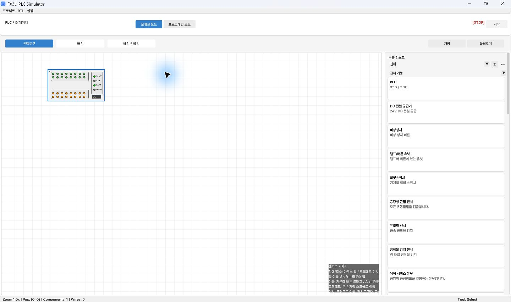

PLC를 더블클릭하면 Z·회전·입력/출력 모드 등을 설정하는 메뉴가 나타난다.
이 단계에서는 기본 설정을 변경하지 않았다. 입출력 극성은 실제 배선 전에
확정하고 기록해야 한다.

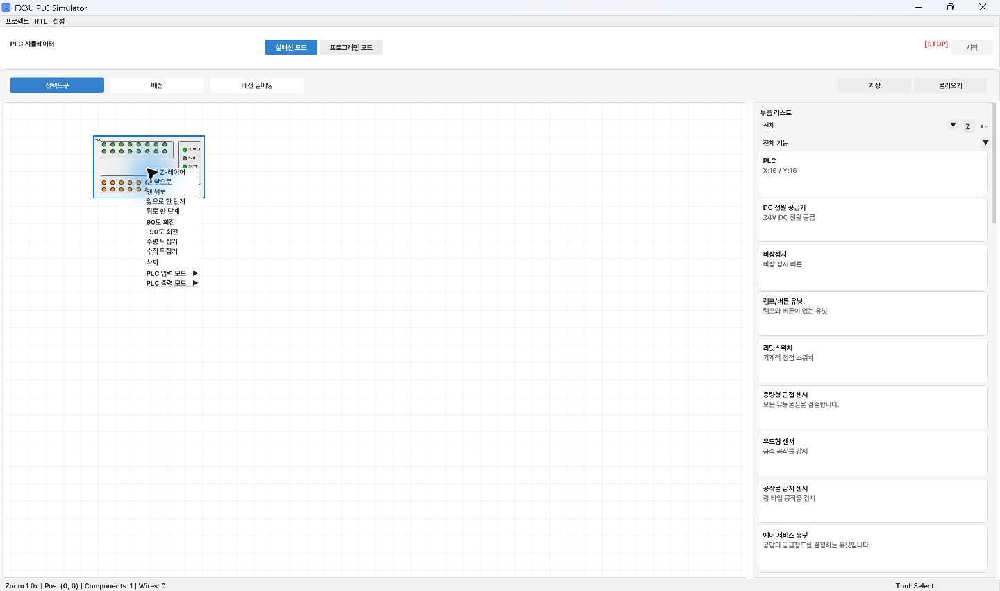

### 2.2 DC 전원 배치

`DC 전원 공급기`를 PLC 왼쪽에 드래그한다. 빨간 단자는 24V,
검은 단자는 0V다. 현재는 부품 배치만 완료했으며 배선하지 않았다.

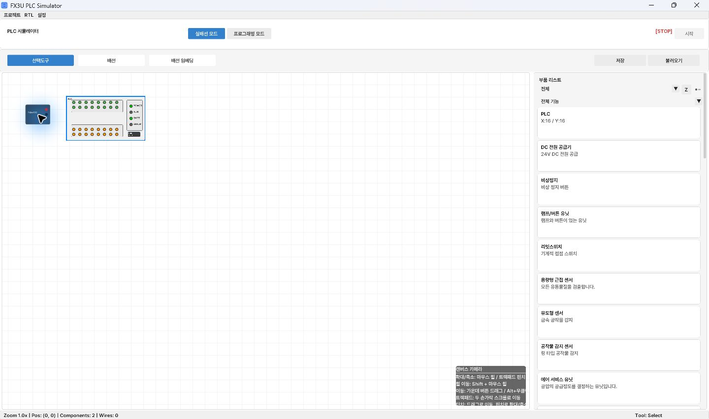

### 2.3 산업기사 부품 필터

부품 목록의 첫 번째 드롭다운을 열어 `자동화설비산업기사`를 선택한다.
기능 분류 드롭다운과 자격증 필터는 서로 다른 필터다.

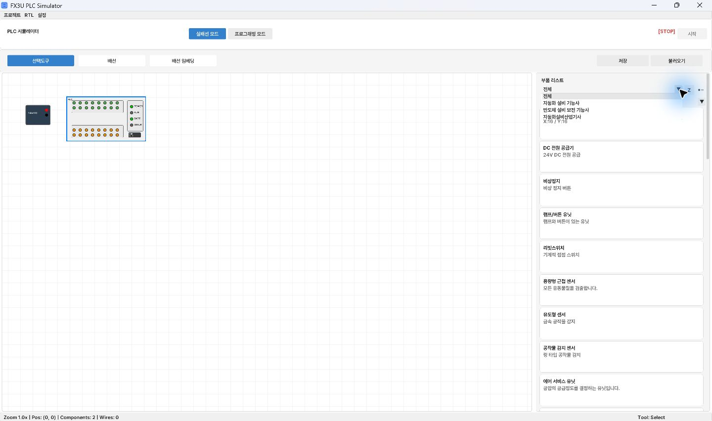

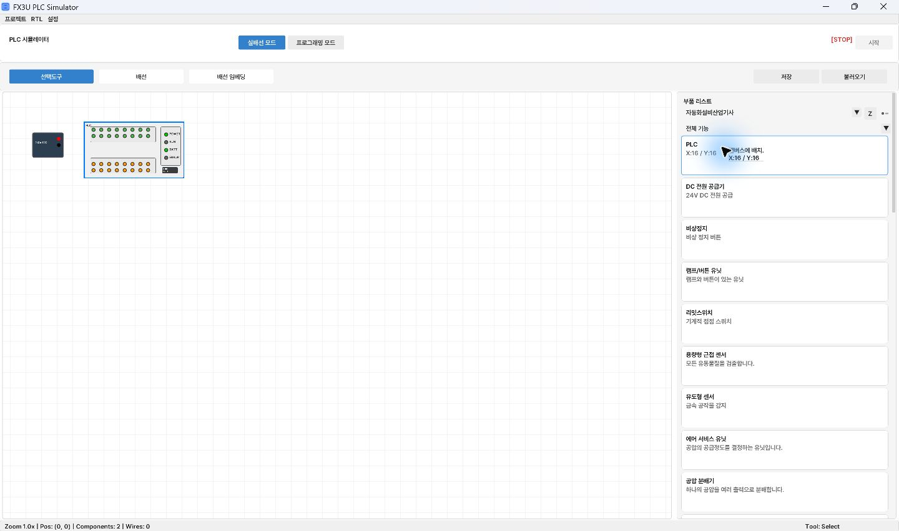

### 2.4 제어 분류에서 HMI 찾기

두 번째 드롭다운에서 `제어`를 선택한다. PLC·DC 모터 드라이버·서보앰프·
터치패널이 표시된다.

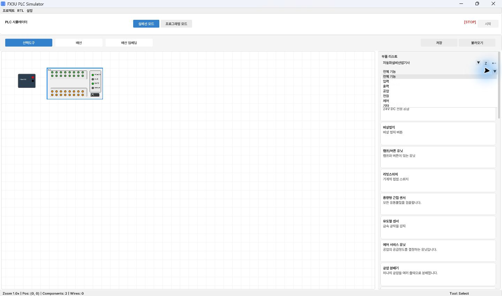

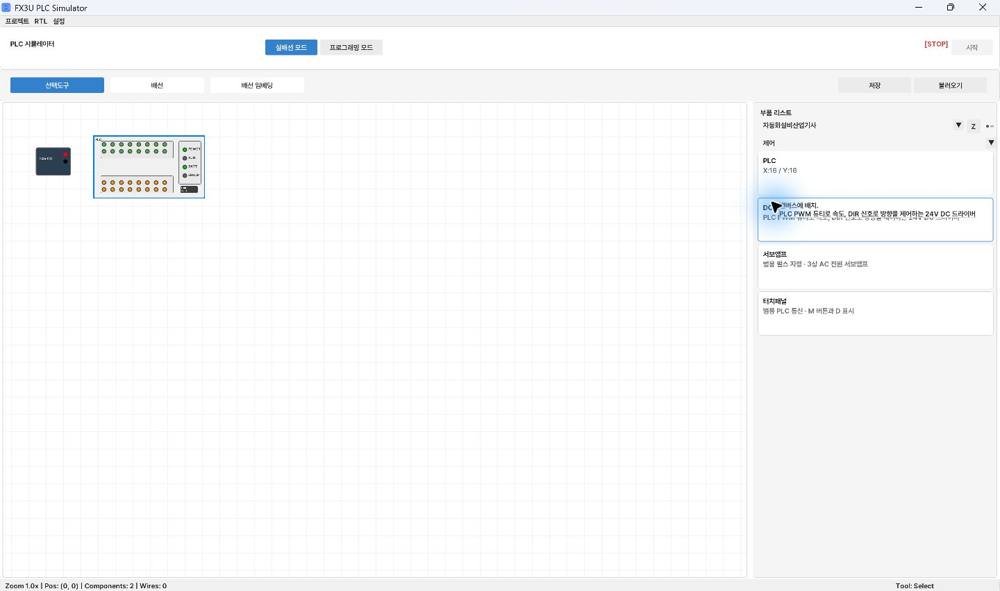

`터치패널`을 PLC 오른쪽으로 드래그한다. 아직 전원 배선과 주소 설정은
완료하지 않았다.

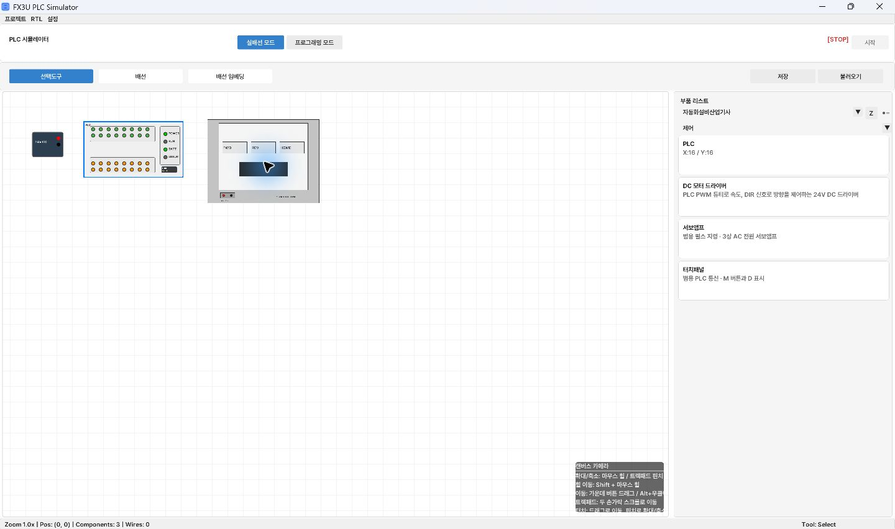

### 2.5 HMI 편집기 열기와 크기 조절

터치패널의 버튼 밖 몸체를 더블클릭하고 `화면 편집`을 선택한다.
편집기가 열리면 시뮬레이션은 자동 일시정지된다. 편집창을 닫으면 재개된다.

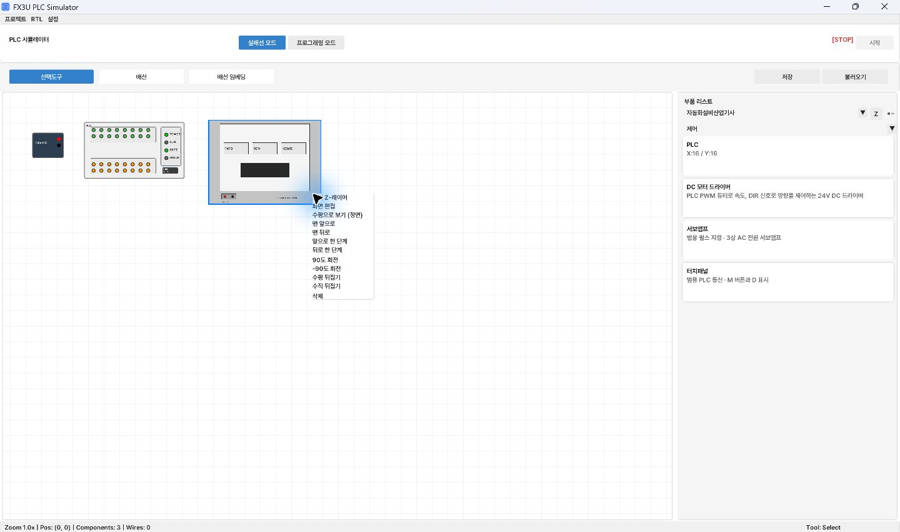

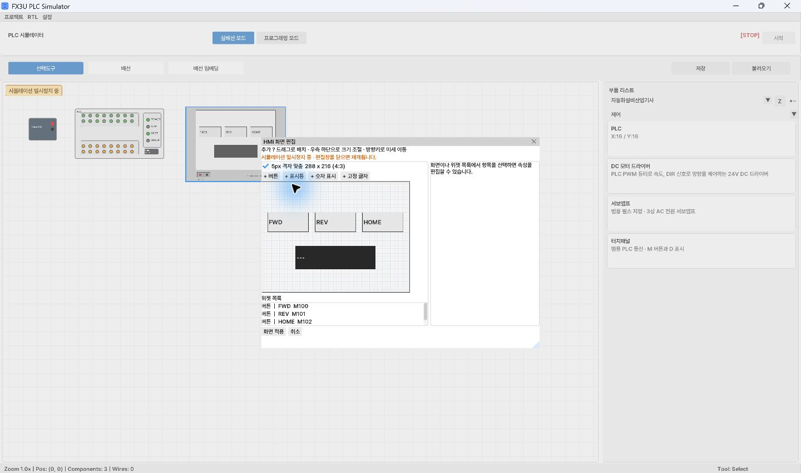

우측 하단 모서리를 드래그하면 편집창을 확대할 수 있다. 편집 화면은
288×216(4:3), 초기 위젯은 FWD M100·REV M101·HOME M102·숫자 D100이다.

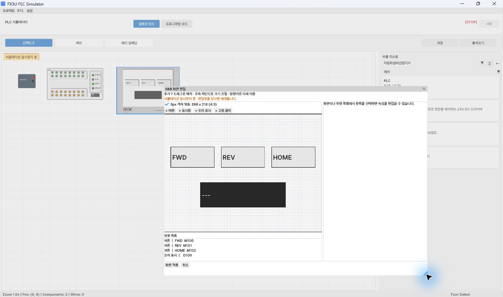

### 2.6 버튼 속성 및 문제 조건 충족 여부 확인

화면의 버튼 또는 목록의 버튼을 클릭하면 오른쪽에 표시 이름·PLC 주소·
위치·크기·글자 크기·누르는 동안 켜짐 속성이 나타난다. 화면 전환 대상
페이지를 지정하는 속성과 페이지 추가 기능은 현재 편집기에 없다.

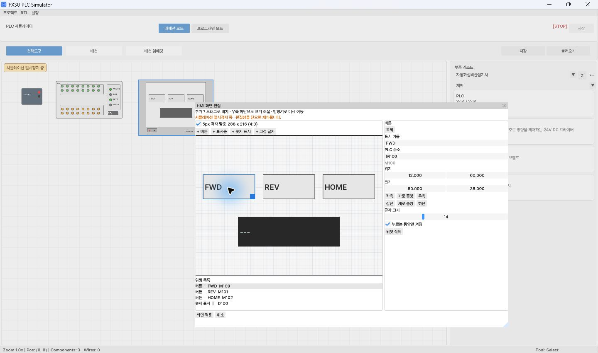

**발견한 제한:** 현 버전의 HMI는 단일 화면이다. 3번의 필수 조건인
테스트동작↔장비시운전 화면 전환을 그대로 구현할 수 없다.
HMI 두 개를 배치하는 방식은 시험의 화면 전환 조건을 충족한 것으로
간주하지 않는다. 필요한 기능 보완 또는 현재 지원 범위 실습 여부를
사용자에게 확인 중이다. 현재 단계는 완성 답안이 아니다.

### 2.7 편집 종료와 HMI 전원 배선

이번 속성 확인에서는 변경하지 않았으므로 `취소`를 누른다.
편집창과 일시정지 배지가 사라지는 것을 확인한다.

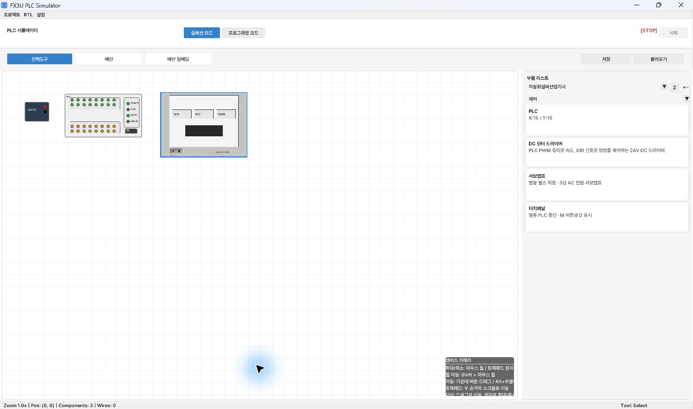

상단 `배선` 도구를 선택한다. 공압·전기는 별도 도구를 고르는 대신
연결할 단자의 타입으로 결정된다.

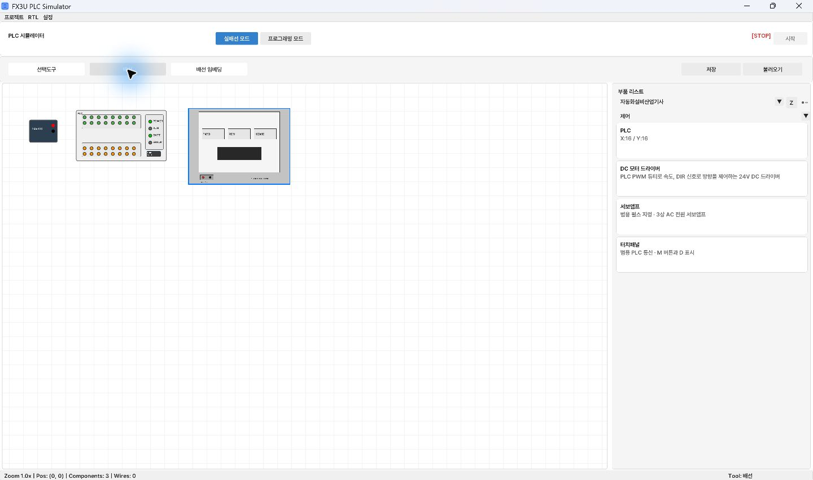

DC 전원의 빨간 단자를 클릭하고 HMI 아래의 빨간 `POWER_24V` 단자를
클릭한다. 시작 단자를 클릭하는 순간 호환 오류 툴팁이 잠깐 나타났지만,
끝 단자를 클릭한 뒤 실제 선이 생성됐다. 이 툴팁만으로 연결 실패를
판정하지 말고 선 생성 및 하단 Wires 개수를 함께 확인한다.

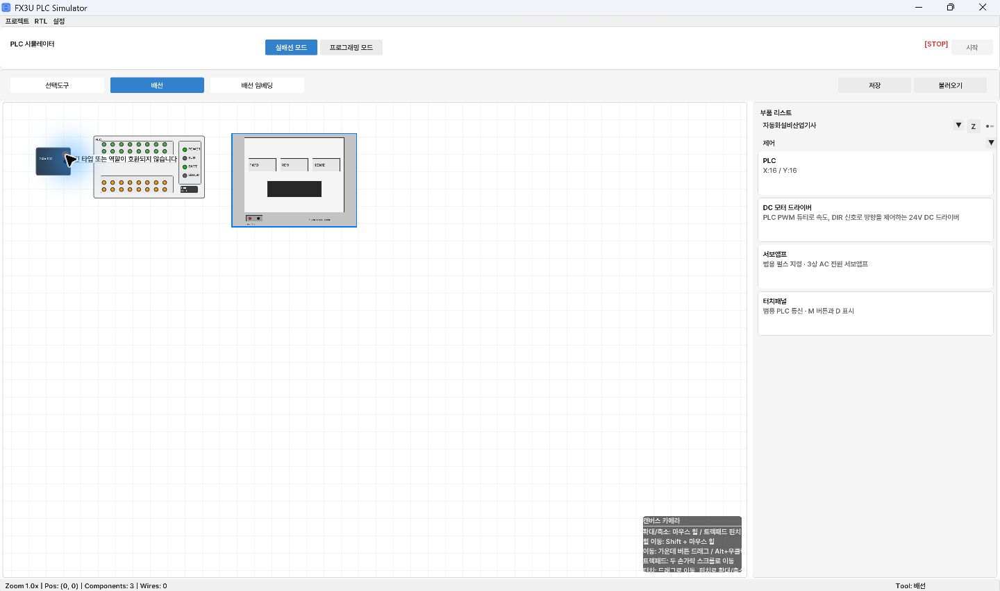

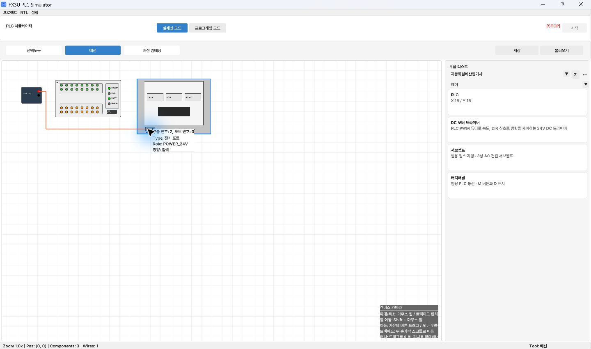

DC 전원의 검은 0V 단자를 클릭하고 HMI의 검은 `POWER_0V` 단자를 클릭한다.
하단 Wires가 2개이고 두 전원 선이 생성된 것을 확인한다.
HMI와 PLC 사이 통신선은 필요 없지만, HMI 전원선은 필요하다.
아직 래더/RUN을 실행하지 않았으므로 통신·버튼 동작까지 검증한 것은 아니다.

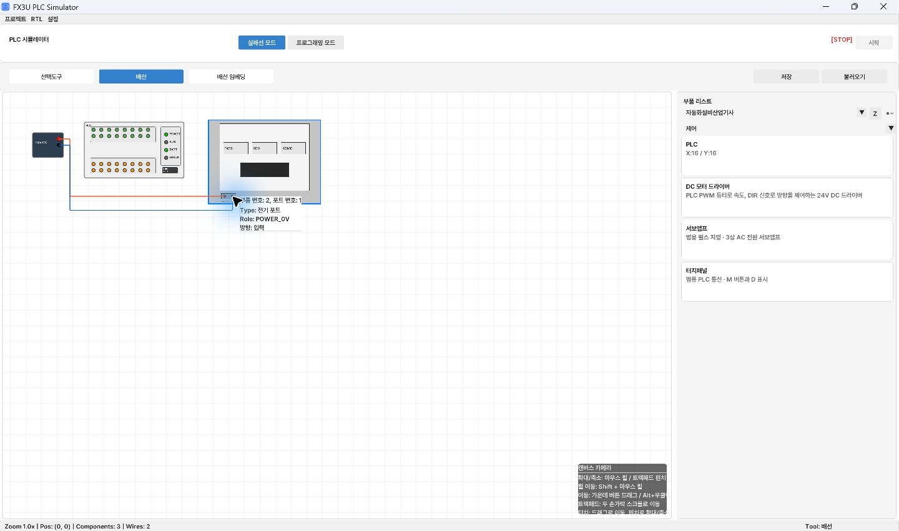

### 2.8 프로젝트 중간 저장 시도

`프로젝트 → 프로젝트 저장`에서 새 프로젝트 파일 경로를 입력했다.
대화상자가 닫혔지만 파일 존재 확인에서 결과 파일이 없었다.
원인은 확정하지 않았으며, **프로젝트 저장 성공으로 간주하지 않는다.**
실배선 장면은 아래의 JSON 저장 절차로 별도 보존했다.

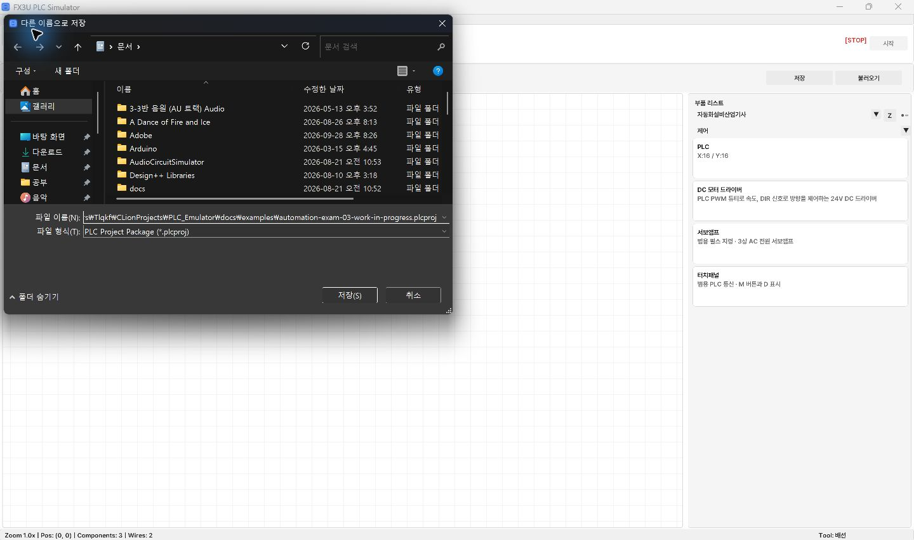

### 2.9 서보앰프와 공압 부품 배치

제어 분류의 `서보앰프`를 HMI 오른쪽에 드래그한다.
서보 전력·상·엔코더·PLC 제어 배선은 아직 하지 않았다.

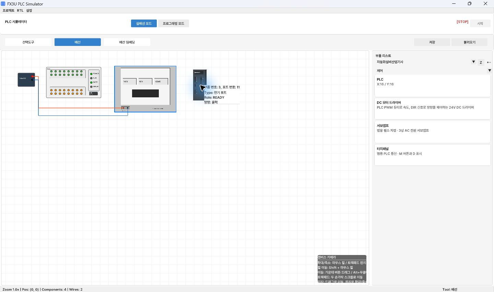

기능 분류를 `공압`으로 바꾸면 서비스 유닛·분배기·솔레노이드·실린더 등을
선택할 수 있다.

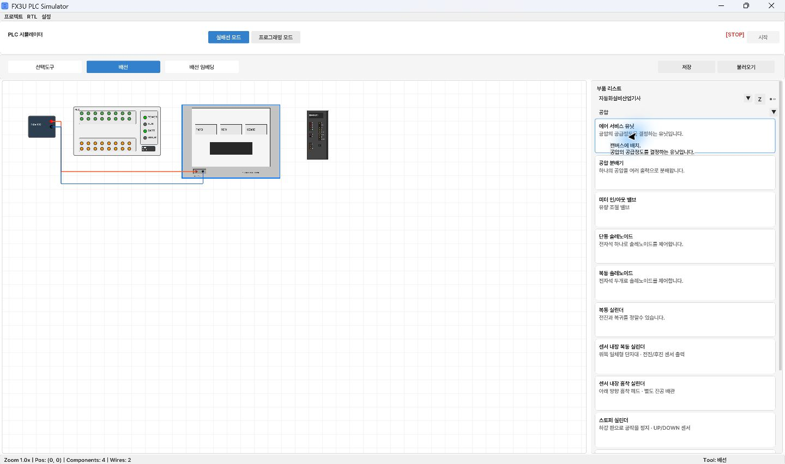

`에어 서비스 유닛`을 DC 전원 아래에 드래그한다.
노브 위에 마우스를 놓으면 압력 툴팁이 나타난다. 초기 표시값은 6.0bar였다.


노브 위에서 휠을 아래로 내려 압력을 낮춘다. 실제 작업에서는
6.0→5.5→5.0bar 순으로 확인했다. 목표 0.5MPa는 5.0bar이다.
다른 입력 장치에서는 휠 감도가 다를 수 있으므로 툴팁 수치를 기준으로 맞춘다.

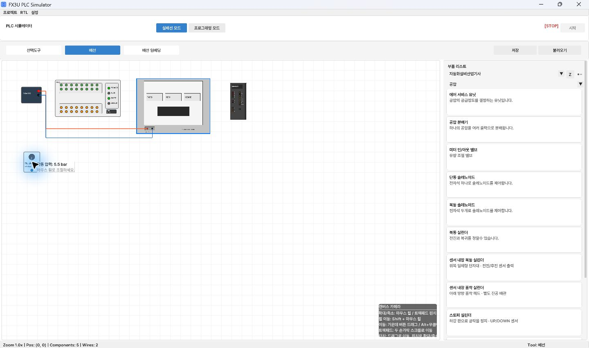


`공압 분배기`를 서비스 유닛 오른쪽에 배치한다. 아직 배관은 연결하지 않았다.

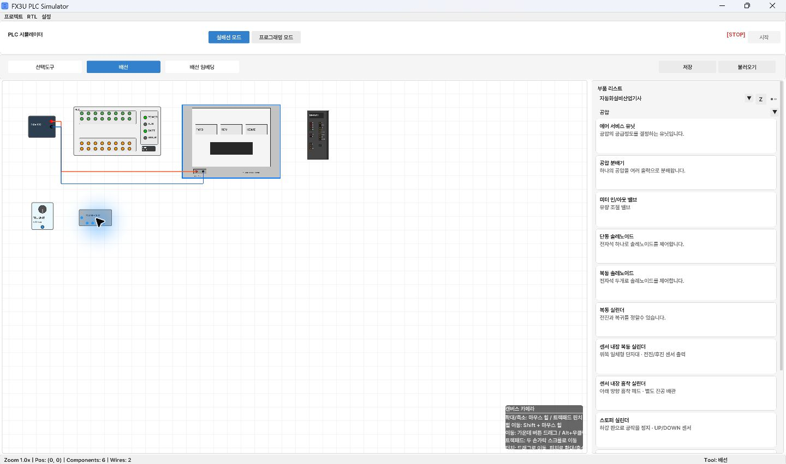

### 2.10 공급용 센서 내장 실린더 방향 맞추기

`센서 내장 복동 실린더`를 아래 기계 영역에 드래그한다.
기본 형상은 로드가 왼쪽을 향한다.

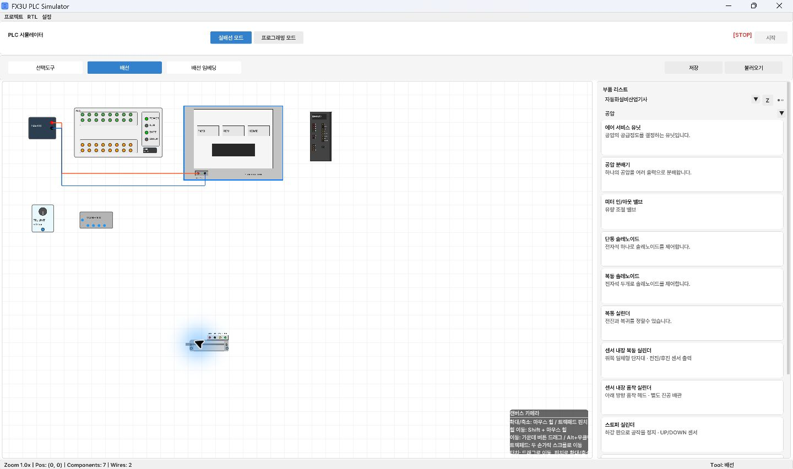

상단을 `선택도구`로 바꾼 뒤 실린더 몸체를 더블클릭한다.
배선 도구 상태에서는 동일한 더블클릭으로 편집 메뉴가 열리지 않았다.
메뉴의 `수평 뒤집기`를 선택한다.

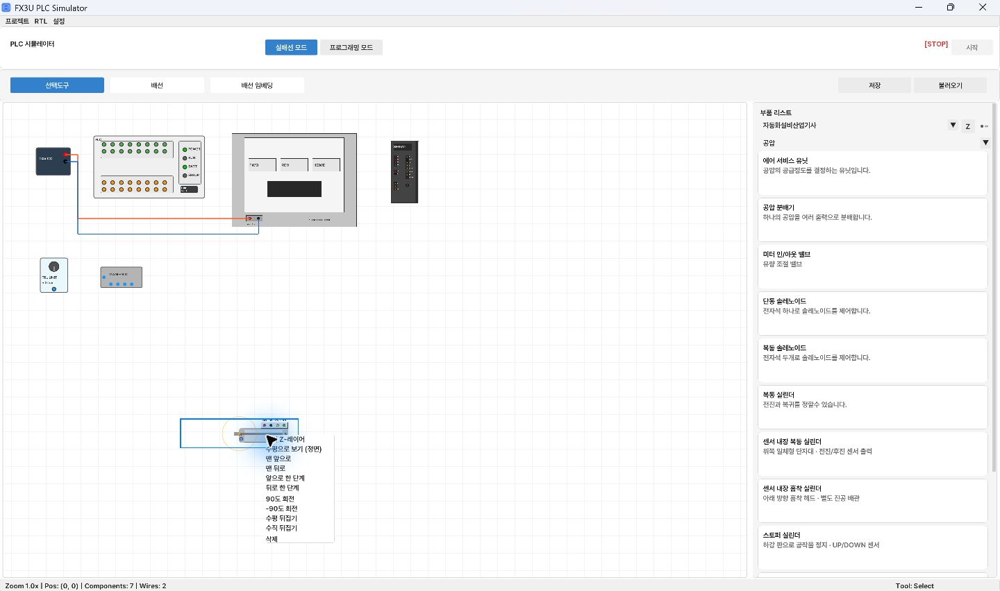

로드가 오른쪽을 향하는 것을 확인한다. 센서 단자대도 함께 반전된다.
현재 위치는 초기 배치이며, 공작물 경로를 구성한 뒤 접촉 위치를 조정해야 한다.

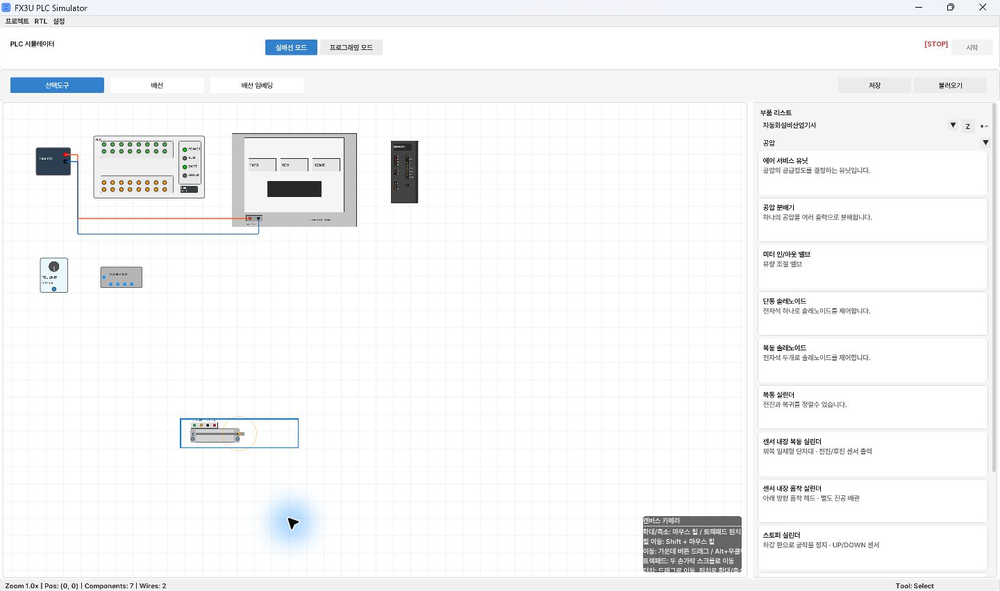

`단동 솔레노이드`를 실린더 위에 배치한다. 해당 부품은 코일 하나와
복귀 스프링으로 전환하는 5포트 밸브다. 전기 코일과 P/A/B 배관을 구분한다.
이 단계에서는 배치만 했으며 실린더 구동은 미검증이다.

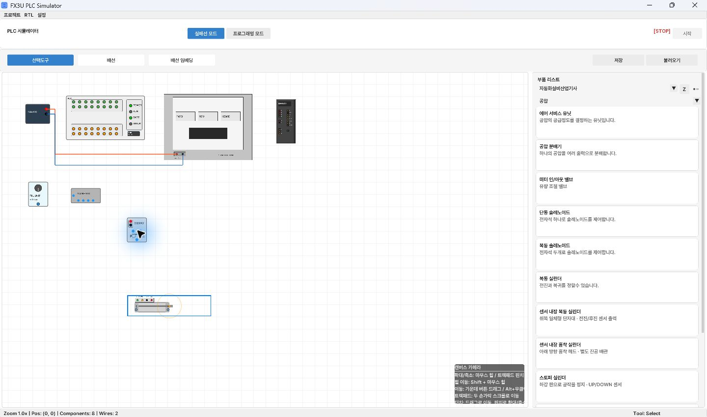

### 2.11 실배선 JSON으로 중간 장면 저장

실배선 모드 상단 `저장` 버튼을 눌러 다음 경로에 저장한다.

`exam03-layout-progress.json` (사용자 작업 폴더에 저장)

프로젝트 패키지 저장과 달리 이 버튼은 실배선 장면만 저장한다.
래더 답안과 결합된 완성 프로젝트 파일로 혼동하지 않는다.

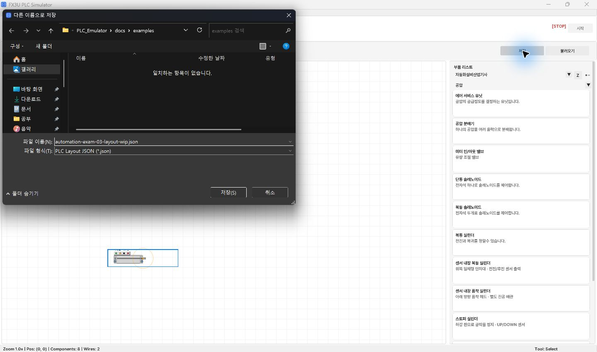

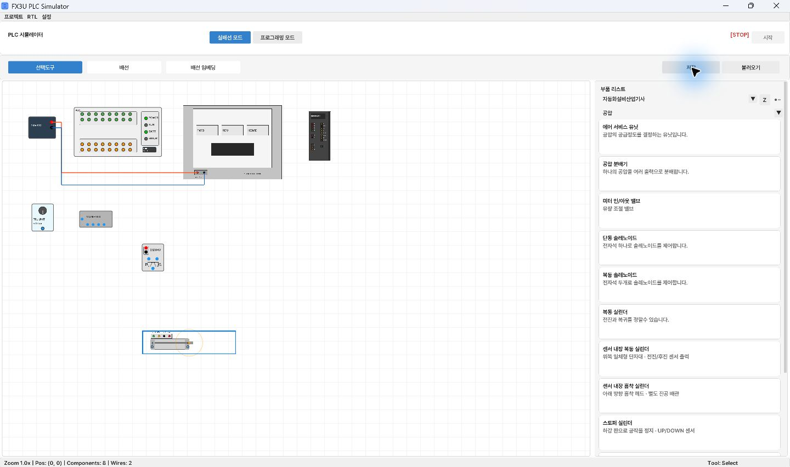

실제 파일 생성(5,606바이트)을 확인했다. 저장 내용은 부품 8개와
HMI 전원 배선 2개다. 다시 열 때는 실배선 모드의 `불러오기`에서 JSON을
선택한다. 아직 전체 공정·HMI·래더 답안은 완성되지 않았다.

### 2.12 다중 화면 기능 보완 후 편집 확인

새 빌드의 HMI 편집창에는 화면 선택, 화면 추가, 화면 이름,
상태 메시지 위젯이 추가되었다. 기존 중간 JSON을 불러와도 기존 위젯은
첫 화면에 유지된다. 편집창을 열면 시뮬레이션 일시정지가 표시된다.

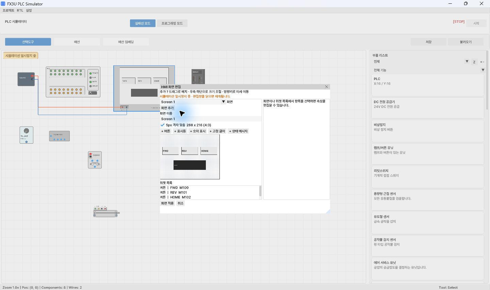

`화면 추가`를 누르면 빈 두 번째 화면으로 전환된다. 첫 화면의 위젯이
두 번째 화면에 겹쳐 표시되지 않는다. 화면 이름에 `장비 시운전`을 입력한다.

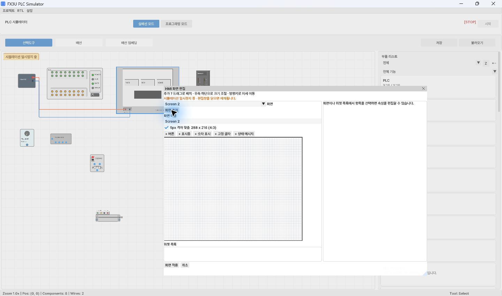

`+ 상태 메시지`를 누르면 PLC 주소와 D=0/1/2 각각의 표시 문구를 편집할 수 있다.
실습 답안에서는 정지/연속운전/일시정지에 대응하는 값을 래더가 출력한다.
여기서는 편집 UI만 확인했고, RUN 중 문구 전환은 아직 검증하지 않았다.

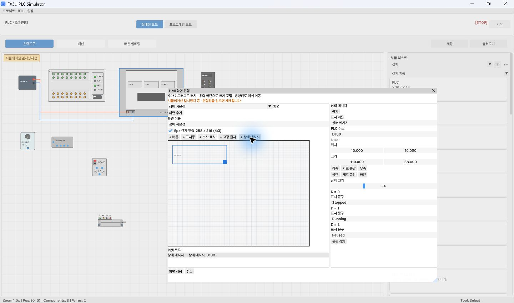

첫 화면으로 돌아와 버튼을 선택하고 `화면 전환 버튼`을 켠다.
`전환할 화면`에서 `장비 시운전`을 선택한다. 이 버튼은 M 비트 출력 대신
HMI 화면을 바꾼다. `화면 적용` 후 편집창이 닫히고 일시정지 표시가 사라졌다.

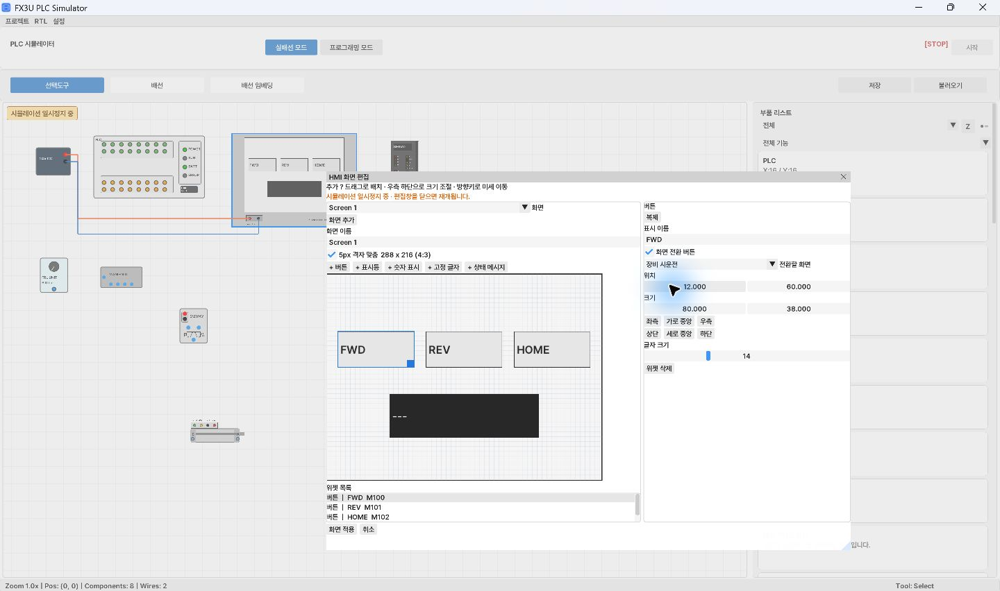

기능 보완 빌드의 CTest 17/17 통과. 두 화면의 설정 저장/로드, 전환 시
눌림 비트 해제, 숨겨진 버튼 차단, 상태 메시지의 D 값 수신을 회귀 테스트로
확인했다. 실제 공정 전체의 검증과 구분한다.

## 3. 전체 배선과 프로그램 불러오기

초기 손 배치에서 이어 전체 공정을 구성했다. 배선 JSON과 PLC CSV는
`docs/examples/build_automation_exam_03.py`로 편집 가능한 설정 파일을 작성했다.
실행 중 센서 상태나 적재 결과를 넣은 파일은 아니다. 실제 동작은 아래 GUI의
RUN으로 확인한다. 주소와 물리 설정은
[I/O·시퀀스 문서](AUTOMATION_EXAM_03_IO_AND_SEQUENCE.md), 창고 구동은
[창고실린더 연동 문서](AUTOMATION_EXAM_03_PHYSICAL_EXTENSION.md)를 참조한다.

1. 실배선 `불러오기`에서 `automation-exam-03-answer.json`을 선택한다.
2. 하단 부품 38개·배선 114개를 확인한다. 전원은 24V DC, 공압은 5bar다.
3. HMI 전원 단자는 사용하지만 PLC 통신선은 별도로 필요하지 않다.
4. 공급·송출·컨베이어는 Z1, 가공·스토퍼는 Z1~2다.
   최종 답안에서 창고는 Z2~4, 리프트는 흡착 Z1부터 창고 Z4까지 움직인다.
   처음 단속 시험의 창고 Z1~3은 연속 시험에서 비금속과 겹쳐 수정했다.

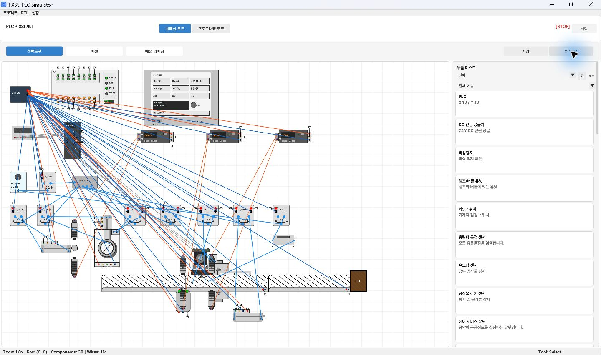

5. `프로그래밍 모드` → `불러오기`에서 같은 이름의 CSV를 선택한다.
6. CSV를 불러온 뒤 창 크기가 줄어들면 제목 표시줄을 두 번 눌러 최대화한다.
7. 초기화 M8002, 속도 선택 M106~M108 등이 래더로 표시되는지 확인한다.

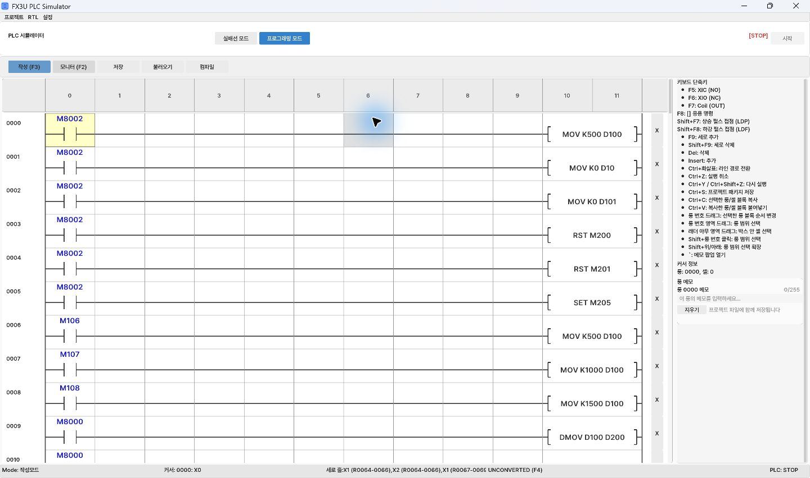

8. `컴파일`을 눌러 하단 `CONVERTED`를 확인한다.
9. `실배선 모드`로 돌아와 `시작`을 누른다. PLC 표시가 RUN이 된다.
   공압·서보 원점 초기화 완료 후 HMI를 조작한다.

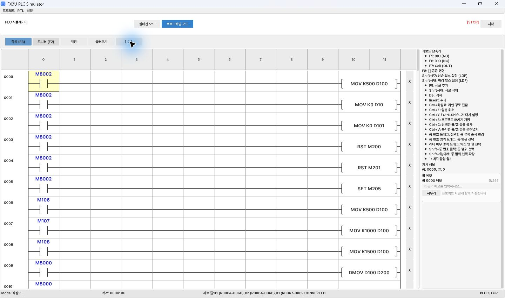

## 4. HMI 수동 동작과 단속 금속 적재

1. HMI 몸체를 더블클릭한다. `수평으로 보기(정면)`을 선택한다.
2. 조작 창 오른쪽 아래 모서리를 드래그해 모든 위젯이 보이도록 크기를 조절한다.
3. 제목 표시줄을 드래그해 설비를 가리지 않는 오른쪽으로 옮긴다.
   창을 크게 해도 내부 화면 자체의 배율은 별도다.
4. `PLC ONLINE`, JOG 속도 `500 mm/min`을 확인한다.

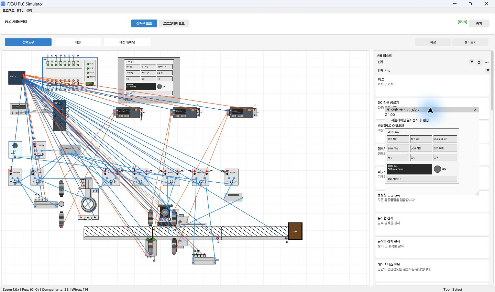

5. `고속` → `중속` → `저속`을 눌러 각각 1500/1000/500 mm/min을 확인한다.

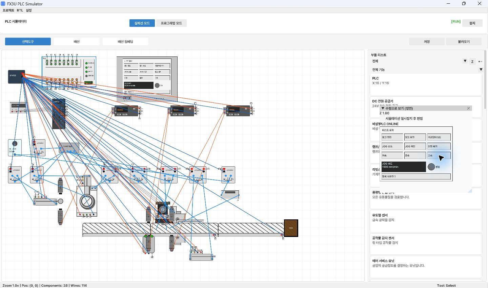

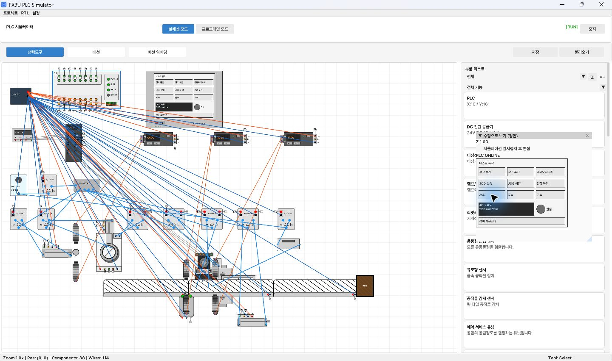

6. `창고 전진`을 누른다. 창고실린더 로드와 창고의 열 위치가 함께 이동한다.
7. `창고 후진`으로 원위치에 돌린다. 일회 입력으로 복솔레노이드 상태가 유지된다.

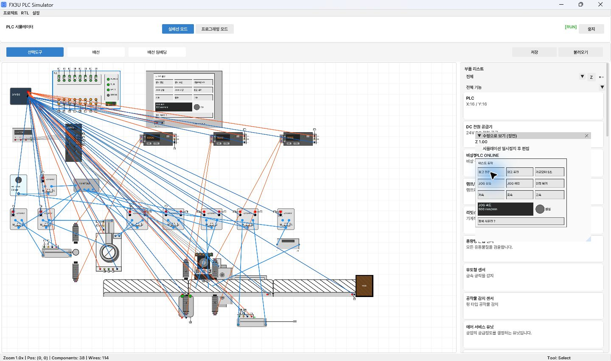

8. `가공모터 5초`를 누른다. 자동 공정 없이 모터만 운전한다.
9. `JOG 하강`을 누르는 동안 이동한 뒤 놓는다. Computer Use는 짧은
   드래그로 눌림을 재현했으며, 장시간 누르는 이동량 검증은 런타임 테스트와
   구분한다. 실제 사용자는 버튼을 누른 채 유지한다.
10. `원점 복귀`를 누른다. 완료 시 원점 램프가 녹색으로 켜진다.


11. 아래 `장비 시운전` 버튼으로 두 번째 HMI 화면을 연다.
    단속에서는 금속 적재 수치가 숨겨져 있다.

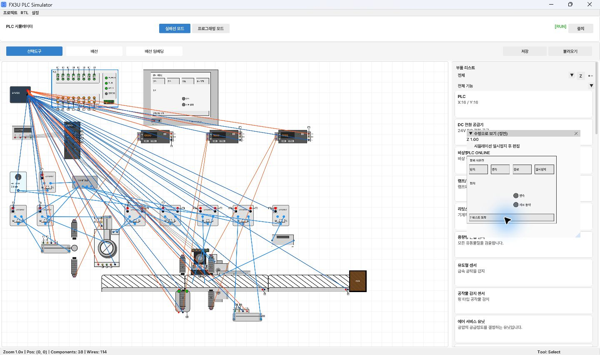

12. 공급 위치에 금속 공작물이 있는 상태에서 `단속`을 누른다.
    공급 전진·후진, 가공 하강·3초·상승, 송출, 분류, 흡착·적재 순서로 움직인다.

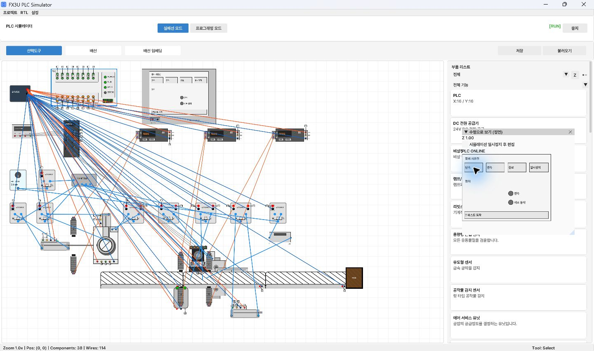
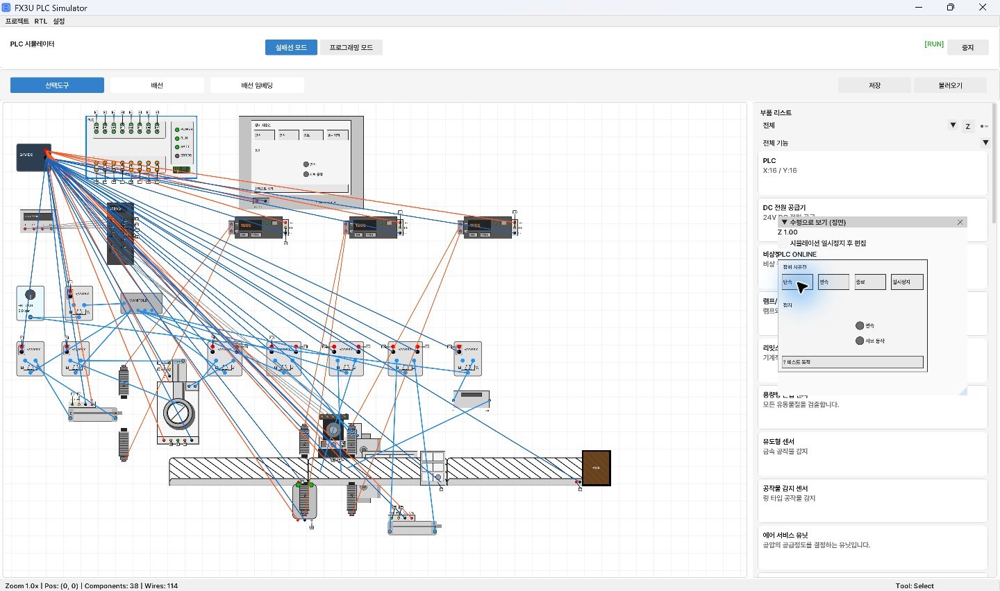

13. 저장창고를 더블클릭해 정면 보기를 연다. 아래층 오른쪽 2번 슬롯의
    공작물을 확인한다. 상세 정보에도 슬롯 2와 공작물 ID가 표시된다.
    창 오른쪽 위 X로 닫는다.

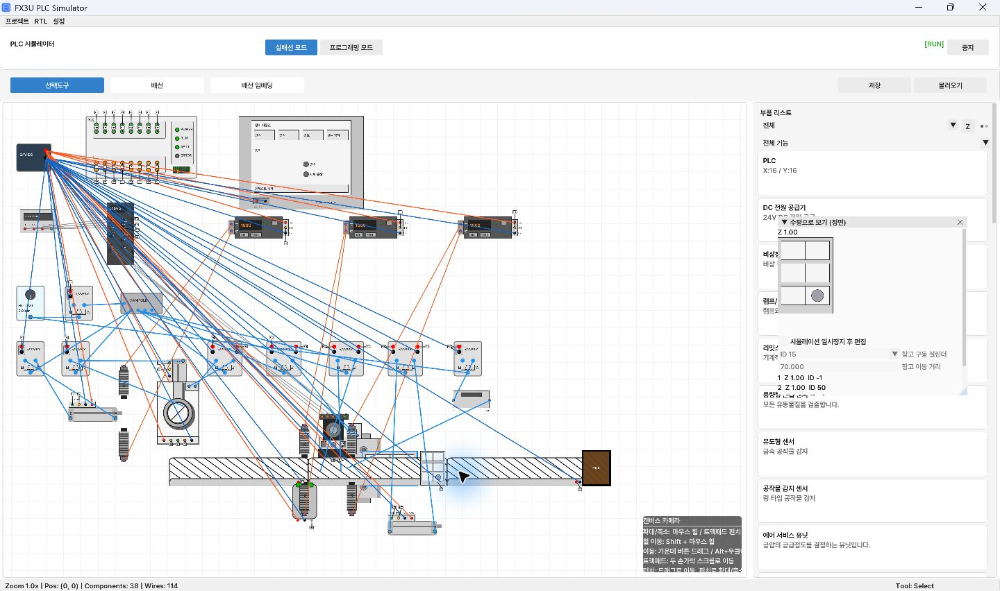

## 5. 연속 운전 준비

1. 상단 `중지` 후 실배선 `불러오기`에서
   `automation-exam-03-continuous.json`을 선택한다.
2. 이 장면에는 공급 위치의 비금속 한 개와 위쪽 대기 위치의 금속·비금속·금속
   세 개가 있다. 저장창고나 박스에 이미 저장된 공작물은 없다.
3. 최종 높이 수정본 CSV를 다시 불러오고 컴파일한다.
4. `시작` → HMI 정면 보기 → `장비 시운전` → `연속`을 누른다.

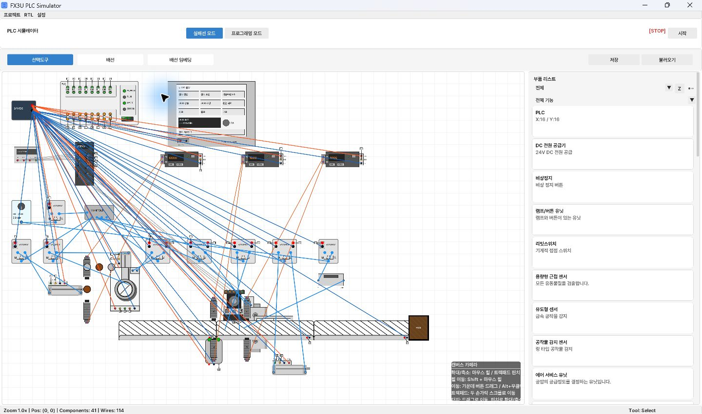

`연속운전` 메시지, 녹색 연속 램프, 금속 적재 `0개`가 표시된다.
대기 공작물은 한 사이클이 끝난 뒤 공급 위치로 드래그해 투입한다.


## 6. 연속 운전의 실제 결과

1. 첫 비금속의 박스 도착을 확인한다. 금속 수량은 0개를 유지한다.
2. 대기 금속을 먼저 클릭해 선택하고 공급 위치로 드래그한다.
   공급 광 센서가 감지하면 다음 사이클이 시작된다.
3. 금속의 가공·송출·분류·흡착·창고 적재 후 수량 1개를 확인한다.


4. 다음 비금속을 같은 방법으로 투입한다. 박스 도착 후에도 금속 수량은 1개다.
   박스 안의 공작물은 겹쳐 그려질 수 있으므로 이미지 한 장만으로 개수를
   세지 않는다. 런타임 검증에서 ID50·ID52의 실제 박스 저장 상태를 각각 확인했다.
5. 마지막 금속을 투입한다. 창고실린더가 전진하고 리프트가 위층으로 이동한다.
6. 5번 칸 적재와 원점 복귀 후 수량 2개, 연속 램프 OFF, `정지`를 확인한다.
   PLC 자체는 RUN을 유지한다.

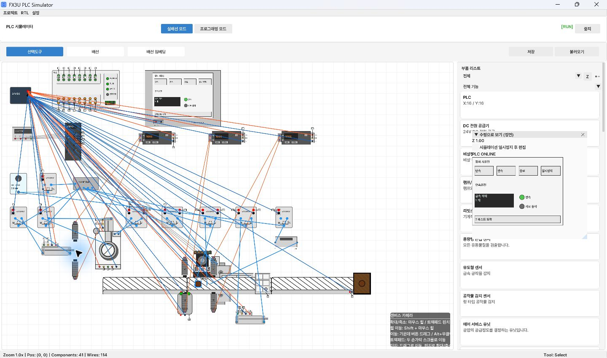
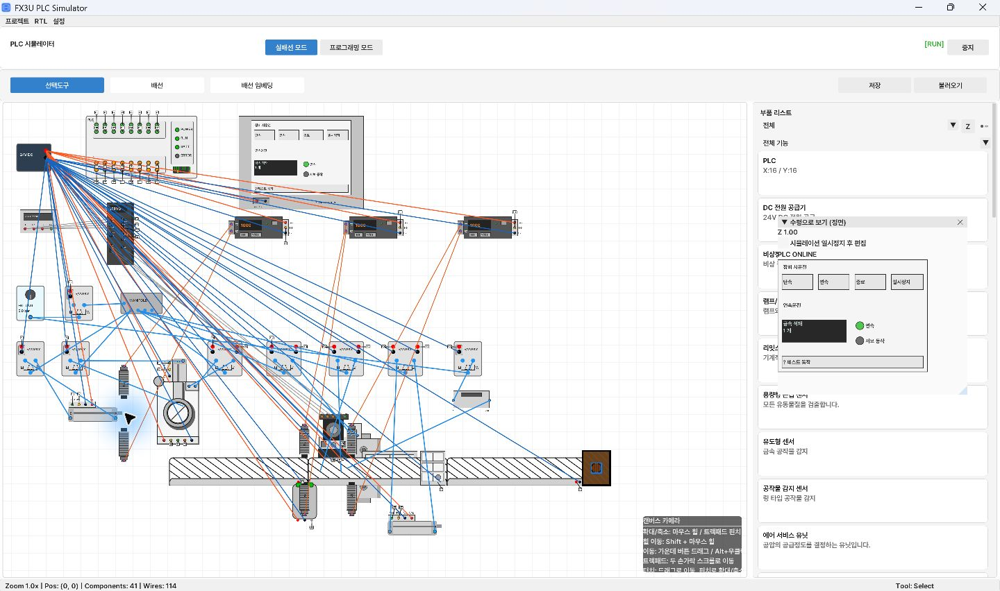
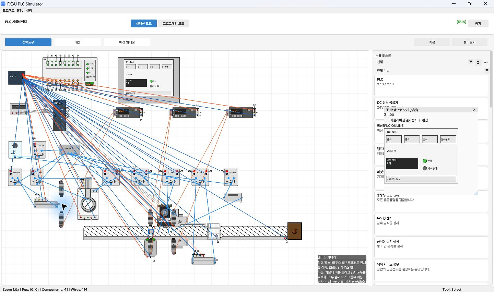


7. 저장창고 몸체를 더블클릭해 정면 보기를 연다.
   옆에 표시되는 작은 정면 오버레이 대신 가로형 몸체를 선택한다.
8. 창 크기를 늘려 슬롯 정보를 확인한다.
   `2 Z2.00 ID51`, `5 Z4.00 ID53`이고 나머지는 ID -1이다.

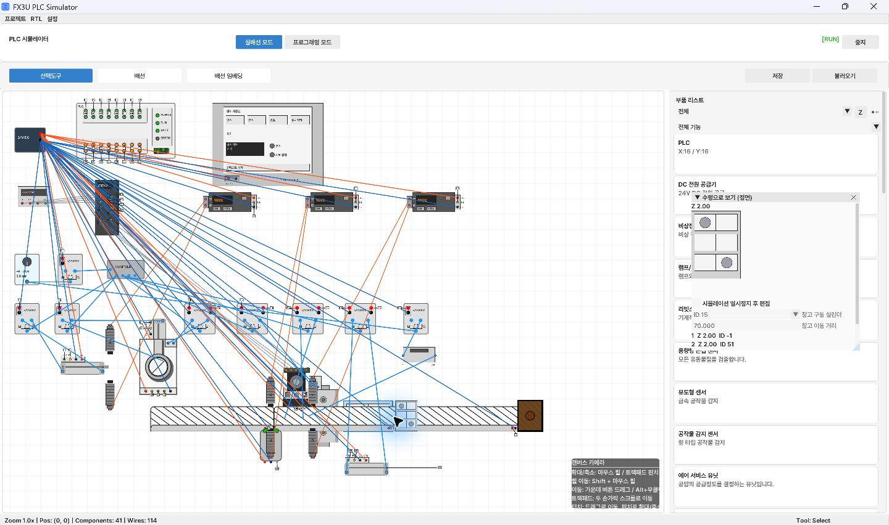
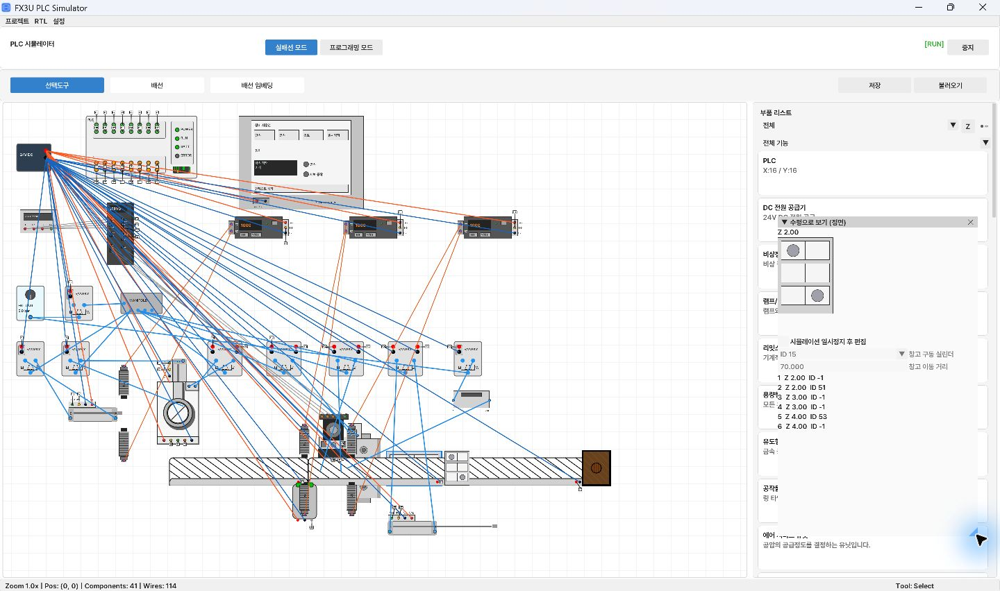

## 7. 프로젝트 저장과 재로드

1. 운전 전 장면에서 `프로젝트 → 저장` 또는 Ctrl+S를 누른다.
2. 파일 이름을 `automation-exam-03-horizontal.plcproj`로 지정한다.
3. `프로젝트 → 불러오기`로 방금 저장한 파일을 다시 연다.
4. 부품 41개·배선 114개와 HMI 두 화면, PLC 프로그램을 확인한다.
   컴파일 후 RUN으로 같은 공정을 다시 실행한다.

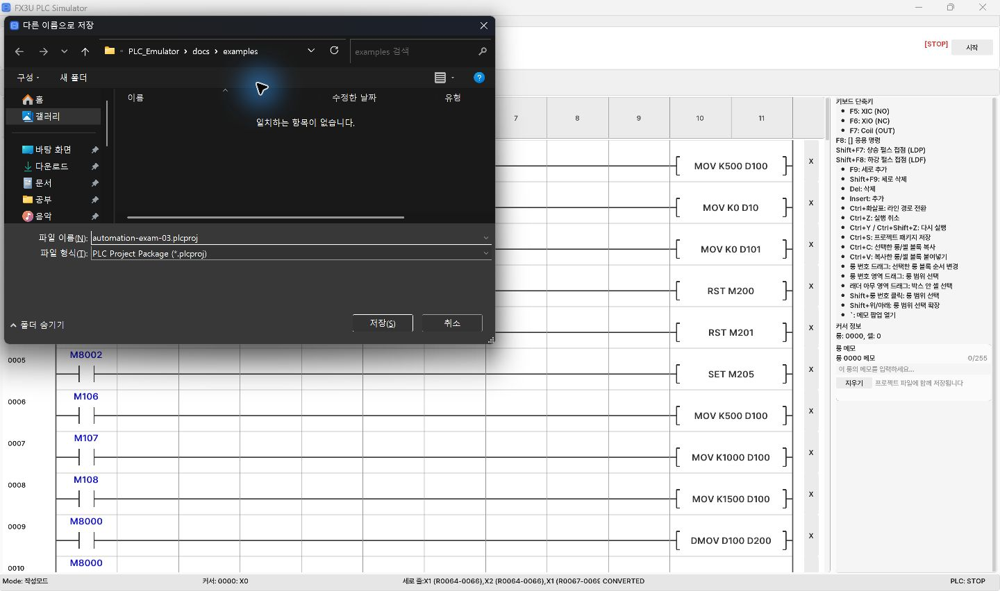


작은 공작물을 빠르게 드래그할 때 시작 위치 대신 이동 후 포인터 위치를
검사하던 문제를 수정했다. 먼저 선택하고 드래그하는 절차로 투입한다.


## 8. 현재 사이클 종료와 재동작

1. PLC를 중지하거나 전체 리셋하지 않고 박스의 비금속을 다시 공급 위치로 옮긴다.
2. HMI의 `연속`을 누른다. 금속 수량이 0으로 시작하고 공급이 진행된다.
3. 공정 중 `종료`를 누른다. 즉시 멈추는 대신 현재 사이클을 끝내야 한다.
4. 비금속이 박스에 도착한 뒤 `정지`와 연속 램프 OFF를 확인한다.


투입 대기 중의 종료 요청은 다음 사이클 종료에서 처리된다. GUI 재시험에서는
공작물이 실제 이송 중인 시점에 요청해 박스 도착 후 정지하는 것을 확인했다.


## 9. 일시정지 후 초기화

1. 같은 RUN 상태에서 공작물을 다시 투입하고 `연속`을 누른다.
2. 이동 중 `일시정지`를 누른다. 상태 문구가 `일시정지`로 바뀐다.
3. 5초 동안 동작을 멈추고, 이후 실린더 후진·가공 상승·서보 원점의
   초기화가 진행된다. 초기화 이동이 끝나면 `정지`가 된다.
   5초에 초기화를 시작한다는 뜻이며 모든 축이 5초 안에 원점에
   도착한다는 뜻은 아니다.
4. 이 버튼은 이전 단계의 재개 버튼이 아니다. 새 공작물 투입 후 다시 시작한다.


정확한 5초 조건과 가공실린더 위치 유지 여부는 10ms 간격의 실제
시뮬레이션 런타임 테스트로 확인했다. GUI 스크린샷은 시간 측정 자료와 구분한다.

## 10. 검증 방법과 수정한 문제

런타임 검증은 답안 JSON·CSV를 읽고 실제 컴파일러와 시뮬레이션을 사용한다.
센서 입력이나 적재 성공 값을 직접 쓰지 않는다. 공작물 공급은 실제 이동
명령으로 재현하고, 실린더·모터·광 센서·서보·진공·창고·박스의 결과를 검사한다.

| 검사 | 실제 확인 내용 |
|---|---|
| 단속 금속 | 공정 후 저장창고 ID16, 슬롯2에 적재 |
| 연속 4개 | 비금속 ID50·52는 박스 저장, 금속 ID51·53은 슬롯2·5, 수량2 후 종료 |
| 수동 모터 | 4.5초 시점 운전, 5.2초 시점 정지 |
| JOG·원점 | 500/1000/1500 선택, 눌림 중 축 이동, 원점 Z4와 완료 램프 |
| 종료 요청 | 가공 중 요청해도 현재 비금속의 박스 저장 후 종료 |
| 일시정지 | 가공 중 출력 차단·실린더 위치 유지, 5초 후 초기화 |
| 반복 | 같은 애플리케이션과 RUN에서 수동/자동·종료·일시정지를 반복 |
| 저장·로드 | HMI 화면·메시지·표시 조건·창고 구동 설정 회귀 시험, 실제 프로젝트 재로드 |

물리 시험 중 서보의 -6000펄스 끝점에 매우 작은 부동소수점 오차가 생겨
리프트가 원점/하한에 완전히 도착하지 않는 문제를 수정했다. 허용 오차 내
끝점만 보정하며 실제 과행정은 계속 알람 처리한다. 끝점 회귀 테스트를 추가했다.

HMI 창의 모서리 조작이 뒤쪽 캔버스 부품 이동으로 전달되던 문제도
캔버스 창의 실제 hover 여부를 검사하도록 수정했다.
최종 GUI에서 PLC 위에 걸친 HMI 모서리를 늘린 뒤 창을 오른쪽으로 옮겨
PLC 위치가 그대로임을 확인했다. 작은 공작물 이동도 다시 확인했다.


추가 공정 시험에서 버튼을 한 프레임만 누르면 물리 업데이트와 PLC 스캔의
위상에 따라 입력을 놓칠 수 있었다. 시험의 눌림과 해제를 각각 여러 스캔에
걸쳐 유지하도록 수정했다. 이 수정은 시험 입력 조건에 대한 것이며
통과시키기 위해 센서·출력·공정 상태를 강제로 바꾸지 않는다.

### 자동 검증 실행

저장소 루트에서 빌드 후 다음을 실행한다. GUI 입력 작업과 동시에 실행하지 않는다.
런타임 시험이 자체 창을 만들 수 있기 때문이다.

```powershell
ctest --test-dir cmake-build-p1-msvc --output-on-failure
./cmake-build-p1-msvc/bin/application_runtime_tests.exe --verify-exam3 ./docs/examples
```

전체 공정 시험의 성공 표시는
`EXAM3 PASS single, continuous, manual, home, end, pause, repeat`다.
최종 빌드의 CTest는 17/17 통과했다.
추가 공정 시험도 최종 실행에서 위 PASS 문구와 종료 코드 0을 확인했다.
실제 캡처 파일 77개 중 가이드에 74개를 삽입했고, 문서의 파일 링크를 점검했다.
원본 시험장 단자 주소와 이 실습 모델의 차이, 스토퍼 상승 대기 및 Z 범위는
[I/O·시퀀스 문서](AUTOMATION_EXAM_03_IO_AND_SEQUENCE.md)의 제한 사항을 확인한다.

## 참고 자료

원본: `C:/Users/Tlqkf/Downloads/Documents/자동화설비산업기사(공개문제)_시험2_PLC제어작업.pdf`.
문서의 시험장 제출·삭제 지시는 이 로컬 실습의 파일 관리 지시로 사용하지 않는다.
