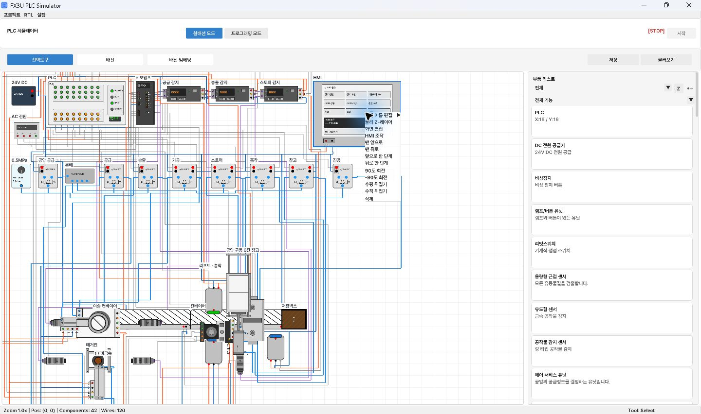
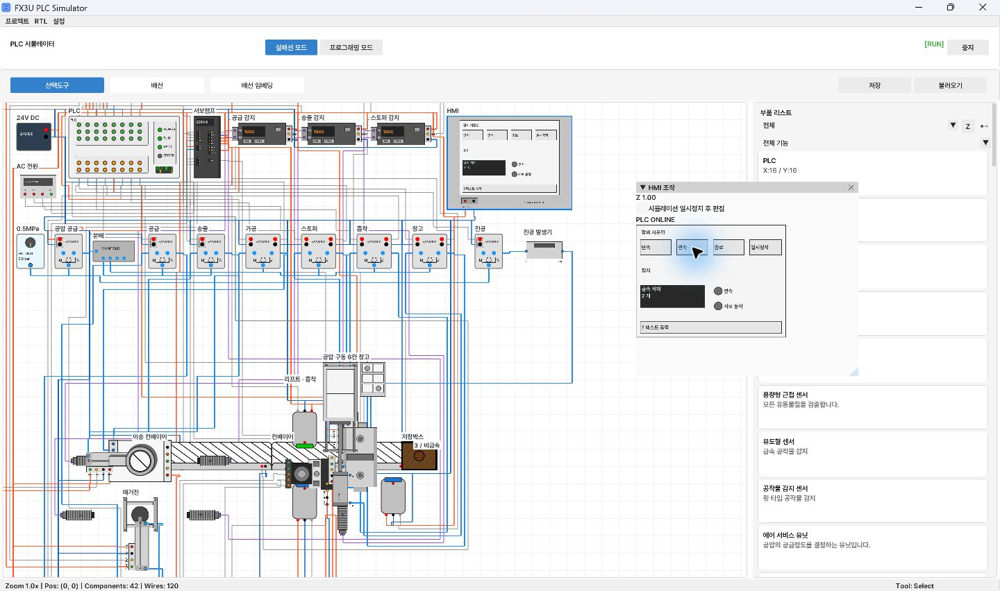

# 공압 구동 6칸 저장창고

저장 타입은 `DRIVEN_WAREHOUSE`이며 부품 목록에서 독립 부품으로 배치한다.
고정 프레임, 두 직선 가이드, 70mm 복동실린더, 로드와 이동 받침대로 구성한다.
시험 PDF의 공개문제 3번 테스트동작 표(PDF 14페이지, 인쇄면 10-4)는
창고실린더 전진·후진과 서보 리프트 상승·하강을 별도로 명시한다.
따라서 시험 답안의 창고는 공압 구동이며 서보는 리프트 높이 선택을 담당한다.
실린더 로드와 창고는 하나의 변위를 공유한다. 외부 실린더 ID나 이동 비율을
설정하지 않으며, 부품의 기준 좌표와 배선 단자는 이동하지 않는다.

## 구동과 단자

| 단자 ID | 표시 | 역할 |
| --- | --- | --- |
| 0 | A | 공압 실린더 A실 |
| 1 | B | 공압 실린더 B실 |
| 2 | 24V | 내장 위치 센서 전원 |
| 3 | 0V | 내장 위치 센서 공통 |
| 4 | FWD | 70mm 전진 완료 출력 |
| 5 | REV | 0mm 후진 완료 출력 |

센서 단자대는 기존 센서 실린더와 같은 얇은 형태로 본체 위에 바로 붙어 있다.
A/B 포트는 실린더 엔드캡 안에 있으며 별도 받침대나 돌출 피팅은 없다.
단자는 고정 본체에 속하며 창고 받침대가 이동해도 배선 좌표는 유지된다.

기존 공압 솔버가 A/B 압력, 배기, 관성 및 마찰로 실린더 변위를 계산한다.
현재 솔버 규칙에서 B실 압력이 A실보다 높으면 전진한다. 센서 전원이 없으면
FWD/REV 전기 출력은 해제된다. PLC는 솔레노이드 밸브를 구동하여 공압을
전환하며, PLC 값으로 창고 위치를 직접 지정하지 않는다.

이 모델의 로드·받침대 결합은 동일 변위를 사용하는 기구학적 구속이다.
별도의 Box2D 조인트나 적재 하중에 따른 변형·가이드 저항 모델은 포함하지 않는다.

창고는 물리 Z 범위에 걸쳐 3개 높이, 높이마다 2칸을 가진다.
적재 공작물은 해당 칸의 Z 높이를 유지하며 받침대와 같은 거리만큼 이동한다.
회전·뒤집기에도 로컬 좌표 변환을 적용한다. 기존 `WAREHOUSE` 저장 파일은
종전 부품으로 계속 불러온다.

## 실습 배치와 사용 메뉴

3번 가로 배치 프로젝트는 외부 창고 실린더를 제거하고 이 부품으로 교체했다.
공급·가공 구역을 분류·적재 구역에서 벌리고 추가 컨베이어로 이어 놓았다.
창고는 회전하지 않은 평면으로 배치하여 좌우로 이동한다. 전진 70mm 시
왼쪽 열이 기존 오른쪽 열의 적재 위치로 이동한다. 리프트는 Z 높이를 선택한다.
스토퍼 평면 본체는 80×80이며 시험 배치에서 보이는 가로 폭은 80으로
컨베이어 폭과 같다. 표시 축소와 함께 단자·충돌 영역을 같은 비율로 조정했다.
광화이버 헤드는 동작부 밖으로 옮기고 부품 몸체보다 뒤에 표시한다.
스토퍼 광 경로는 이미 적재된 공작물을 통과하지 않도록 유지한다.

- 이름 설정: 부품 더블클릭 → **부품 이름 편집** → 이름 입력 → **Enter**.
- 이름 숨김: 같은 메뉴에서 **이름 표시하기** 해제. 이름 값은 보존한다.
- HMI 운전: HMI 더블클릭 → **HMI 조작**. HMI에는 수평으로 보기 메뉴가 없다.
- HMI 편집: HMI 더블클릭 → **화면 편집**.

이름과 표시 여부는 프로젝트에 저장되며 실행 취소 대상이다.

## 확인 결과

수동 JOG 뒤 자동 운전을 시작하면 단계 0에서 `DDRVA K0`으로 리프트를
원점으로 복귀시킨다. `D8340=0`, 앰프 INP, BUSY 해제를 모두 확인한 뒤
공급 단계로 진행한다. 수동 원점복귀 중에는 자동 시작을 받지 않으며,
수동 원점복귀와 초기화 완료에도 같은 위치 확인을 적용한다.

- 전체 CTest 17개 통과. 이름과 숨김 상태 저장·불러오기 포함.
- 공압 구동 창고: 네 방향 회전, 고정 기준점, 정확한 70mm 적재물 이동,
  공압 차단 시 정지, 센서 전원 차단, 후진 복귀 검증 통과.
- 새 배치: 단속·연속·수동·원점복귀·종료·일시정지·반복 시퀀스 검증 통과.
- 수동 JOG 후 자동 시작: 원점 복귀 전 공급 차단, 금속 공작물 흡착·이동·
  창고 적재까지 완료 확인. 양쪽 끝까지 JOG를 유지한 뒤 원점 복귀도 확인.
- 80×80 스토퍼: 네 방향 충돌 검증과 전체 3번 시퀀스 재검증 통과.
- 실제 앱에서 축소 스토퍼 배치와 창고 전진·후진 시 좌우 이동 확인.
- 실제 앱: HMI 조작 메뉴와 이름 표시 켜기/끄기 확인.
- 실제 앱에서 4개 연속 운전: 비금속 저장박스 배출, 금속 창고 2번·5번 적재,
  HMI 금속 적재 카운터 2개와 연속 운전 자동 정지 확인.

## 공작물 공급 수정

별도 매거진을 제거하고 공작물 감지 센서가 두 Z 레이어를 이용하여
중력 공급한다. 배선 및 공급 조건은 [공급 동작 설명](RING_SENSOR_GRAVITY_FEED.md)을 참조한다.

## 마우스로 공작물 꺼내기

선택 도구에서 창고 옆에 보이는 6칸 정면 미리보기의 공작물을 잡고
캔버스의 원하는 위치로 드래그한다. 잡은 슬롯만 비워지고, 공작물은
커서를 따라 이동한다. 다른 슬롯과 꺼낸 공작물의 Z 높이는 유지한다.
평면상 같은 위치에 있는 서로 다른 층의 공작물도 미리보기에서 구분해 꺼낼 수 있다.
