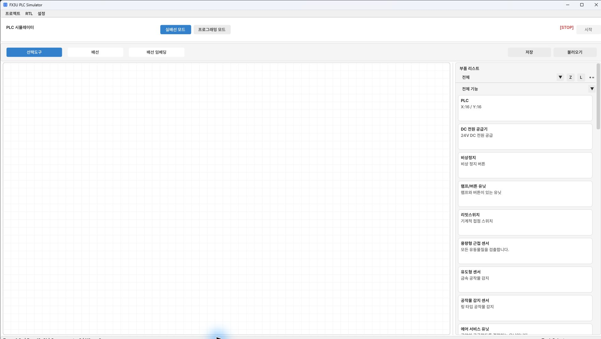
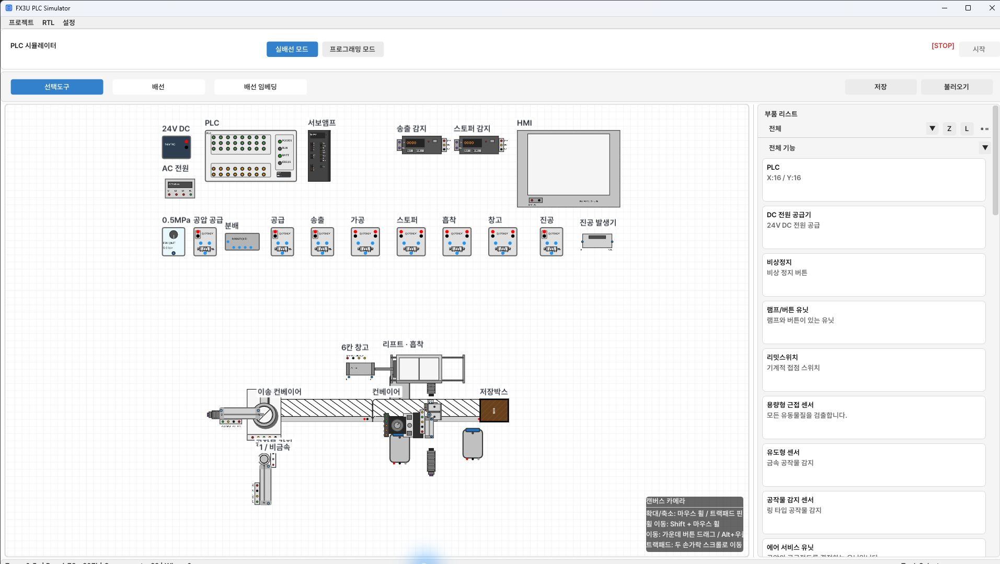

[目次](GUIDE.ja.md) · [電源配線 →](02-power.ja.md)

# 1. 部品配置

## 起動と配置ファイル

PLC Simulatorを起動し、**配線** を選びます。
運転はSTOPのままにします。実配線ツールバー右側の **読み込み** で
`exam03-placement-only.json` を選びます。上部の `プロジェクト → 読み込み` と
実配線ツールバーのJSON読み込みは別の操作です。

図のように制御部・バルブ列・機構部が表示され、配線がなければ配置の読み込みは完了です。
HMI画面も空です。全体が小さく見える場合は制御部から拡大して作業します。

配置ファイルには部品39個と、位置・回転・サイズ・Z範囲・表示レイヤー・
サーボ機械設定が入っています。配線0本、HMIウィジェット0個で、PLCプログラムは含みません。
電源・入出力設定は入力Sink／出力Sourceです。
名前の後の〔数字〕は配置ファイルの部品IDです。同名のバルブ・シリンダーを
区別するために使い、画面座標ではなく端子名で接続します。

ホイールで拡大・縮小、中ボタンドラッグで画面を移動します。
部品を移動する際は **選択ツール** で本体をドラッグします。
`R` は回転、`Shift+R` は逆方向回転です。

## 配置の関係

上の制御部はDC電源・PLC・サーボアンプ・光アンプ・HMIの順に置きます。
その下に空圧供給・分配・各駆動バルブを置き、
下の設備は供給・加工・送出 → コンベヤー → ストッパー・吸着・倉庫 → 保存ボックスの関係です。
配線の余白を残し、センサー本体でワークの経路を隠さないようにします。
供給部の4つのワークは検出センサーの上に積まれています。
最初のワークが供給されてシリンダーが戻ると、重力で次のワークが下ります。

配置ファイルを読み込んだ場合、座標の再入力は不要です。

[部品別の座標・Z設定表](reference-placement.ja.md)

## Zと表示レイヤー

右側の **Z** は物理高さ、**L** は描画順です。
Zが異なると同じ画面位置でもワークと部品は物理的に反応しません。
Lで本体を後ろに送っても、Zや動作条件は変わりません。
配置JSONはグループとZ設定を保持するので、最初はそのまま使います。
光ヘッドが搬送装置を隠す場合は、L画面でそのグループ順を確認します。

リフト〔14〕の機械設定は **60 pulse/rev、リード1 mm、ストローク100 mm、
最大速度100 mm/s、加速度200 mm/s²** です。
サーボのパルス位置と画面上のZ高さは同じ値ではありません。
この条件ではJOGの500/1000/1500 mm/minは500/1000/1500 pulse/sに対応します。

---

[目次](GUIDE.ja.md) · [電源配線 →](02-power.ja.md)
