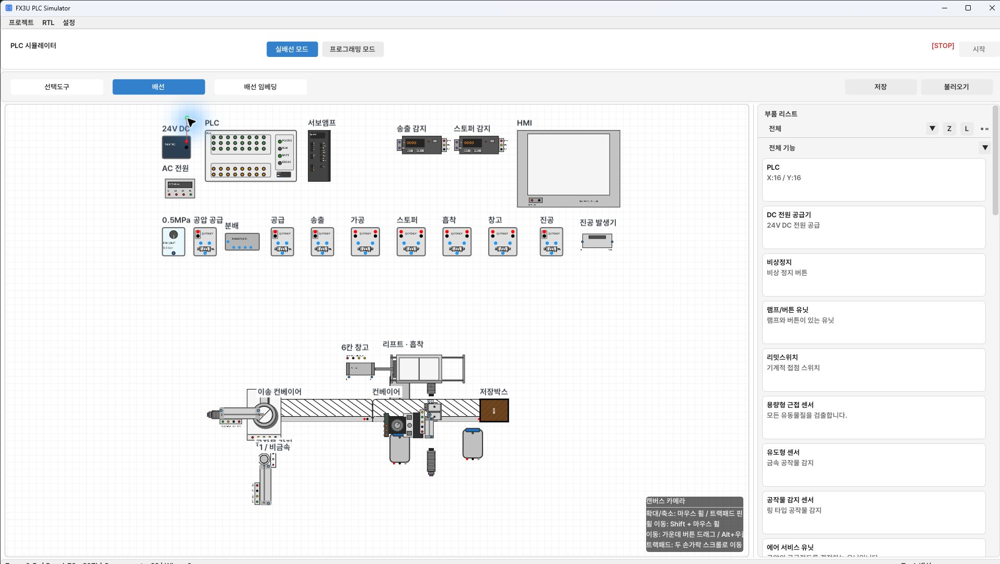
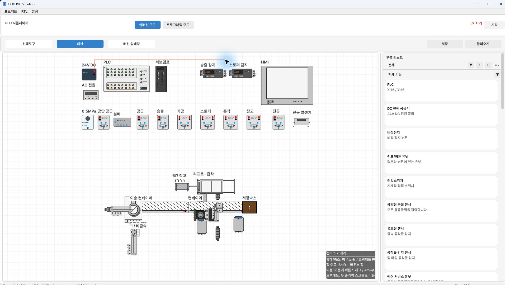
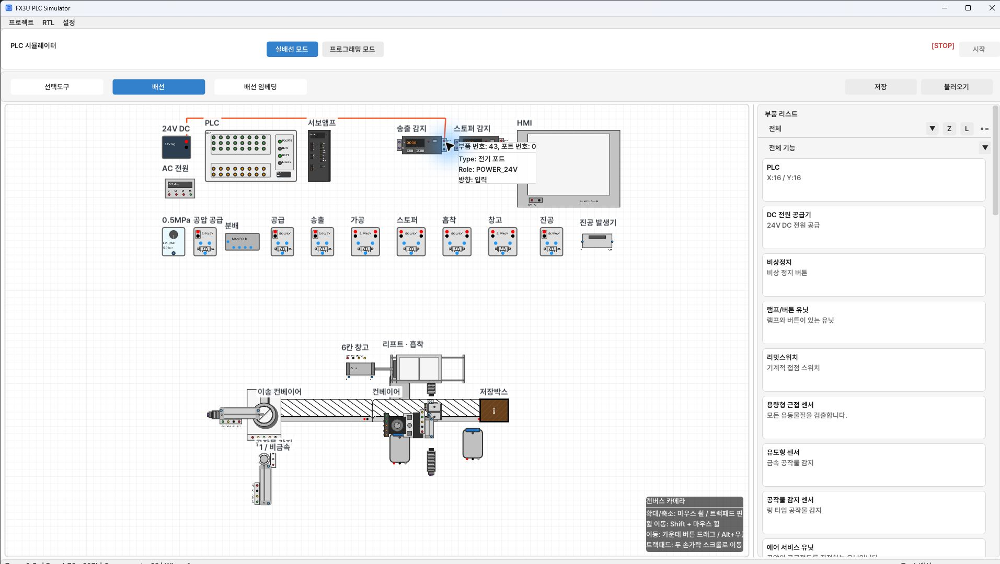
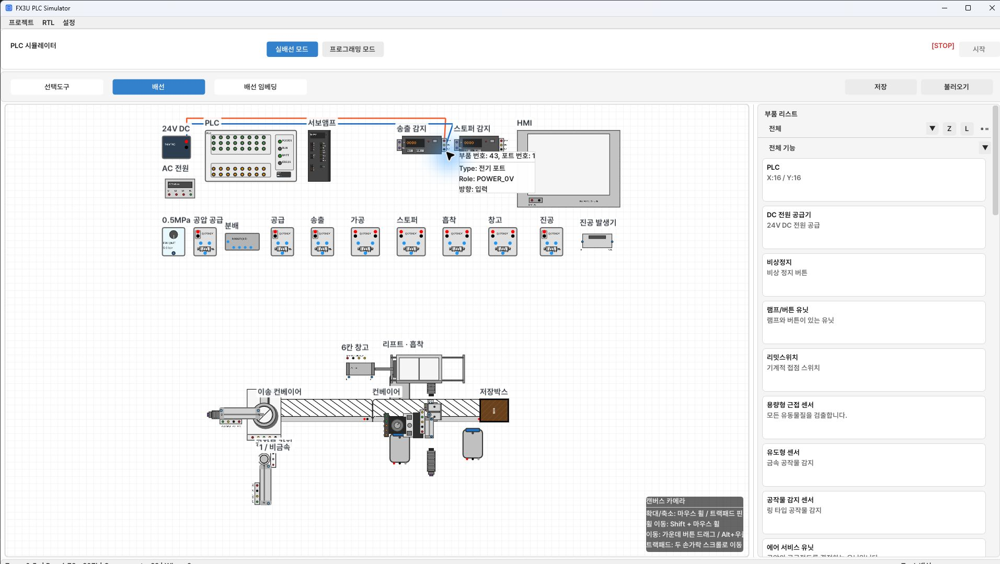
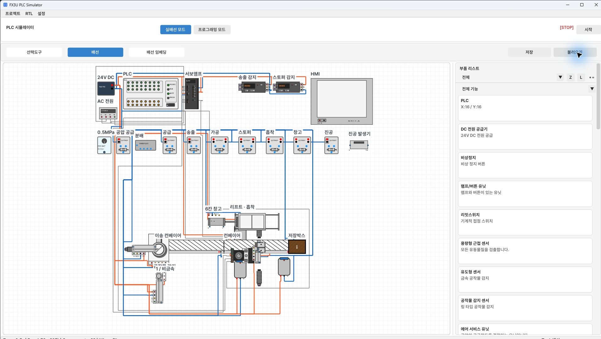

[목차](GUIDE.md) · [← 부품 배치](01-placement.md) · [제어 배선 →](03-control.md)

# 2. 전원 배선

> **목표:** 센서·코일의 전원과 서보 동력 연결을 마칩니다.
> **완료 기준:** 전원·동력 연결 51개.

## 배선 도구와 직각 경로

도구줄에서 **배선**을 선택한다. 출발 핀 → 빈 공간의 꺾임점 → 도착 핀 순서로
클릭한다. 빈 공간 클릭은 중간 경유점을 추가한다. 오른쪽 클릭은 연결 중 취소다.
핀 타입으로 전기·공압·광 연결이 자동 결정된다.
배선을 만들 때 몸체 가운데를 가로지르지 말고 부품 행 사이의 빈 공간을 이용한다.

24V는 빨강, 0V는 검정, PLC 제어선은 주황, 공압은 파랑,
광 케이블은 보라로 구분하면 추적하기 쉽다.
연결을 끝낸 뒤 선을 선택해 색과 경유점을 정리한다.
서로 다른 신호를 같은 선으로 합치지 않는다.
분기점처럼 보이는 선 교차만으로 전기 연결이 생겼다고 판단하지 않는다.
각 표의 출발 핀과 도착 핀을 실제로 연결한다.

### 실제 클릭 예: DC 24V → 송출 감지 증폭부 24V

1. **배선**을 선택하고 DC 전원〔1〕의 빨간 **24V** 핀을 클릭한다.
2. 전원 위쪽의 빈 공간을 클릭해 첫 꺾임점을 만든다.

3. 송출 감지 증폭부〔43〕위의 빈 공간을 클릭해 수평 통로를 만든다.

4. 증폭부 오른쪽의 **24V** 핀을 클릭해 연결을 끝낸다.
   마우스를 핀에 올렸을 때 `Role: POWER_24V`, `방향: 입력`인지 확인한다.
   SIG와 0V는 별도 핀이므로 이 전원선에 연결하지 않는다.

사진 속 선은 기본 주황색으로 생성됐다. 색상 정리는 연결 후 수행한다.
핀 옆에 ‘호환되지 않습니다’가 표시되면 단자를 다시 확인한다.
그 문구만 보고 연결이 끝났다고 판단하지 말고, 목적지에 고정된 선을 확인한다.

## 24V 분배

DC 전원〔1〕의 빨간 24V 핀에서 시작한다. 아래 연결을 한 줄씩 만든다.
전원 위쪽 통로를 따라 수평으로 진행한 뒤 해당 부품 핀으로 내려간다.
솔레노이드 코일 +는 이 표에서 24V에 직접 연결하지 않는다. PLC Y 출력으로 구동한다.

상세 입력표 펼치기 · 14개 항목

| 순서 | 출발 단자 | 도착 단자 |
| --- | --- | --- |
| 1 | 24V DC〔1〕 · **24V** | 공작물 감지〔23〕 · **24V** |
| 2 | 24V DC〔1〕 · **24V** | 송출 감지〔43〕 · **24V** |
| 3 | 24V DC〔1〕 · **24V** | 스토퍼 감지〔46〕 · **24V** |
| 4 | 24V DC〔1〕 · **24V** | 서보앰프〔3〕 · **24V** |
| 5 | 24V DC〔1〕 · **24V** | 서보앰프〔3〕 · **RESET** |
| 6 | 24V DC〔1〕 · **24V** | 공급〔10〕 · **24V** |
| 7 | 24V DC〔1〕 · **24V** | 송출〔11〕 · **24V** |
| 8 | 24V DC〔1〕 · **24V** | 리프트 · 흡착〔14〕 · **24V** |
| 9 | 24V DC〔1〕 · **24V** | 6칸 창고〔16〕 · **24V** |
| 10 | 24V DC〔1〕 · **24V** | 스토퍼〔13〕 · **24V** |
| 11 | 24V DC〔1〕 · **24V** | 용량형〔24〕 · **24V** |
| 12 | 24V DC〔1〕 · **24V** | 통과 감지〔25〕 · **24V** |
| 13 | 24V DC〔1〕 · **24V** | 가공〔12〕 · **24V** |
| 14 | 24V DC〔1〕 · **24V** | 유도형〔22〕 · **24V** |

## 0V 공통

DC 전원〔1〕의 검정 0V 핀에서 각각 연결한다.
24V 통로보다 한 칸 아래에 별도 통로를 둔다.
서보 P-COM은 0V 공통이고, PE는 보호접지다. 서로 같은 핀으로 취급하지 않는다.

24V 예제와 같은 증폭부〔43〕에 0V를 연결한다. 도착 핀 툴팁은
`POWER_0V`여야 한다. 사진에서는 0V가 파랑으로 표시된다.
전기와 공압의 구분은 선 색만으로 판단하지 말고 핀 타입으로 확인한다.

상세 입력표 펼치기 · 28개 항목

| 순서 | 출발 단자 | 도착 단자 |
| --- | --- | --- |
| 1 | 24V DC〔1〕 · **0V** | 공작물 감지〔23〕 · **0V** |
| 2 | 24V DC〔1〕 · **0V** | 송출 감지〔43〕 · **0V** |
| 3 | 24V DC〔1〕 · **0V** | 스토퍼 감지〔46〕 · **0V** |
| 4 | 24V DC〔1〕 · **0V** | 서보앰프〔3〕 · **0V** |
| 5 | 24V DC〔1〕 · **0V** | 서보앰프〔3〕 · **P-COM** |
| 6 | 24V DC〔1〕 · **0V** | 공급〔10〕 · **0V** |
| 7 | 24V DC〔1〕 · **0V** | 송출〔11〕 · **0V** |
| 8 | 24V DC〔1〕 · **0V** | 리프트 · 흡착〔14〕 · **0V** |
| 9 | 24V DC〔1〕 · **0V** | 6칸 창고〔16〕 · **0V** |
| 10 | 24V DC〔1〕 · **0V** | 스토퍼〔13〕 · **0V** |
| 11 | 24V DC〔1〕 · **0V** | 용량형〔24〕 · **0V** |
| 12 | 24V DC〔1〕 · **0V** | 통과 감지〔25〕 · **0V** |
| 13 | 24V DC〔1〕 · **0V** | 가공〔12〕 · **0V** |
| 14 | 24V DC〔1〕 · **0V** | 유도형〔22〕 · **0V** |
| 15 | 24V DC〔1〕 · **0V** | 컨베이어〔17〕 · **0V** |
| 16 | 24V DC〔1〕 · **0V** | 공압 공급〔6〕 · **A 코일 0V** |
| 17 | 24V DC〔1〕 · **0V** | 공급〔30〕 · **A 코일 0V** |
| 18 | 24V DC〔1〕 · **0V** | 송출〔31〕 · **A 코일 0V** |
| 19 | 24V DC〔1〕 · **0V** | 가공〔32〕 · **A 코일 0V** |
| 20 | 24V DC〔1〕 · **0V** | 가공〔32〕 · **B 코일 0V** |
| 21 | 24V DC〔1〕 · **0V** | 스토퍼〔33〕 · **A 코일 0V** |
| 22 | 24V DC〔1〕 · **0V** | 스토퍼〔33〕 · **B 코일 0V** |
| 23 | 24V DC〔1〕 · **0V** | 흡착〔34〕 · **A 코일 0V** |
| 24 | 24V DC〔1〕 · **0V** | 흡착〔34〕 · **B 코일 0V** |
| 25 | 24V DC〔1〕 · **0V** | 창고〔35〕 · **A 코일 0V** |
| 26 | 24V DC〔1〕 · **0V** | 창고〔35〕 · **B 코일 0V** |
| 27 | 24V DC〔1〕 · **0V** | 진공〔36〕 · **A 코일 0V** |
| 28 | 24V DC〔1〕 · **0V** | 이송 컨베이어〔18〕 · **0V** |

## 서보 AC 전원

AC 전원〔4〕과 서보앰프〔3〕의 L1/L2/L3/PE를 이름대로 연결한다.
24V 센서 전원과 AC 단자를 섞지 않는다. 이 문서의 배선은 시뮬레이터 모델 기준이다.

| 순서 | 출발 단자 | 도착 단자 |
| --- | --- | --- |
| 1 | AC 전원〔4〕 · **L1** | 서보앰프〔3〕 · **L1** |
| 2 | AC 전원〔4〕 · **L2** | 서보앰프〔3〕 · **L2** |
| 3 | AC 전원〔4〕 · **L3** | 서보앰프〔3〕 · **L3** |
| 4 | AC 전원〔4〕 · **PE** | 서보앰프〔3〕 · **PE** |

## 서보 동력·피드백

서보앰프〔3〕 → 리프트·흡착〔14〕의 U/V/W/PE/ENC를 연결한다.
이 모델은 U/V/W 서보이며 A+/A-/B+/B- 스테핑 모터 모델과 다르다.
리프트 상단 모터 단자와 실린더 센서 단자를 구분한다.

| 순서 | 출발 단자 | 도착 단자 |
| --- | --- | --- |
| 1 | 서보앰프〔3〕 · **U** | 리프트 · 흡착〔14〕 · **U** |
| 2 | 서보앰프〔3〕 · **V** | 리프트 · 흡착〔14〕 · **V** |
| 3 | 서보앰프〔3〕 · **W** | 리프트 · 흡착〔14〕 · **W** |
| 4 | 서보앰프〔3〕 · **PE** | 리프트 · 흡착〔14〕 · **PE** |
| 5 | 서보앰프〔3〕 · **ENC** | 리프트 · 흡착〔14〕 · **ENC** |

## HMI 연결

HMI는 PLC에 자동 연결되므로 전원선·통신선을 그리지 않는다.
HMI 버튼은 M 주소에 쓰고 숫자 표시기는 D 주소를 읽도록 편집한다.

## 전원·동력 배선 완료 참고 사진

2장의 연결표에 해당하는 **전원·동력 배선 51개**만 표시한 상태다.
24V·0V 분배, AC 전원, 서보 동력·피드백 연결을 확인한다.
PLC 입력·출력선과 공압·광 연결은 다음 단계에서 추가하므로 이 사진에 없다.
HMI가 비어 있는 것은 아직 화면 작화를 하지 않았기 때문이다.

---

[목차](GUIDE.md) · [← 부품 배치](01-placement.md) · [제어 배선 →](03-control.md)
