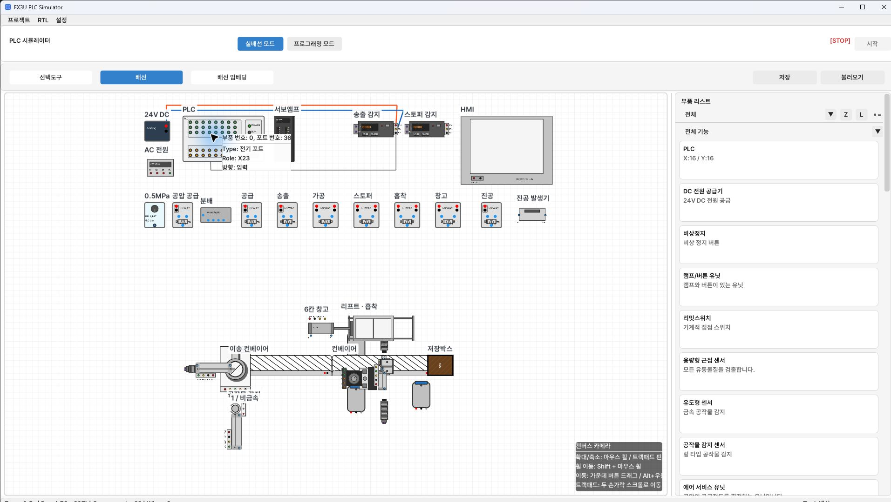
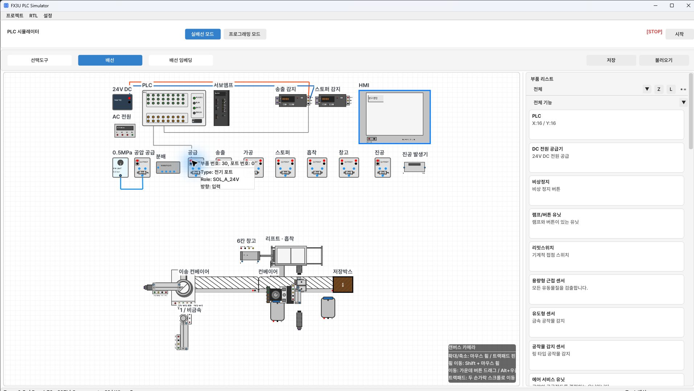
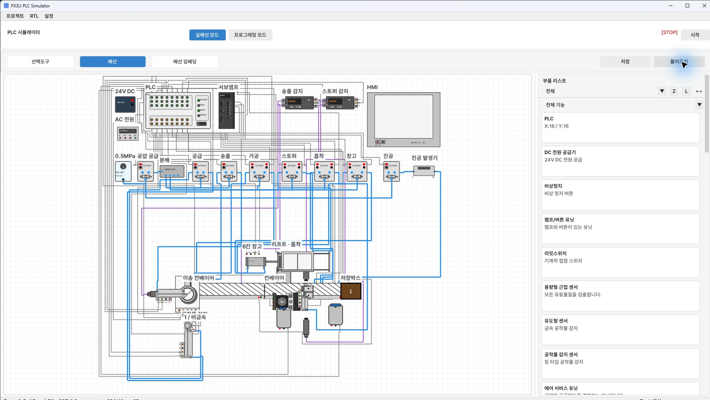

[目次](GUIDE.ja.md) · [← 電源配線](02-power.ja.md) · [HMI画面 →](04-hmi.ja.md)

# 3. 制御配線

> **目標：** センサー入力・駆動出力・空圧・光の接続を完了します。
> **接続数：** 制御65本、電源を含め116本。

## PLC入力X

シリンダー完了センサー・光アンプ出力・静電容量型／誘導型の信号をPLC Xへ接続します。
センサー出力はPNP、PLC入力はSinkにします。
配置JSONの設定をそのまま使えます。
PLC X/Yは8進アドレスなので、X7の次はX10、X17の次はX20です。
X20～X22まで使用できる入力列のあるPLCを使います。

各信号を入力列の上の経路へ上げ、目的のXへ下ろします。
センサー電源と信号を混同しないよう、ピンを拡大して接続します。

送出検出アンプ〔43〕のSIGから始め、制御部の下の経路を通り、
PLC〔0〕のX23へ接続します。終点のツールチップ `Role: X23` を確認します。
このPLCでは入力3段目の4番目のピンです。

詳細入力表を開く・20項目

| 順序 | 開始端子 | 終点端子 |
| --- | --- | --- |
| 1 | ワーク検出〔23〕 · **SIG** | PLC〔0〕 · **X7** |
| 2 | 送出検出〔43〕 · **SIG** | PLC〔0〕 · **X23** |
| 3 | ストッパー検出〔46〕 · **SIG** | PLC〔0〕 · **X16** |
| 4 | サーボアンプ〔3〕 · **INP** | PLC〔0〕 · **X17** |
| 5 | 供給〔10〕 · **FWD** | PLC〔0〕 · **X0** |
| 6 | 供給〔10〕 · **REV** | PLC〔0〕 · **X1** |
| 7 | 送出〔11〕 · **FWD** | PLC〔0〕 · **X2** |
| 8 | 送出〔11〕 · **REV** | PLC〔0〕 · **X3** |
| 9 | リフト · 吸着〔14〕 · **FWD** | PLC〔0〕 · **X10** |
| 10 | リフト · 吸着〔14〕 · **REV** | PLC〔0〕 · **X11** |
| 11 | 6スロット倉庫〔16〕 · **FWD** | PLC〔0〕 · **X12** |
| 12 | 6スロット倉庫〔16〕 · **REV** | PLC〔0〕 · **X13** |
| 13 | ストッパー〔13〕 · **DOWN** | PLC〔0〕 · **X6** |
| 14 | ストッパー〔13〕 · **UP** | PLC〔0〕 · **X21** |
| 15 | リフト · 吸着〔14〕 · **VAC確認** | PLC〔0〕 · **X20** |
| 16 | 静電容量型〔24〕 · **SIG** | PLC〔0〕 · **X14** |
| 17 | 通過検出〔25〕 · **SIG** | PLC〔0〕 · **X22** |
| 18 | 加工〔12〕 · **FWD** | PLC〔0〕 · **X4** |
| 19 | 加工〔12〕 · **REV** | PLC〔0〕 · **X5** |
| 20 | 誘導型〔22〕 · **SIG** | PLC〔0〕 · **X15** |

## PLC出力Y

出力はSourceです。Yから目的のコイル＋または制御ピンに接続します。
ダブルソレノイドのA/Bコイルは異なるYへ接続します。
Y17は運転空圧供給とサーボSONの2か所へ分岐します。
Y7は2台のコンベヤー駆動ピンへ分岐します。
モーター制御には加工シリンダー内蔵のMOTORピンを使います。

例えばY1から始め、PLCとバルブ列の間に2つの曲げ点を作り、
供給バルブ〔30〕の赤いコイル＋へ接続します。
終点は `SOL_A_24V` です。直下の黒い `SOL_A_0V` と
混同しないでください。近ければ拡大し、誤接続はCtrl+Zで取り消します。
コイル0Vも2章の0V表に従い、別途接続します。

詳細出力表を開く・18項目

| 順序 | 開始端子 | 終点端子 |
| --- | --- | --- |
| 1 | PLC〔0〕 · **Y17** | サーボアンプ〔3〕 · **SON** |
| 2 | PLC〔0〕 · **Y0** | サーボアンプ〔3〕 · **PULSE** |
| 3 | PLC〔0〕 · **Y4** | サーボアンプ〔3〕 · **DIR** |
| 4 | PLC〔0〕 · **Y3** | 加工〔12〕 · **MOTOR** |
| 5 | PLC〔0〕 · **Y7** | コンベヤー〔17〕 · **24V** |
| 6 | PLC〔0〕 · **Y17** | 空圧供給〔6〕 · **Aコイル +** |
| 7 | PLC〔0〕 · **Y1** | 供給〔30〕 · **Aコイル +** |
| 8 | PLC〔0〕 · **Y2** | 送出〔31〕 · **Aコイル +** |
| 9 | PLC〔0〕 · **Y5** | 加工〔32〕 · **Aコイル +** |
| 10 | PLC〔0〕 · **Y6** | 加工〔32〕 · **Bコイル +** |
| 11 | PLC〔0〕 · **Y10** | ストッパー〔33〕 · **Aコイル +** |
| 12 | PLC〔0〕 · **Y11** | ストッパー〔33〕 · **Bコイル +** |
| 13 | PLC〔0〕 · **Y12** | 吸着〔34〕 · **Aコイル +** |
| 14 | PLC〔0〕 · **Y13** | 吸着〔34〕 · **Bコイル +** |
| 15 | PLC〔0〕 · **Y15** | 倉庫〔35〕 · **Aコイル +** |
| 16 | PLC〔0〕 · **Y16** | 倉庫〔35〕 · **Bコイル +** |
| 17 | PLC〔0〕 · **Y14** | 真空〔36〕 · **Aコイル +** |
| 18 | PLC〔0〕 · **Y7** | 搬送コンベヤー〔18〕 · **24V** |

## 空圧配管

FRL〔5〕は0.5 MPaに相当する設定値5です。
運転空圧供給バルブ〔6〕を通して分配器〔7〕に供給します。
単ソレノイド供給バルブのBを分配器へつなぐのは、このモデルで運転ON時に
圧力が出るポートを使うためです。
加工・ストッパー・吸着・倉庫のバルブは、表のとおりシリンダーA/Bと交差接続します。
外観の左右だけで判断せず、表の端子名に従います。

真空分岐は **供給遮断バルブの前のFRL** から取ります。
吸着中の一時停止でワークを保持するには、この分岐位置が必要です。
別の真空パッドは追加せず、リフト一体型シリンダーのVACを使います。

最初の配管はFRL〔5〕下側のOUTから始めます。バルブ列の下へ下ろし、
横へ進めて運転空圧供給バルブ〔6〕下側のP_INに接続します。
電気配線と同じ **配線** ツールを使います。

詳細配管表を開く・23項目

| 順序 | 開始端子 | 終点端子 |
| --- | --- | --- |
| 1 | 0.5MPa〔5〕 · **OUT** | 空圧供給〔6〕 · **P** |
| 2 | 空圧供給〔6〕 · **B** | 分配〔7〕 · **IN** |
| 3 | 分配〔7〕 · **OUT1** | 供給〔30〕 · **P** |
| 4 | 供給〔30〕 · **A** | 供給〔10〕 · **A** |
| 5 | 供給〔30〕 · **B** | 供給〔10〕 · **B** |
| 6 | 分配〔7〕 · **OUT1** | 送出〔31〕 · **P** |
| 7 | 送出〔31〕 · **A** | 送出〔11〕 · **A** |
| 8 | 送出〔31〕 · **B** | 送出〔11〕 · **B** |
| 9 | 分配〔7〕 · **OUT2** | 加工〔32〕 · **P** |
| 10 | 加工〔32〕 · **A** | 加工〔12〕 · **B** |
| 11 | 加工〔32〕 · **B** | 加工〔12〕 · **A** |
| 12 | 分配〔7〕 · **OUT2** | ストッパー〔33〕 · **P** |
| 13 | ストッパー〔33〕 · **A** | ストッパー〔13〕 · **B** |
| 14 | ストッパー〔33〕 · **B** | ストッパー〔13〕 · **A** |
| 15 | 分配〔7〕 · **OUT2** | 吸着〔34〕 · **P** |
| 16 | 吸着〔34〕 · **A** | リフト · 吸着〔14〕 · **B** |
| 17 | 吸着〔34〕 · **B** | リフト · 吸着〔14〕 · **A** |
| 18 | 分配〔7〕 · **OUT2** | 倉庫〔35〕 · **P** |
| 19 | 倉庫〔35〕 · **A** | 6スロット倉庫〔16〕 · **B** |
| 20 | 倉庫〔35〕 · **B** | 6スロット倉庫〔16〕 · **A** |
| 21 | 0.5MPa〔5〕 · **OUT** | 真空〔36〕 · **P** |
| 22 | 真空〔36〕 · **B** | 真空発生器〔21〕 · **P** |
| 23 | 真空発生器〔21〕 · **VAC** | リフト · 吸着〔14〕 · **VAC** |

## 光ケーブル

アンプTXを投光ヘッド、RXを受光ヘッドへ接続します。
ヘッドを直接PLC Xへつながず、PLCはアンプのSIGを読みます。
同じZでヘッドを向かい合わせ、ワークがその間を通るようにします。
SIGだけ配線して光ケーブルがなければ検出できません。

| 順序 | 開始端子 | 終点端子 |
| --- | --- | --- |
| 1 | 送出検出〔43〕 · **TX** | 送出 ワーク TX〔44〕 · **24V** |
| 2 | 送出検出〔43〕 · **RX** | 送出 ワーク RX〔45〕 · **24V** |
| 3 | ストッパー検出〔46〕 · **TX** | ストッパー TX〔47〕 · **24V** |
| 4 | ストッパー検出〔46〕 · **RX** | ストッパー RX〔48〕 · **24V** |

## 配線完了の確認

1. 表の各行を確認します。HMI電源2本を除く接続は合計116本です。
2. 供給・送出・吸着・倉庫のFWD/REVとストッパーのDOWN/UPを区別します。
3. サーボPULSE=Y0、DIR=Y4、INP=X17、SON=Y17を確認します。
4. 吸着確認=X20、ストッパー上昇=X21、ボックス通過=X22を確認します。
5. `タグ` を使う場合は、表のタグ名と実際の接続を先に確認します。
   このガイドでは最初は直接配線のまま、接続を追跡します。
6. 自分の進捗は実配線の **保存** で別名に保存します。
   配布された配置JSONには上書きしません。

## 制御配線の参考画像

3章の **制御・空圧・光65本** を表示した状態です。
PLC X/Yは灰色、空圧は青、光は紫で表示されています。
この段階では制御・空圧・光配線を確認します。
実際に作る回路には、前の手順の電源・動力51本も必要です。
合わせて116本です。すべての配線を終えてから運転します。

---

[目次](GUIDE.ja.md) · [← 電源配線](02-power.ja.md) · [HMI画面 →](04-hmi.ja.md)
