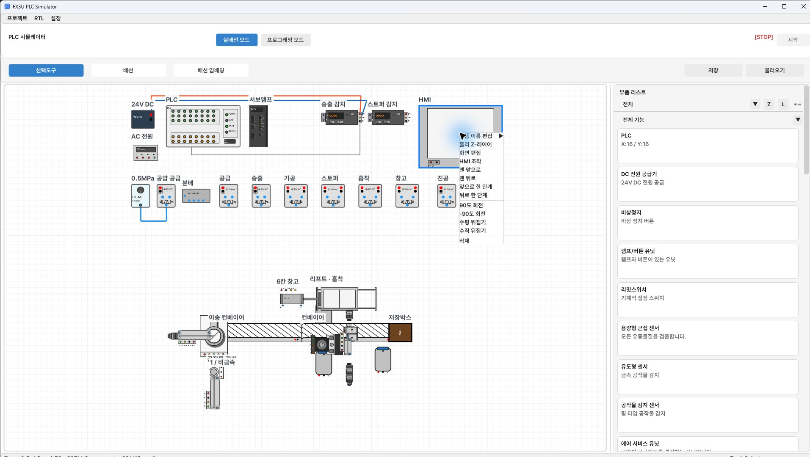
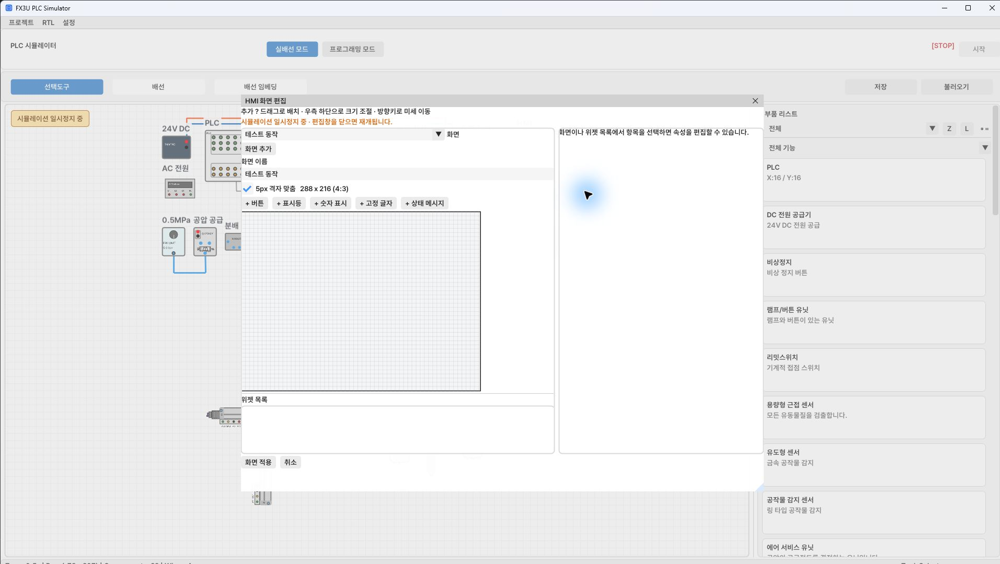
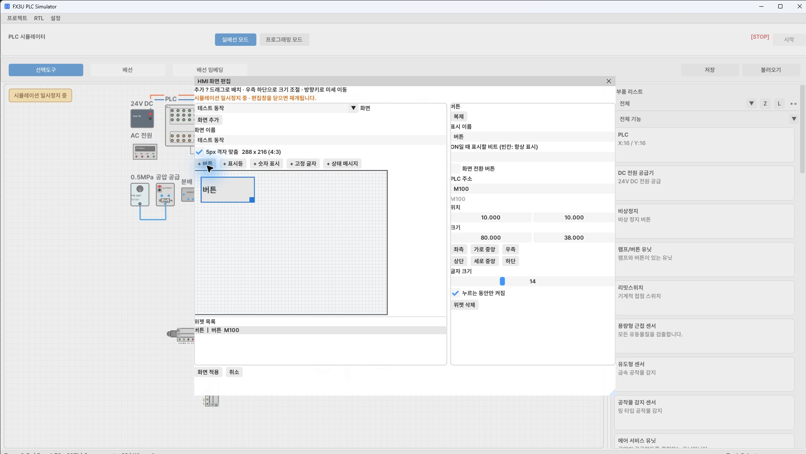
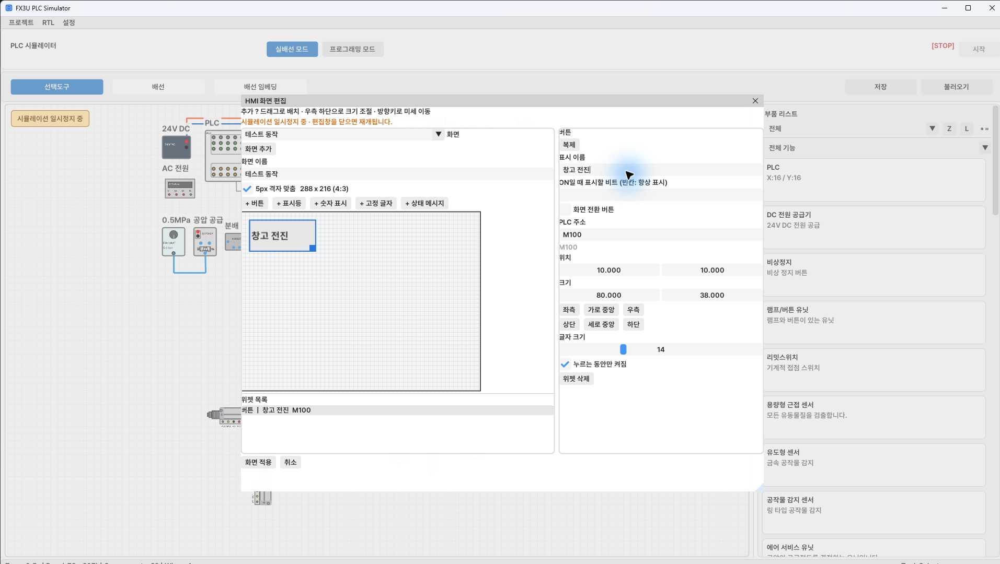
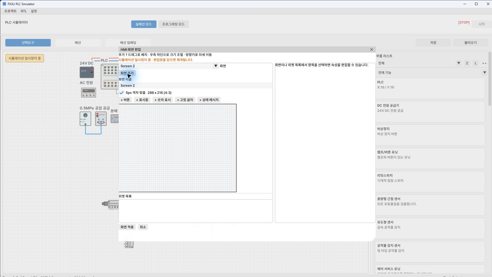
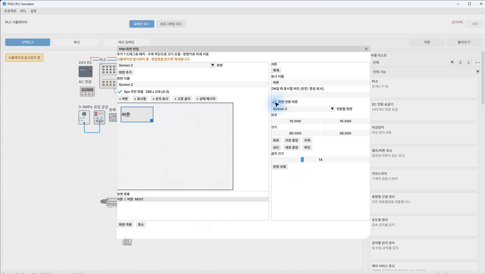
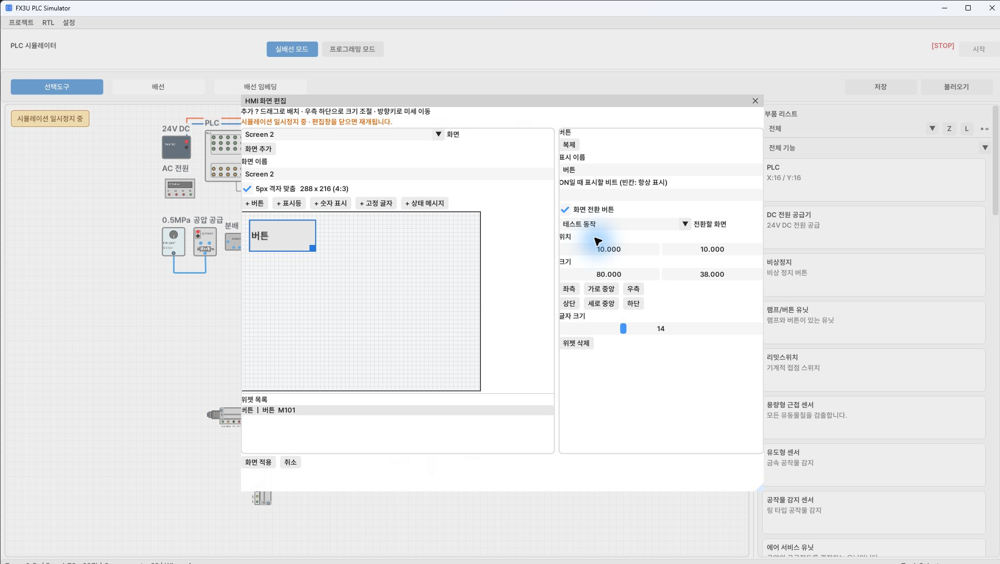

[목차](GUIDE.md) · [← 제어 배선](03-control.md) · [래더 입력 방법 →](05-ladder-basics.md)

# 4. HMI 화면 만들기

**선택도구**에서 HMI 몸체를 더블클릭 → **화면 편집**을 연다.
**HMI 조작** 창의 편집 버튼을 이용해도 된다.

화면 편집 중에는 시뮬레이션이 일시정지되고 편집창을 닫으면 편집 전 운전 상태로 돌아간다.
화면 크기는 288×216, 4:3으로 둔다.
첫 화면 이름은 `테스트 동작`, 두 번째 화면은 `장비 시운전`으로 만든다.
각 위젯은 아래 표의 유형·주소·위치·크기를 입력한다.
좌표와 크기는 HMI 화면 내부 좌표이며 프로그램 캔버스 좌표와 다르다.
버튼은 순간 동작으로 설정한다. 특히 JOG는 누르는 동안만 M104/M105가 ON이어야 한다.
화면전환 버튼은 **화면 전환 버튼**을 체크하고 **전환할 화면**을 선택한다.
이 상태에서는 PLC 주소 입력칸 대신 화면 선택칸이 나타난다.

### 버튼 한 개를 만드는 순서

1. 위쪽 **+ 버튼**을 누른다. 미리보기와 위젯 목록에 버튼이 생긴다.
2. 위젯을 선택하면 오른쪽에 표시 이름·PLC 주소·위치·크기가 나타난다.

3. **표시 이름**에 `창고 전진`, **PLC 주소**에 `M100`을 입력한다.
   입력칸의 기존 글자는 Ctrl+A로 선택한 뒤 교체한다.
4. **누르는 동안만 켜짐**을 체크한다.
5. 아래 완성 설정표에 맞춰 위치·크기를 입력한다. 사진은 기본 위치에서
   이름을 입력하는 예제이고, 최종 배치 좌표는 표를 따른다.

### 두 번째 화면과 전환 버튼

1. **화면 추가**를 누르면 `Screen 2`가 생긴다.
2. **화면 이름** 입력칸에서 `장비 시운전`으로 바꾼다.

3. 두 번째 화면에 버튼을 추가하고 **화면 전환 버튼**을 체크한다.

4. **전환할 화면**에서 `테스트 동작`을 선택한다. 버튼 표시 이름은
   `<- 테스트 동작`으로 입력하고 위치·크기는 아래 표를 따른다.
   첫 화면의 전환 버튼은 반대로 `장비 시운전`을 대상으로 지정한다.

5. 모든 설정을 마친 뒤 왼쪽 아래 **화면 적용**을 누른다.
   취소를 누르면 편집 내용을 적용하지 않는다.
6. 숫자·표시등·상태 메시지도 해당 추가 버튼으로 만들고 아래 표의
   주소와 표시 조건을 지정한다. 편집창을 다시 열 때는 같은 메뉴를 사용한다.

### 화면 1: 테스트 동작

상세 입력표 펼치기 · 13개 항목

| 내용 | 유형 | 주소 | X,Y | 폭×높이 | 추가 설정 |
| --- | --- | --- | --- | --- | --- |
| 테스트 동작 | text | 비움 | 8,4 | 200×20 |  |
| 창고 전진 | button | M100 | 8,28 | 85×28 |  |
| 창고 후진 | button | M101 | 98,28 | 85×28 |  |
| 가공모터 5초 | button | M103 | 188,28 | 92×28 |  |
| JOG 상승 | button | M104 | 8,64 | 85×28 |  |
| JOG 하강 | button | M105 | 98,64 | 85×28 |  |
| 원점 복귀 | button | M102 | 188,64 | 92×28 |  |
| 저속 | button | M106 | 8,100 | 85×28 |  |
| 중속 | button | M107 | 98,100 | 85×28 |  |
| 고속 | button | M108 | 188,100 | 92×28 |  |
| JOG 속도 | number | D100 | 8,138 | 175×42 | 단위 mm/min |
| 원점 | lamp | M209 | 188,138 | 92×42 |  |
| 장비 시운전 -> | button | 비움 | 8,185 | 272×24 | 전환 → 장비 시운전 |

### 화면 2: 장비 시운전

| 내용 | 유형 | 주소 | X,Y | 폭×높이 | 추가 설정 |
| --- | --- | --- | --- | --- | --- |
| 장비 시운전 | text | 비움 | 8,4 | 200×20 |  |
| 단속 | button | M110 | 8,28 | 60×30 |  |
| 연속 | button | M111 | 78,28 | 60×30 |  |
| 종료 | button | M112 | 148,28 | 60×30 |  |
| 일시정지 | button | M113 | 218,28 | 62×30 |  |
| 동작 상태 | message | D103 | 8,70 | 272×35 | 0=정지 / 1=연속운전 / 2=일시정지 |
| 금속 적재 | number | D101 | 8,115 | 125×44 | 표시 조건 M210, 단위 개 |
| 연속 | lamp | M200 | 148,115 | 132×24 |  |
| 서보 동작 | lamp | M211 | 148,144 | 132×24 |  |
| <- 테스트 동작 | button | 비움 | 8,185 | 272×24 | 전환 → 테스트 동작 |

금속 적재 수량 표시기의 표시 조건 `M210`을 반드시 설정한다.
단속에서는 M210=OFF라 수량이 숨겨지고 연속에서는 표시된다.
원점 램프 M209, 서보 동작 램프 M211의 점멸은 PLC 프로그램이 만든다.
HMI 메시지 위젯의 세 문구를 한글로 직접 지정한다.

---

[목차](GUIDE.md) · [← 제어 배선](03-control.md) · [래더 입력 방법 →](05-ladder-basics.md)
