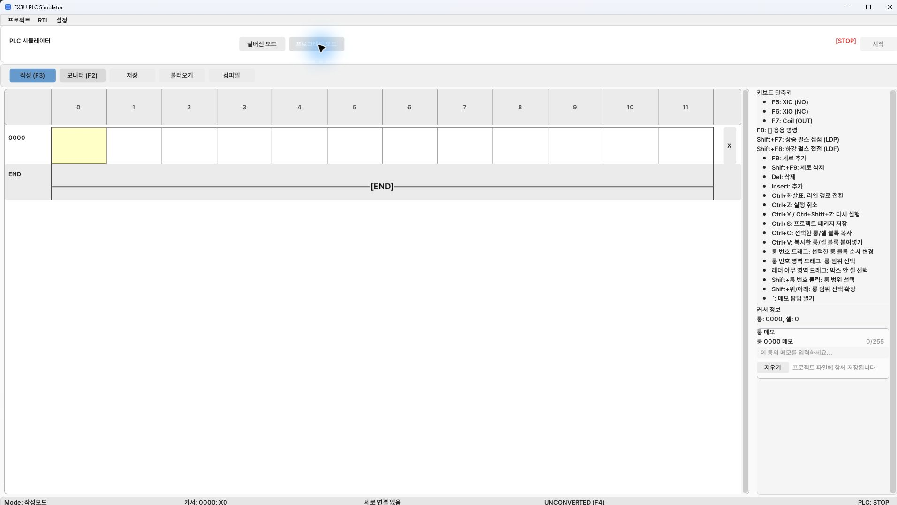
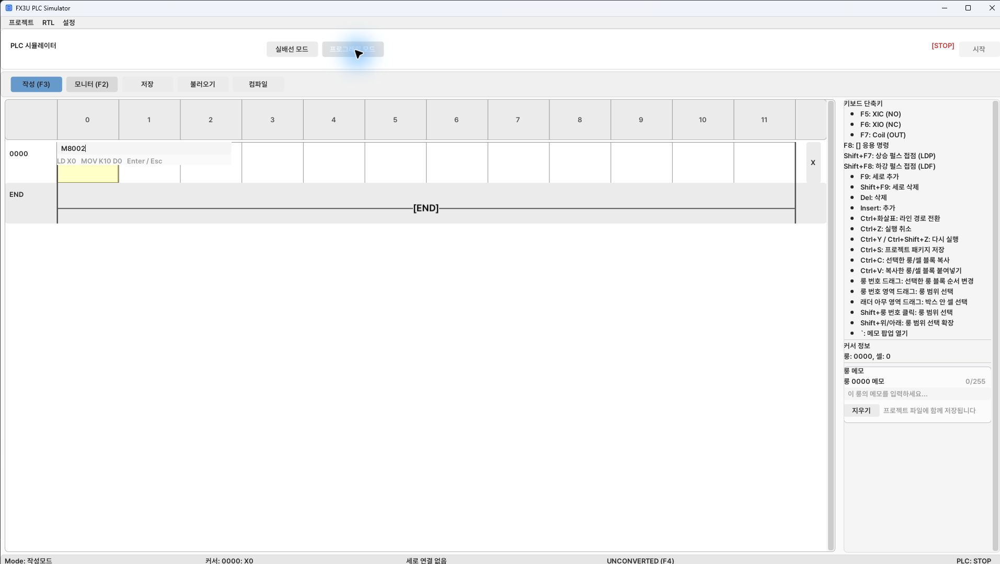
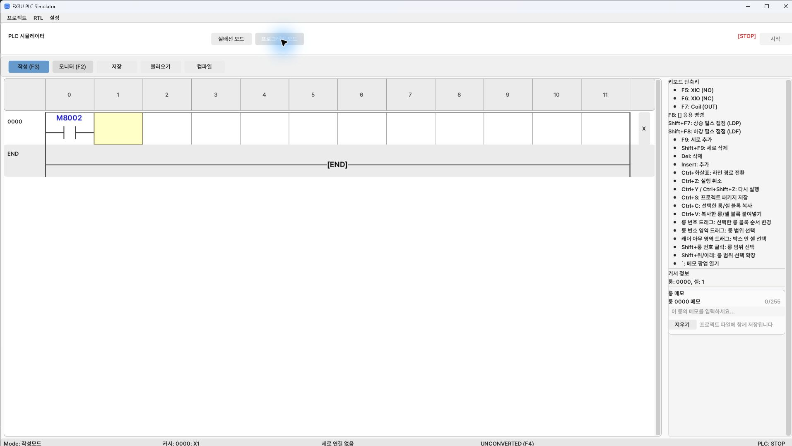
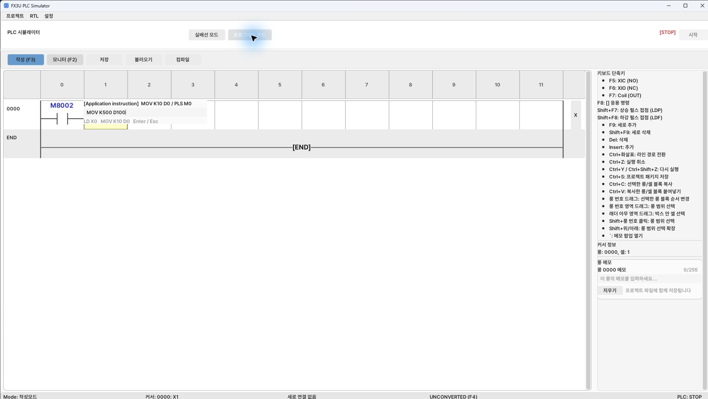
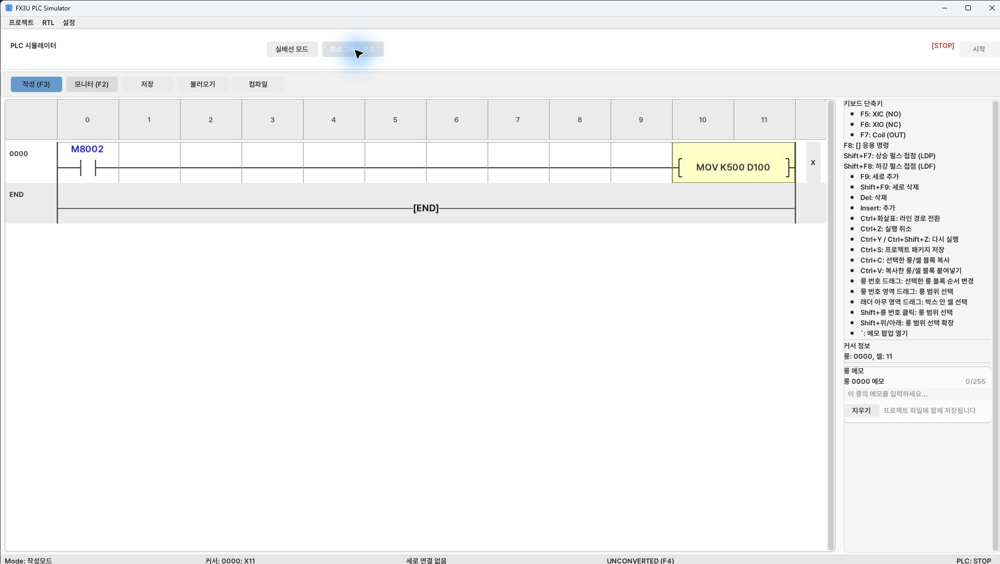
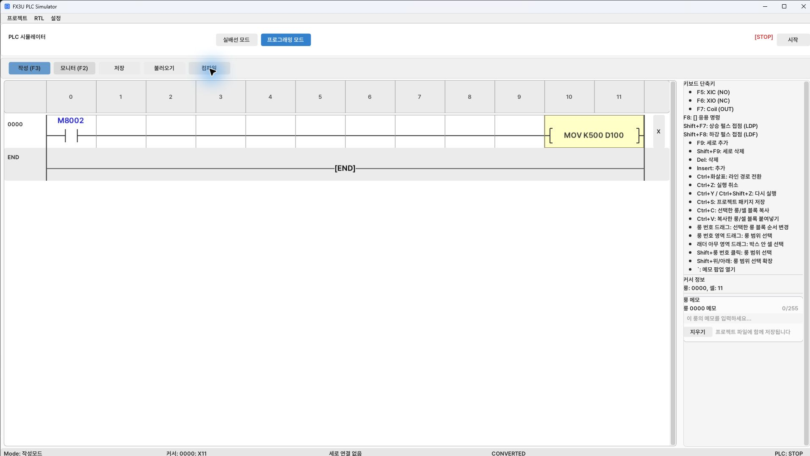

[Contents](GUIDE.en.md) · [← HMI screens](04-hmi.en.md) · [Initialization →](logic-01-init.en.md)

# 5. Entering ladder logic

Switch to Edit (F3) in **Programming**.
Use F5 for contacts, F6 for negated contacts, F7 for coils, and F8 for application instructions.
Enter an instruction with its operands, such as `MOV K500 D100`.
Confirm with Enter. Select the outlined cell, then enter an address/instruction.
Start with only END and write the circuits in the order below.

In the first cell of the empty row, enter F5 → `M8002` → Enter.
Confirming the contact selects the next cell.

In the next cell, enter F8 → `MOV K500 D100` → Enter.
The instruction is placed at the row's right, with horizontal wiring added automatically.

Select **Compile** above; the status below becomes `CONVERTED`.
After entering all circuits and END, recompile and continue with [trial run](06-checks.en.md).

Add rows with Insert.
Rising pulse contacts use Shift+F7; falling pulse contacts use Shift+F8.
Add horizontal wire with F9 and vertical connections at parallel junctions with Shift+F9.
Create branches at the specification's parentheses, connect each branch, then
place the common output. Do not simply put every contact in one row.

The instruction listings below are in-document circuit specifications, not separate files.
`LD` starts a contact condition, `INV` negates it, `ANB` combines blocks in series,
and `ORB` combines blocks in parallel. Do not enter INV/ANB/ORB as output coils.
Use the table expressions to arrange contacts in series/parallel, then enter the final instruction.
In expressions, `¬` means normally closed, `∧` series, `∨` parallel,
and `↑M` a rising pulse contact.

Write initialization/HMI manual controls first, then stage transitions, servo commands,
and finally outputs and initialization completion.
Keep the actual rung order identical to the table below.
D10 is next stage; D11 is this scan's stage.
Copy D10→D11 at scan start to prevent multiple stage transitions within one scan.

[Device reference](reference-devices.en.md)

---

[Contents](GUIDE.en.md) · [← HMI screens](04-hmi.en.md) · [Initialization →](logic-01-init.en.md)
