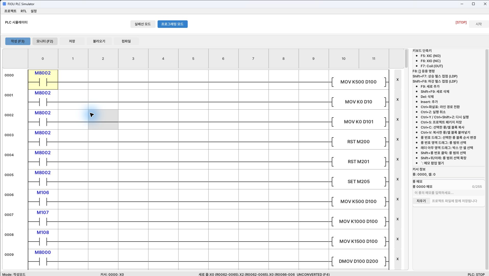

[目次](GUIDE.ja.md) · [← 入力方法](05-ladder-basics.ja.md) · [手動操作 →](logic-02-manual.ja.md)

# 1. 初期化

**動作の流れ**

最初のスキャン → 数値・状態初期化 → 機構復帰 → 運転準備

> **目標**
> RUNの最初のスキャンで速度500、段階0、格納数0を設定し、
> 前の運転状態を解除して初期化M205をオンにします。

### 作成方法

1. 左にM8002のa接点を置き、右の命令を各行に1つずつ配置します。
2. `MOV K500 D100`、`MOV K0 D10`、`MOV K0 D101`、`RST M200`、`RST M201`、`SET M205` の順です。
3. 同じ最初のスキャン条件で複数の値を初期化するため、M8002が繰り返されます。

### 確認

 D10=0、D101=0でも、すべての軸が原点とは限りません。
M205は各復帰センサーとサーボ位置を確認してから解除します。

---

[目次](GUIDE.ja.md) · [← 入力方法](05-ladder-basics.ja.md) · [手動操作 →](logic-02-manual.ja.md)
