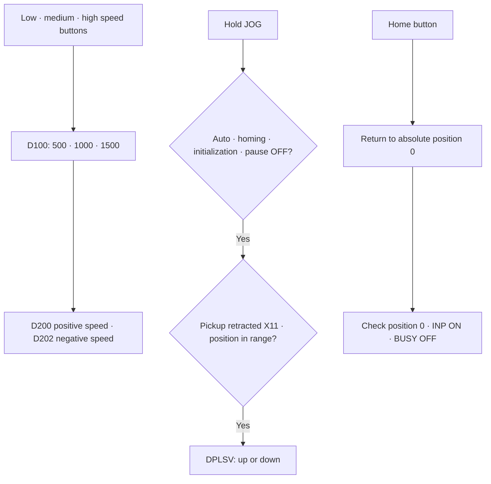

[Contents](GUIDE.en.md) · [← Initialization](logic-01-init.en.md) · [Supply/processing →](logic-03-process.en.md)

# 2. Manual operation

**Operation flow**

Select speed → check permission → move while pressed → home

> **Goal**
> Speed buttons change D100; JOG moves the lift only while
> held. Home and motor-test requests latch after pressing.

### Speed selection

 Write M106→500, M107→1000, and M108→1500 to D100 with MOV.
Copy D100 to D200 and clear the high word with D201=0.
Copy D200 to D202 and reverse its sign with DNEG so both directions use the same speed.

### Processing motor test

 Put M103 rising pulse and automatic-run OFF in series to SET M212.
M212 starts T11 K50; T11 completion resets M212.
Include an M212 branch in processing motor Y3's output condition.

### Homing

 Put M102 rising pulse, auto OFF, initialization OFF, and X11 in series
to SET M206. Completion requires T12, D8340=0, X17 ON, and M8340 OFF.
On completion, SET M208 and RST M206.
Home lamp M209 combines ‘M206 AND blink bit M8013’ in parallel with ‘M208’.
Thus it blinks during homing and stays lit when complete.

### JOG while held

 Start with M104 or M105, then normally closed M201/M206/M205/M204,
normally open X11 and a position comparison in series. Up requires D8340<0;
down requires D8340>-6000. The right-side instructions are
`DPLSV D200 Y0 Y4` and `DPLSV D202 Y0 Y4`.

### Checks

 Check that releasing JOG stops motion, end limits are respected,
and JOG cannot interfere with homing.

---

[Contents](GUIDE.en.md) · [← Initialization](logic-01-init.en.md) · [Supply/processing →](logic-03-process.en.md)
