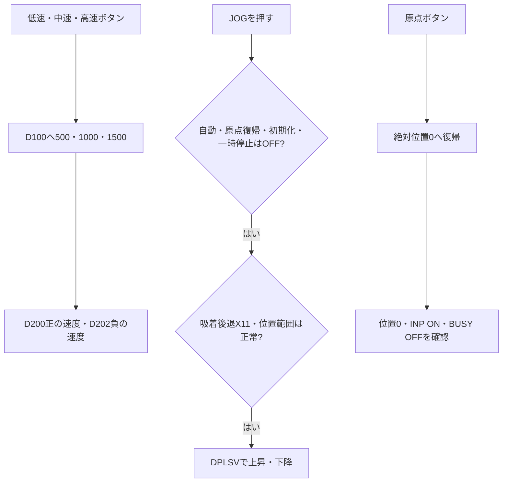
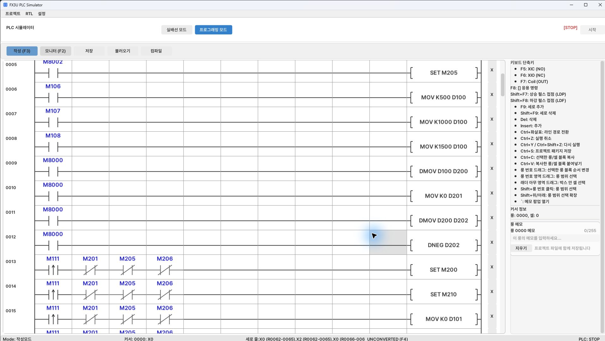
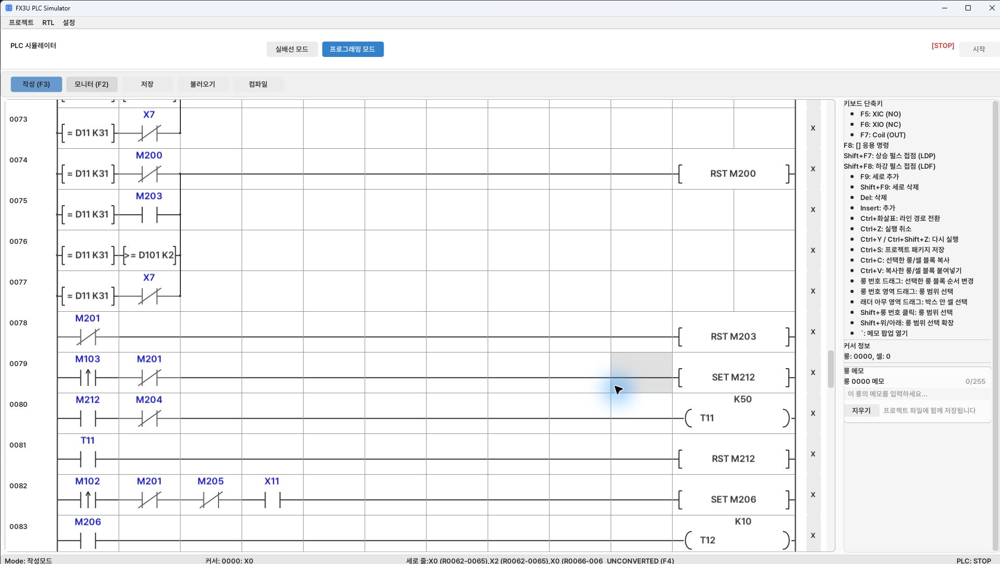
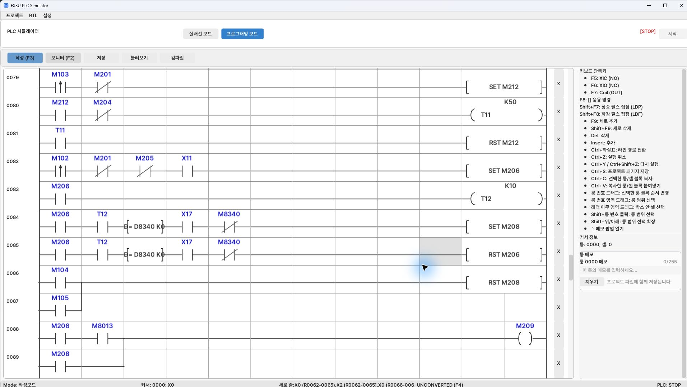
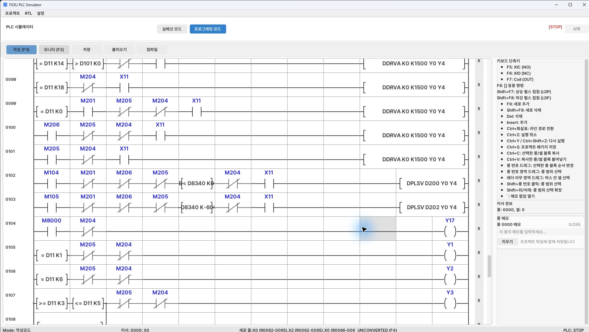

[目次](GUIDE.ja.md) · [← 初期化](logic-01-init.ja.md) · [供給・加工 →](logic-03-process.ja.md)

# 2. 手動操作

**動作の流れ**

速度選択 → 許可条件確認 → 押している間の移動 → 原点復帰

> **目標**
> 速度ボタンはD100を変更し、JOGは押している間だけ
> リフトを動かします。原点とモーター試験は押した要求を保持して動作します。

### 速度選択

 M106→500、M107→1000、M108→1500をMOVでD100に入れます。
D100をD200へコピーし、D201=0で上位ワードを整えます。
D200をD202へコピーし、DNEGで符号を反転するため、両方向で同じ速度を使います。

### 加工モーター試験

 M103立ち上がりパルスと自動運転OFFを直列にし、M212をSETします。
M212でT11 K50を開始し、T11完了でM212をRSTします。
加工モーターY3の出力条件にもM212分岐を入れます。

### 原点復帰

 M102立ち上がりパルス、自動OFF、初期化OFF、X11を直列にして
M206をSETします。完了はT12、D8340=0、X17 ON、M8340 OFFで確認します。
完了するとM208をSETし、M206をRSTします。
原点ランプM209は「M206と点滅ビットM8013」の分岐と「M208」を並列にします。
復帰中は点滅し、完了すると点灯を続けます。

### 押している間のJOG

 M104またはM105から始め、M201/M206/M205/M204のb接点、
X11のa接点、位置比較を直列にします。上昇はD8340<0、
下降はD8340>-6000で許可します。右側の命令はそれぞれ
`DPLSV D200 Y0 Y4` と `DPLSV D202 Y0 Y4` です。

### 確認

 JOGを離すと停止すること、上下の限界を超えないこと、
原点復帰中にJOGが割り込まないことを確認します。

---

[目次](GUIDE.ja.md) · [← 初期化](logic-01-init.ja.md) · [供給・加工 →](logic-03-process.ja.md)
