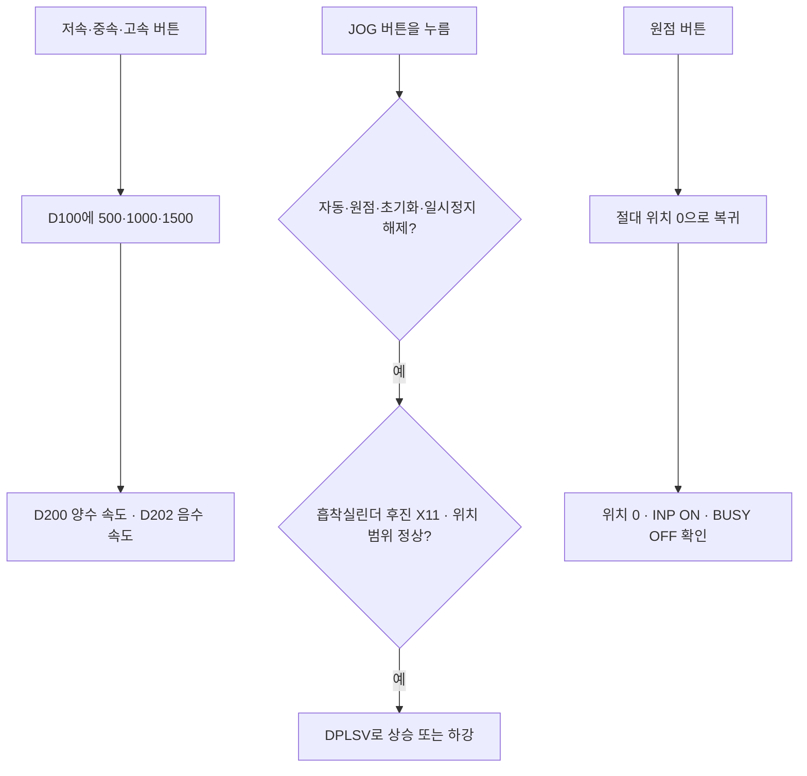

[목차](GUIDE.md) · [← 초기화](logic-01-init.md) · [공급·가공 →](logic-03-process.md)

# 2. 수동 조작

**동작 흐름**

속도 선택 → 허용 조건 확인 → 누르는 동안 이동 → 원점 복귀

> **목표**
> 속도 버튼은 D100의 숫자를 바꾸고, JOG 버튼은 누르는 동안만
> 리프트를 움직인다. 원점 버튼과 모터 시험 버튼은 눌렀던 요청을 기억해 동작한다.

### 속도 선택

 M106→500, M107→1000, M108→1500을 각각 MOV로 D100에 넣는다.
D100을 D200에 복사하고 D201=0으로 상위 워드를 정리한다.
D200을 D202에 복사한 뒤 DNEG로 부호를 바꾸므로 두 방향이 같은 속도를 쓴다.

### 가공 모터 시험

 M103 상승 펄스와 자동 운전 OFF를 직렬로 묶어 M212를 SET한다.
M212가 켜지면 T11 K50을 세고, T11 완료로 M212를 RST한다.
가공 모터 Y3의 출력 조건에는 M212 분기를 함께 넣는다.

### 원점 복귀

 M102 상승 펄스, 자동 OFF, 초기화 OFF, X11을 직렬로 묶어
M206을 SET한다. 복귀 완료는 T12, D8340=0, X17 ON, M8340 OFF를 확인한다.
완료하면 M208을 SET하고 M206을 RST한다.
원점 램프 M209는 ‘M206과 점멸 비트 M8013’ 분기와 ‘M208’ 분기를 병렬로 묶는다.
복귀 중에는 깜박이고 완료하면 계속 켜지는 이유다.

### 누르는 동안 JOG

 M104 또는 M105에서 시작하고 M201/M206/M205/M204 B접점,
X11 A접점과 위치 비교를 직렬로 넣는다. 상승은 D8340<0,
하강은 D8340>-6000에서 허용한다. 오른쪽 명령은 각각
`DPLSV D200 Y0 Y4`, `DPLSV D202 Y0 Y4`다.

### 완료 확인

 JOG를 놓으면 멈추는지, 위·아래 끝을 넘지 않는지,
원점 복귀 중에는 JOG가 섞이지 않는지 확인한다.

---

[목차](GUIDE.md) · [← 초기화](logic-01-init.md) · [공급·가공 →](logic-03-process.md)
