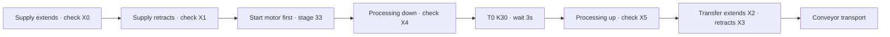

[Contents](GUIDE.en.md) · [← Manual operation](logic-02-manual.en.md) · [Material branching →](logic-04-material.en.md)

# 3. Supply and processing

**Operation flow**

Supply → start motor → confirm down → 3s → confirm up → transfer

> **Goal**
> Start the motor after supply extension/retraction. Confirm cylinder-down
> sensor X4, wait 3s, then raise. Transfer only after up-complete X5.

### How to draw it

1. Put stage comparison `= D11 Kstage` on the left, then completion sensors and normally closed M204/M205 in series.
2. Set the next stage with `MOV Knext_stage D10` on the right.
3. For example, D11=3 and X4 ON writes 4 to D10.
4. D11=4 with pause OFF runs T0 K30; D11=4 with T0 complete writes 5 to D10.

### What moves when the stage changes?

 MOV K5 D10 does not itself raise the cylinder.
Later output circuits activate Y5/Y6 for that stage.
M8000→MOV D10 D11 runs once at scan start to prevent several stage transitions
in the same scan.

### Checks

 Starting the timer before X4 shortens actual processing time.
Do not stop the motor or transfer before X5 turns ON.

---

[Contents](GUIDE.en.md) · [← Manual operation](logic-02-manual.en.md) · [Material branching →](logic-04-material.en.md)
