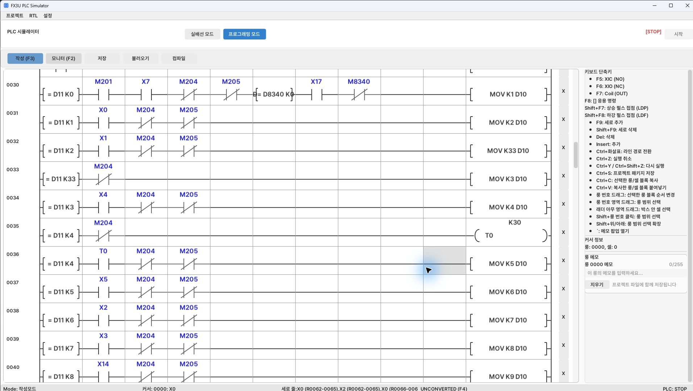

[목차](GUIDE.md) · [← 수동 조작](logic-02-manual.md) · [재질 분기 →](logic-04-material.md)

# 3. 공급·가공

**동작 흐름**

공급 → 모터 기동 → 하강 확인 → 3초 → 상승 확인 → 송출

> **목표**
> 공급 전진·복귀 후 가공 모터를 켠다. 가공실린더가 내려왔다는
> 센서 X4를 확인한 뒤 3초 기다리고 상승시킨다. 상승 완료 X5 다음에 송출한다.

### 이렇게 그리세요

1. 왼쪽에 현재 단계 비교 접점 `= D11 K단계`를 넣고, 그 옆에 완료 센서와 M204/M205 B접점을 직렬로 배치한다.
2. 오른쪽 `MOV K다음단계 D10`으로 다음 단계를 지정한다.
3. 예를 들어 D11=3이고 X4가 ON이면 D10에 4를 넣는다.
4. D11=4, 일시정지 OFF 행에서는 T0 K30을 실행하고, D11=4와 T0 완료 행에서는 D10에 5를 넣는다.

### 단계가 바뀌면 무엇이 움직이나요?

 MOV K5 D10 자체가 실린더를 올리지는 않는다.
뒤쪽 출력 회로가 해당 단계에 맞춰 Y5/Y6를 켠다.
M8000→MOV D10 D11은 스캔 시작에서 한 번 실행해 한 스캔 안에 여러 단계를
연달아 지나가지 않게 한다.

### 완료 확인

 X4를 기다리지 않고 타이머를 먼저 시작하면 실제 가공 시간이 짧아진다.
X5가 켜지기 전에 모터를 끄거나 송출하지 않는다.

---

[목차](GUIDE.md) · [← 수동 조작](logic-02-manual.md) · [재질 분기 →](logic-04-material.md)
