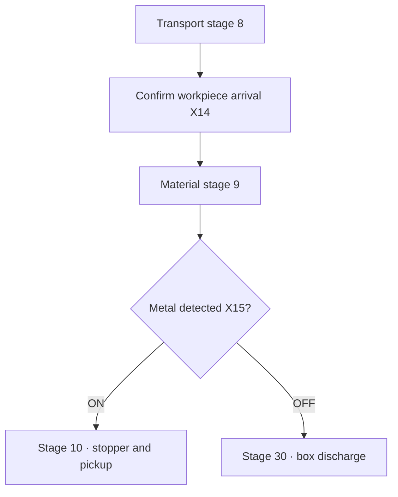

[Contents](GUIDE.en.md) · [← Supply/processing](logic-03-process.en.md) · [Pickup/storage →](logic-05-storage.en.md)

# 4. Material branching

**Operation flow**

Confirm arrival → metal to rack / nonmetal to box

> **Goal**
> Confirm arrival X14 at the material sensor and enter stage 9.
> In that stage, X15 ON selects storage; OFF selects box discharge.

### How to draw it

1. After D11=9, put X15 normally open and normally closed contacts on separate rows.
2. End the normally open row with MOV K10 D10 and normally closed row with MOV K30 D10.
3. Evaluate material only at the arrival stage; otherwise X15 OFF with no workpiece could be mistaken for nonmetal.

### Checks

 Metal must select stage 10; nonmetal stage 30.
Metal positioning requires both stopper-down X6 and optical detection X16.

---

[Contents](GUIDE.en.md) · [← Supply/processing](logic-03-process.en.md) · [Pickup/storage →](logic-05-storage.en.md)
