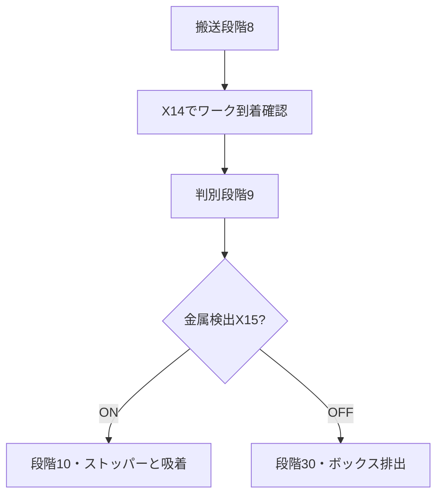

[目次](GUIDE.ja.md) · [← 供給・加工](logic-03-process.ja.md) · [吸着・格納 →](logic-05-storage.ja.md)

# 4. 材質分岐

**動作の流れ**

到着確認 → 金属は倉庫／非金属はボックス

> **目標**
> 材質検出位置への到着X14を確認し、段階9に入ります。
> その段階で金属検出X15がONなら格納、OFFならボックス排出です。

### 作成方法

1. 同じD11=9比較の後に、X15のa接点とb接点を別の行に置きます。
2. a接点の行はMOV K10 D10、b接点の行はMOV K30 D10で終えます。
3. 材質判定は到着段階だけで行います。そうしないとワーク不在のX15 OFFを非金属と誤認します。

### 確認

 金属は段階10、非金属は段階30が選択されます。
金属の定位置はストッパー下降X6と光検出X16の両方で確認します。

---

[目次](GUIDE.ja.md) · [← 供給・加工](logic-03-process.ja.md) · [吸着・格納 →](logic-05-storage.ja.md)
