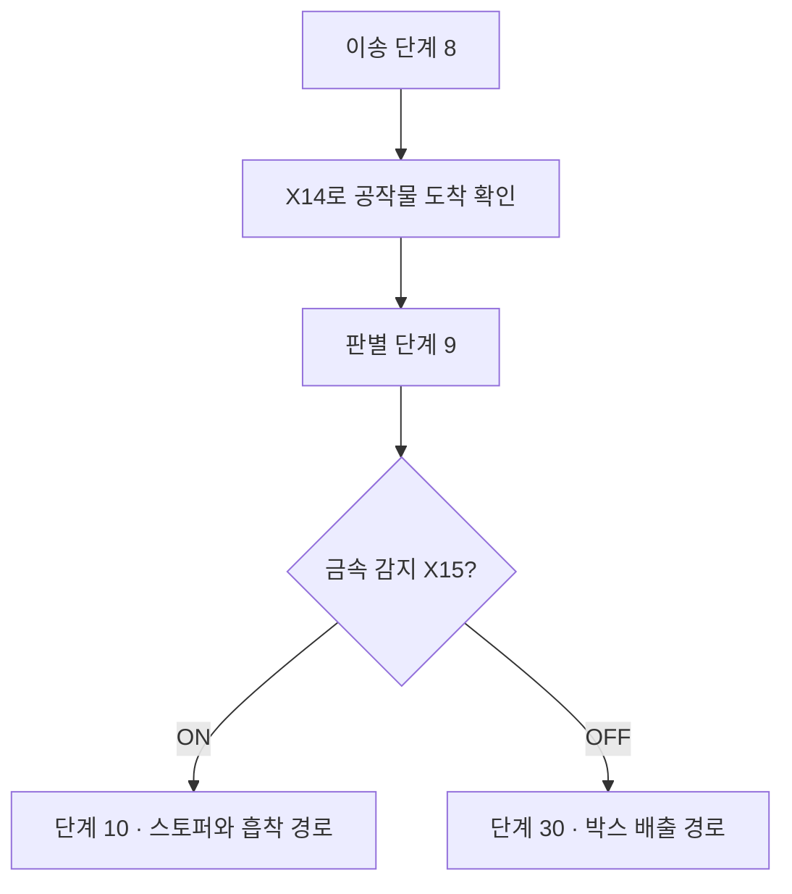
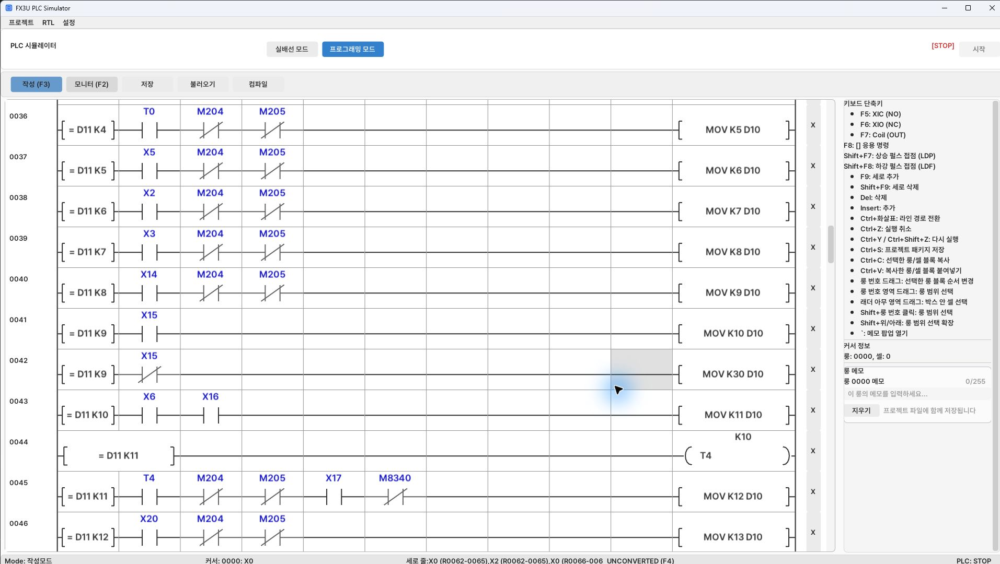

[목차](GUIDE.md) · [← 공급·가공](logic-03-process.md) · [흡착·적재 →](logic-05-storage.md)

# 4. 재질 분기

**동작 흐름**

공작물 도착 확인 → 금속이면 적재 / 비금속이면 박스

> **목표**
> 재질 감지 위치에 도착한 X14를 확인하고 단계 9로 들어간다.
> 그 단계에서 금속 감지 X15가 ON이면 적재 경로, OFF이면 박스 배출 경로다.

### 이렇게 그리세요

1. 같은 D11=9 비교 뒤 X15 A접점과 X15 B접점을 각각 다른 행에 배치한다.
2. A접점 행은 MOV K10 D10, B접점 행은 MOV K30 D10으로 끝낸다.
3. 재질 판별을 아무 때나 실행하지 않고 도착 단계 안에서 실행해야 공작물이 없는 때의 X15 OFF를 비금속으로 오인하지 않는다.

### 완료 확인

 금속에서는 단계 10, 비금속에서는 단계 30이 선택돼야 한다.
금속 정위치는 스토퍼 하강 X6와 광 감지 X16을 둘 다 확인한다.

---

[목차](GUIDE.md) · [← 공급·가공](logic-03-process.md) · [흡착·적재 →](logic-05-storage.md)
