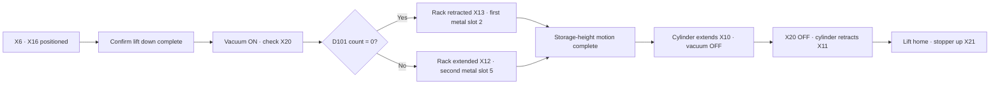

[Contents](GUIDE.en.md) · [← Material branching](logic-04-material.en.md) · [Discharge/finish →](logic-06-finish.en.md)

# 5. Pickup and storage

**Operation flow**

Position → confirm pickup → select rack position → store → return

> **Goal**
> Stop the metal workpiece, lower the lift, and pick it up. After X20 confirms pickup,
> select rack position by stored count and move the lift to storage height.

### How to draw it

1. D11=12 and X20 in series advance to stage 13.
2. At stage 13, create ‘D101=0 AND X13’ and ‘D101>0 AND X12’ rows.
3. Both advance with MOV K14 D10.
4. Stage 14 completion requires T6, normally open X17, and normally closed M8340.

### Reading servo position instructions

 `DDRVA K-6000 K1500 Y0 Y4`
sends pulses at speed 1500 to absolute position -6000.
Y0 is pulse, Y4 direction. X11 before each instruction permits lift motion only
when the pickup cylinder is retracted.
The first storage target is -6000 and the second 0, together with rack Z settings.

### Reading valve outputs

 Y14 stays ON through stages 12–15 to maintain pickup.
Y15/Y16 combine automatic rack selection and manual M100/M101 in parallel.
Y16 also has an initialization M205 branch, retracting the rack during initialization.

### Checks

 If X20 is not ON, check vacuum tubing and detection rather than forcing
the next stage. INP can remain ON at the preceding position, so
also check the settling timer and BUSY OFF.

---

[Contents](GUIDE.en.md) · [← Material branching](logic-04-material.en.md) · [Discharge/finish →](logic-06-finish.en.md)
