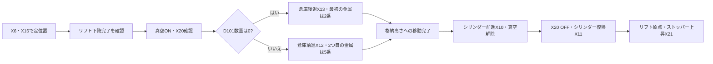

[目次](GUIDE.ja.md) · [← 材質分岐](logic-04-material.ja.md) · [排出・終了 →](logic-06-finish.ja.md)

# 5. 吸着と格納

**動作の流れ**

定位置 → 吸着確認 → 倉庫選択 → 格納 → 復帰

> **目標**
> 金属を止め、リフトを下げて吸着します。X20で吸着を確認した後、
> 格納数に応じて倉庫位置を選び、リフトを格納高さへ移動します。

### 作成方法

1. D11=12とX20を直列にし、段階13へ進めます。
2. 段階13では「D101=0かつX13」と「D101>0かつX12」の行を作ります。
3. 両方ともMOV K14 D10で次の段階に入ります。
4. 段階14の移動完了はT6、X17のa接点、M8340のb接点で確認します。

### サーボ位置命令の読み方

 `DDRVA K-6000 K1500 Y0 Y4` は、
速度1500で絶対位置-6000へパルスを送る命令です。
Y0はパルス、Y4は方向です。各命令前のX11は吸着シリンダーが復帰して
いる場合だけリフト移動を許可します。
最初の格納目標は-6000、2回目は0で、倉庫のZ設定と組み合わせます。

### バルブ出力の読み方

 Y14は吸着保持が必要な段階12～15でオンにします。
Y15/Y16は自動倉庫選択と手動M100/M101を並列にします。
Y16には初期化M205分岐も入り、初期化時に倉庫を後退させます。

### 確認

 X20がONでなければ、次の段階へ強制移行せず真空配管と
検出条件を確認します。INPは前の位置でもONの場合があるため、
整定タイマーとBUSY OFFも確認します。

---

[目次](GUIDE.ja.md) · [← 材質分岐](logic-04-material.ja.md) · [排出・終了 →](logic-06-finish.ja.md)
