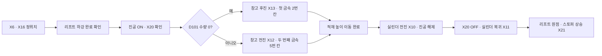
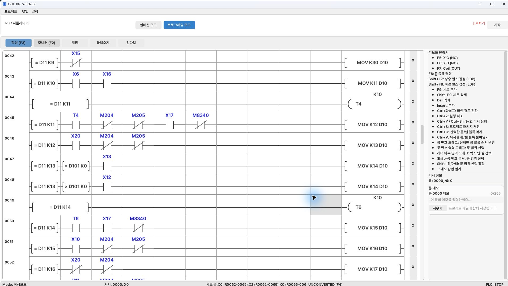
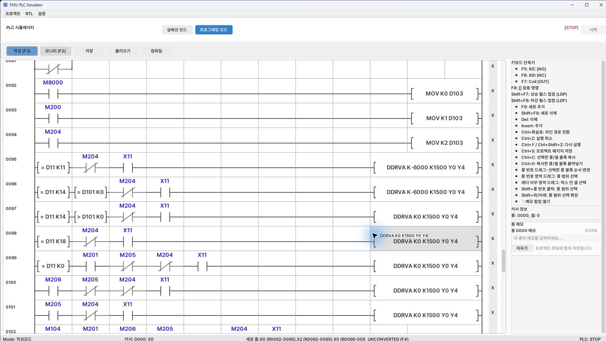
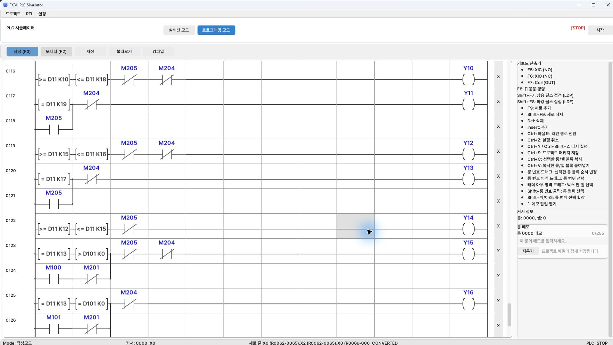

[목차](GUIDE.md) · [← 재질 분기](logic-04-material.md) · [배출·종료 →](logic-06-finish.md)

# 5. 흡착·적재

**동작 흐름**

정위치 → 흡착 확인 → 창고 선택 → 적재 → 복귀

> **목표**
> 금속을 정지시키고 리프트를 내려 흡착한다. X20으로 흡착을 확인한 뒤
> 적재 수량에 따라 창고 위치를 선택하고 리프트를 적재 높이로 이동한다.

### 이렇게 그리세요

1. D11=12와 X20을 직렬로 묶어 단계 13으로 넘긴다.
2. 단계 13에서는 ‘D101=0 그리고 X13’ 행과 ‘D101>0 그리고 X12’ 행을 만든다.
3. 두 경우 모두 MOV K14 D10으로 다음 단계에 들어간다.
4. 단계 14의 이동 완료는 T6, X17 A접점, M8340 B접점으로 확인한다.

### 서보 위치 명령 읽기

 `DDRVA K-6000 K1500 Y0 Y4`는
절대 위치 -6000으로 속도 1500의 펄스를 보내는 명령이다.
Y0가 펄스, Y4가 방향이다. 각 명령 앞 X11은 흡착실린더가 복귀해
있을 때만 리프트 이동을 허용한다.
첫 적재 목표는 -6000, 두 번째는 0이며 창고의 Z 설정과 함께 사용한다.

### 밸브 출력 읽기

 Y14는 흡착을 유지해야 하는 단계 12~15에서 켠다.
Y15/Y16은 자동 창고 선택 조건과 수동 M100/M101 조건을 병렬로 묶는다.
Y16에는 초기화 M205 분기도 들어가므로 초기화 때 창고를 후진시킨다.

### 완료 확인

 X20이 켜지지 않았다면 다음 단계로 강제 이동하지 말고 진공 배관과
감지 조건을 확인한다. INP는 이전 위치에서도 켜져 있을 수 있어
정착 타이머와 BUSY OFF를 함께 확인한다.

---

[목차](GUIDE.md) · [← 재질 분기](logic-04-material.md) · [배출·종료 →](logic-06-finish.md)
