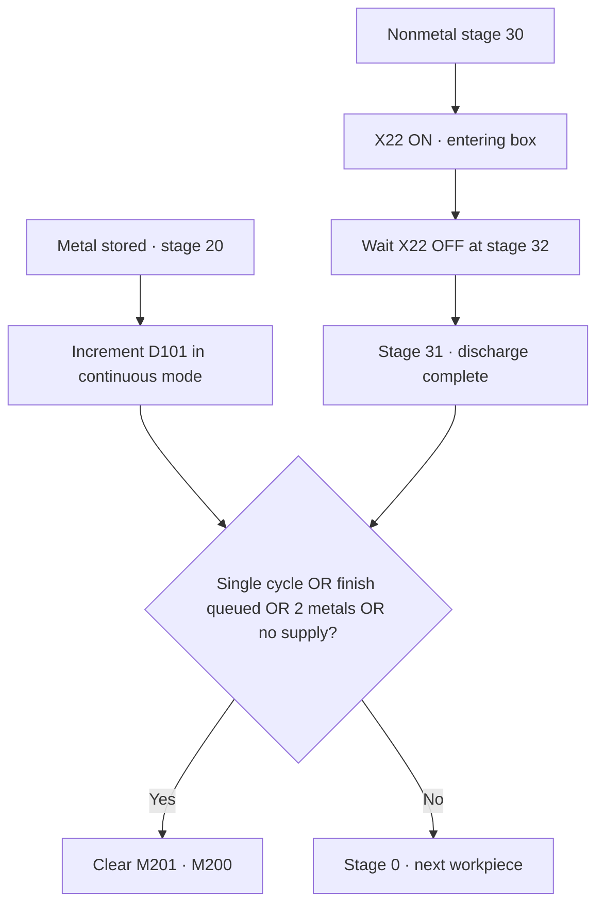

[Contents](GUIDE.en.md) · [← Pickup/storage](logic-05-storage.en.md) · [Pause/recovery →](logic-07-pause.en.md)

# 6. Discharge and finish

**Operation flow**

Finish workpiece → check count/finish conditions → stop or next workpiece

> **Goal**
> For nonmetal, wait for the box-passage sensor to turn ON, then OFF.
> Finish queues a stop after completing the current workpiece.

### How to draw it

1. D11=30 followed by normally open X22 enters stage 32.
2. D11=32 followed by normally closed X22 enters stage 31.
3. Finish conditions are parallel branches.
4. Split paths across lower rows as shown and join at the common RST M201 on the right.
5. Putting all finish conditions in series incorrectly requires them all ON to stop.

### Checks

 Finish M112 sets M203. Do not directly clear M201 from the button
to interrupt immediately. In continuous mode, increment D101 once per completed metal storage.

---

[Contents](GUIDE.en.md) · [← Pickup/storage](logic-05-storage.en.md) · [Pause/recovery →](logic-07-pause.en.md)
