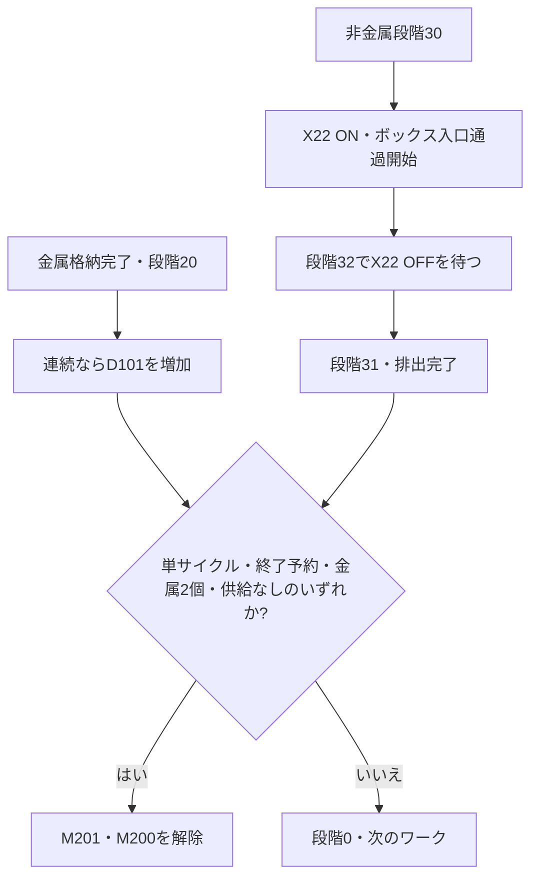

[目次](GUIDE.ja.md) · [← 吸着・格納](logic-05-storage.ja.md) · [一時停止・復帰 →](logic-07-pause.ja.md)

# 6. 排出と終了

**動作の流れ**

ワーク処理完了 → 数量・終了条件確認 → 停止または次のワーク

> **目標**
> 非金属はボックス通過センサーのON→OFFを待ちます。
> 終了ボタンは現在のワーク完了後の停止を予約します。

### 作成方法

1. D11=30の後のX22 a接点で段階32に入ります。
2. D11=32の後のX22 b接点で段階31に入ります。
3. 終了条件は並列分岐です。
4. 写真のように経路を下の行へ分け、右の共通RST M201へまとめます。
5. すべてを直列にすると、全条件が同時にONでなければ停止しない誤回路になります。

### 確認

 終了M112はM203をSETします。ボタンでM201を直接解除して
即時中断しません。連続では金属格納完了ごとにD101を1回増やします。

---

[目次](GUIDE.ja.md) · [← 吸着・格納](logic-05-storage.ja.md) · [一時停止・復帰 →](logic-07-pause.ja.md)
