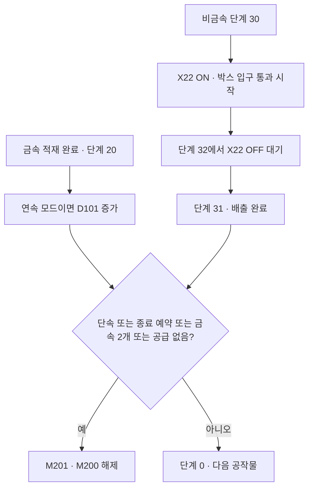
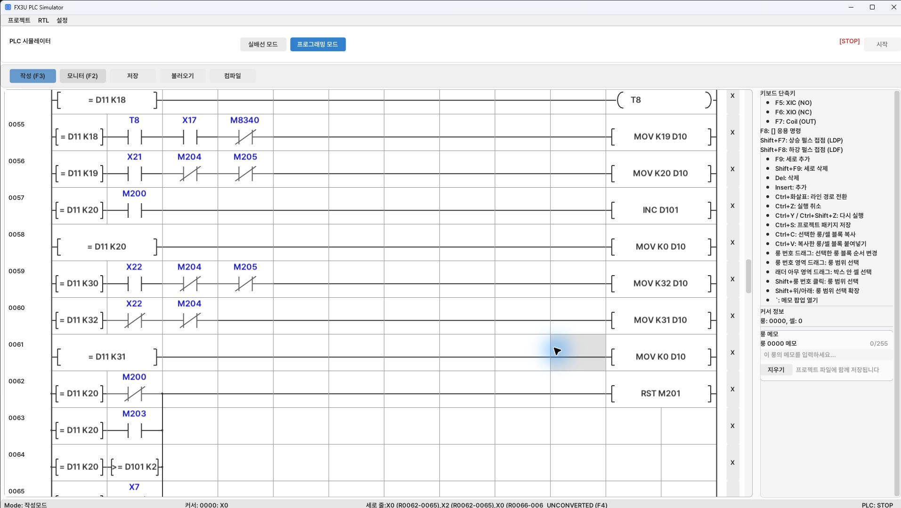

[목차](GUIDE.md) · [← 흡착·적재](logic-05-storage.md) · [일시정지·복귀 →](logic-07-pause.md)

# 6. 배출·종료

**동작 흐름**

공작물 처리 완료 → 수량·종료 조건 확인 → 정지 또는 다음 공작물

> **목표**
> 비금속은 박스 통과 센서가 켜졌다가 꺼지는 순서를 기다린다.
> 종료 버튼은 현재 공작물을 마무리한 뒤 정지하도록 예약한다.

### 이렇게 그리세요

1. D11=30 뒤 X22 A접점으로 단계 32에 들어간다.
2. D11=32 뒤 X22 B접점으로 단계 31에 들어간다.
3. 종료 조건은 병렬 분기다.
4. 사진처럼 각 경로를 아래 행으로 나누고 오른쪽의 공통 RST M201로 합친다.
5. 모든 종료 조건을 직렬로 만들면 조건이 동시에 켜져야 멈추는 잘못된 회로가 된다.

### 완료 확인

 종료 M112는 M203을 SET한다. M201을 버튼에 직접 연결해
즉시 끊지 않는다. 연속 모드에서 금속 적재 완료 때 D101이 한 번 증가해야 한다.

---

[목차](GUIDE.md) · [← 흡착·적재](logic-05-storage.md) · [일시정지·복귀 →](logic-07-pause.md)
