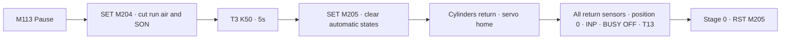
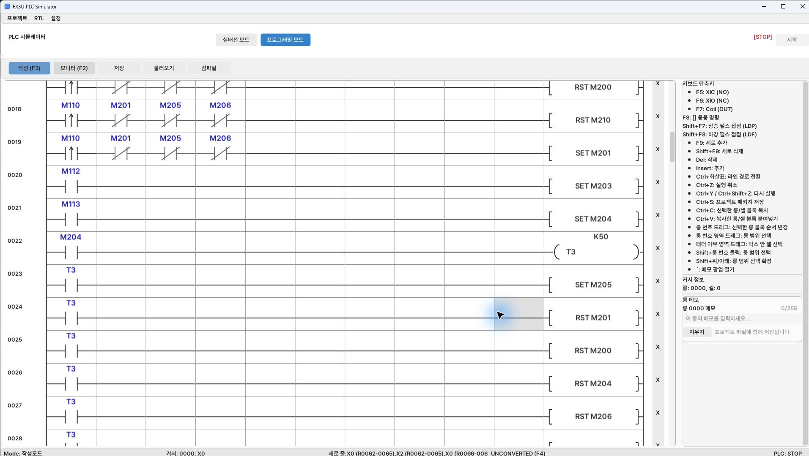
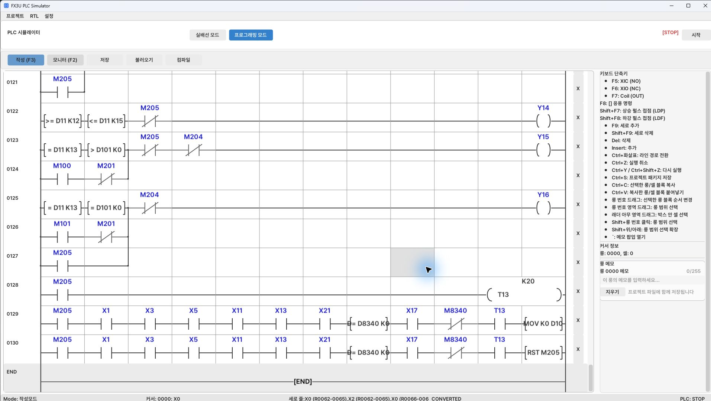
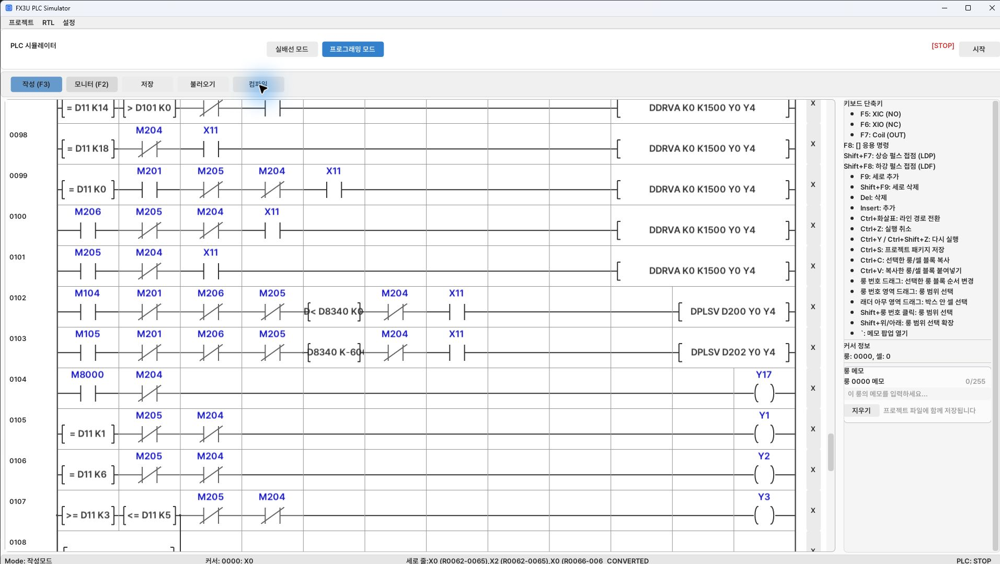

[Contents](GUIDE.en.md) · [← Discharge/finish](logic-06-finish.en.md) · [Trial run →](06-checks.en.md)

# 7. Pause and recovery

**Operation flow**

Pause → 5s → initialize → verify all returns → ready to restart

> **Goal**
> Latch the pause request and start initialization after 5s.
> Completion requires all cylinder return sensors and servo home.

### How to draw it

1. Draw M113→SET M204 and M204→OUT T3 K50 first.
2. With T3 completion, add SET M205 and RST rows for each run state.
3. Omit normally closed M204 from vacuum Y14 to retain the workpiece during pickup pauses.

The last two rows place M205, X1/X3/X5/X11/X13/X21, D8340=0, X17,
normally closed M8340, and T13 in series. Outputs are MOV K0 D10 and RST M205.
If any sensor is OFF, initialization waits rather than completes.

### Checks

 Check initialization after pause and restarting afterward.
`CONVERTED` in the photo means compilation succeeded, not that the complete equipment trial passed.

---

[Contents](GUIDE.en.md) · [← Discharge/finish](logic-06-finish.en.md) · [Trial run →](06-checks.en.md)
