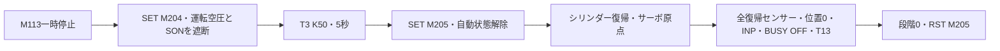

[目次](GUIDE.ja.md) · [← 排出・終了](logic-06-finish.ja.md) · [試運転 →](06-checks.ja.md)

# 7. 一時停止と復帰

**動作の流れ**

一時停止 → 5秒 → 初期化 → 全復帰条件確認 → 再開始準備

> **目標**
> 一時停止要求を保持し、5秒後に初期化を開始します。
> 初期化完了には全シリンダーの復帰センサーとサーボ原点が必要です。

### 作成方法

1. まずM113→SET M204、M204→OUT T3 K50を作ります。
2. T3完了を条件にSET M205と各運転状態のRST行を追加します。
3. 真空Y14にはM204のb接点を入れず、吸着中に一時停止してもワークを保持します。

最後の2行はM205、X1/X3/X5/X11/X13/X21、D8340=0、X17、
M8340のb接点、T13をすべて直列にします。右はMOV K0 D10とRST M205です。
1つでもセンサーがOFFなら、初期化を終了せず待ちます。

### 確認

 一時停止後の初期化と、その後の再開始まで確認します。
写真の `CONVERTED` はコンパイル成功であり、設備全体の試運転成功ではありません。

---

[目次](GUIDE.ja.md) · [← 排出・終了](logic-06-finish.ja.md) · [試運転 →](06-checks.ja.md)
