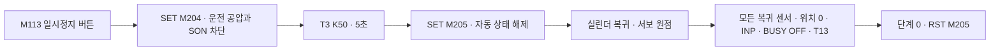

[목차](GUIDE.md) · [← 배출·종료](logic-06-finish.md) · [시운전 확인 →](06-checks.md)

# 7. 일시정지·복귀

**동작 흐름**

일시정지 → 5초 → 초기화 → 모든 복귀 조건 확인 → 재시작 준비

> **목표**
> 일시정지 요청을 기억하고 5초 뒤 초기화를 시작한다.
> 초기화 완료는 모든 실린더 복귀 센서와 서보 원점이 만족돼야 한다.

### 이렇게 그리세요

1. M113→SET M204, M204→OUT T3 K50을 먼저 그린다.
2. T3 완료를 조건으로 SET M205와 각 운전 상태의 RST 행을 추가한다.
3. 진공 Y14에는 M204 B접점을 넣지 않아 흡착 중 일시정지해도 공작물을 유지한다.

마지막 두 행은 M205, X1/X3/X5/X11/X13/X21, D8340=0, X17,
M8340 B접점, T13을 모두 직렬로 묶는다. 오른쪽은 MOV K0 D10과 RST M205다.
어떤 센서 하나가 꺼져 있으면 초기화를 끝내지 않고 기다린다.

### 완료 확인

 일시정지 후 초기화, 그 뒤 재시작까지 확인한다.
사진 속 `CONVERTED`는 컴파일 성공을 뜻하며, 설비의 전체 시운전 성공을 뜻하지 않는다.

---

[목차](GUIDE.md) · [← 배출·종료](logic-06-finish.md) · [시운전 확인 →](06-checks.md)
