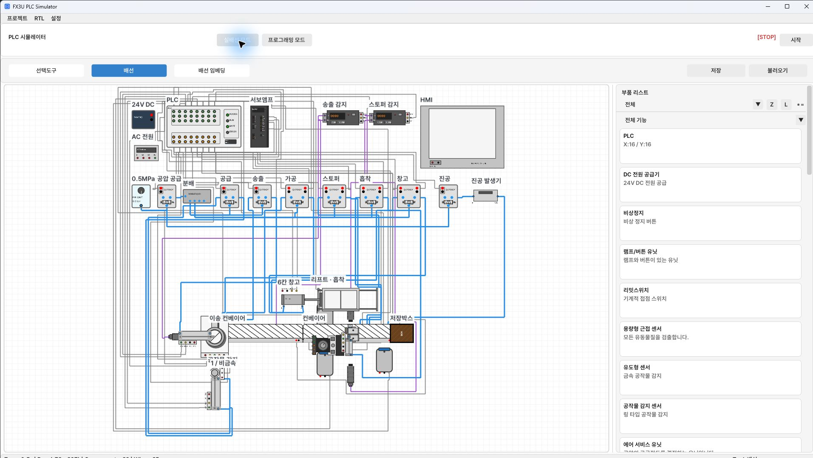

[使い方の目次](README.ja.md) · [2. プロジェクトの保存と読み込み →](02-projects.ja.md)

# 1. 起動と画面の見方

まずは **実配線で部品を配置・接続 → プログラミングでラダーを作成 → コンパイル → 開始** の順で進めます。
RTLは新しいVerilog部品を作るための拡張機能です。最初は基本的なPLC実習から始めて構いません。

## 実行ファイルの選択

| 入手したファイル | 起動方法 |
| --- | --- |
| EXEまたはMSIインストーラー | インストール後にPLC Simulatorを起動 |
| インストール不要ZIP | フォルダー全体を展開し、中の `PLCSimulator.exe` を実行 |
| 単一EXE | そのEXEを実行。必要なファイルはローカルキャッシュに自動展開されます |

ZIP内のEXEだけを別のフォルダーに移すと、DLL・フォント・リソースが見つからなくなる場合があります。
実習プロジェクトはドキュメントなど、自分で保存できる場所に置きます。
配布ファイルの名前はバージョンによって異なる場合があります。

## 画面の5つの領域

*実配線画面のメニュー・ツール・部品一覧。配置された設備は産業技師試験の例です*

| 場所 | 役割 | 最初の操作 |
| --- | --- | --- |
| 最上部のメニュー | プロジェクトの保存・読み込み、RTL、設定 | 保存には **プロジェクト** メニューを使用 |
| モードボタン | 実配線／プログラミングの切り替え | 部品配置は **配線** |
| モードの下のツール | 選択・配線、または編集・モニター・コンパイル | 作業に合うツールを選択 |
| 中央のキャンバス | 部品・配線、またはラダーの編集 | ピンやセルを選べる倍率まで拡大 |
| 右側 | 部品一覧、またはプログラミング情報 | 部品フィルター、Z・L、選択セルを確認 |

右上の **STOP / RUN** は運転状態です。プログラミングの **編集／モニター** は編集・観察の状態です。
モニターボタンと開始ボタンは役割が異なります。

## 最初の作業手順

1. **配線** を選びます。
2. 右側の部品一覧から部品をキャンバスへドラッグします。
3. **配線** を選び、ピン同士を接続します。
4. **プログラミング → 編集（F3）** に移ります。
5. 接点とコイルを入力し、**コンパイル** を押します。
6. エラーがなければ右上の **実行** を押します。
7. **モニター（F2）** で条件と出力を確認します。
8. **プロジェクト → プロジェクトを保存…** で保存します。

---

[使い方の目次](README.ja.md) · [2. プロジェクトの保存と読み込み →](02-projects.ja.md)
