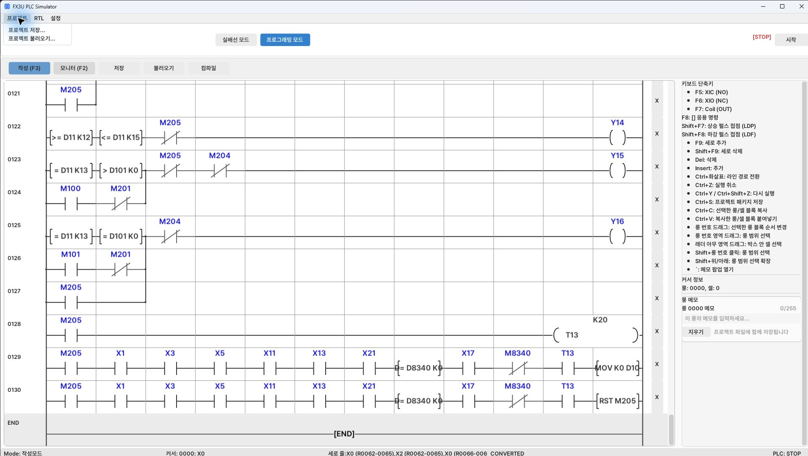

[使い方の目次](README.ja.md) · [← 1. 起動と画面の見方](01-start.ja.md) · [3. 部品の検索・配置・名前表示 →](03-components.ja.md)

# 2. プロジェクトの保存と読み込み

実習全体を続けて編集するには、**`.plcproj` 統合プロジェクト** として保存します。
実配線のJSON保存とプログラミングのCSV保存は、それぞれの領域を個別に保存する機能です。

## ファイルと読み込み場所

| ファイル | 内容 | 読み込み場所 |
| --- | --- | --- |
| `.plcproj` | 部品・配線・ラダー・HMI設定・レイヤー・プロジェクトのRTLデータ | **プロジェクト → プロジェクトを読み込み…** |
| `.json` | 実配線レイアウトとその設定 | **配線 → 読み込み** |
| `.csv` | ラダープログラム | **プログラミング → 読み込み** |
| `.plccomp` | 再利用するRTL部品パッケージ | **RTLライブラリ → 部品をインポート** |

*統合保存・読み込みがあるプロジェクトメニュー*

## 実習全体の保存

1. 上部の **プロジェクト → プロジェクトを保存…** を選びます。`Ctrl+S` でも同じ保存画面を開けます。
2. 保存先のフォルダーを選びます。
3. `button_lamp_01.plcproj` など、分かりやすい名前を入力します。
4. 保存します。既存ファイルを上書きする場合は、選択したファイル名を確認します。
5. 重要な変更の前には、`button_lamp_02.plcproj` など別名でも保存します。

## 再度開いて作業を続ける

1. まず現在の作業を保存します。
2. **プロジェクト → プロジェクトを読み込み…** を選びます。
3. `.plcproj` ファイルを選びます。
4. 実配線で部品・配線・HMI設定を確認します。
5. プログラミングでラダーも読み込まれたことを確認します。
6. コンパイル状態を確認し、変更した場合や必要な場合は再コンパイルします。
7. 運転開始前に、ワークの位置と原点状態を確認します。

プロジェクトの読み込みは、現在の作業に部品を追加する操作ではなく、
そのファイルに保存された実習を開く操作です。

## 配置またはラダーだけを保存する場合

実配線ツールの **保存** はJSONレイアウトを保存します。ラダーまで保存したことにはなりません。
プログラミングツールの **保存** はCSVです。配線は含まれません。

産業技師ガイドの **配置専用JSON** も、部品配置から練習するためのファイルです。
読み込むだけで電源配線・制御配線・HMI・ラダーが完成するわけではありません。

---

[使い方の目次](README.ja.md) · [← 1. 起動と画面の見方](01-start.ja.md) · [3. 部品の検索・配置・名前表示 →](03-components.ja.md)
