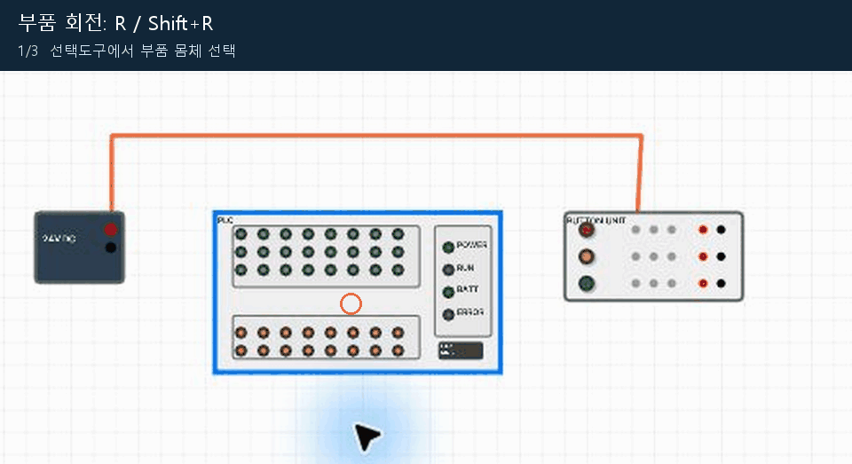
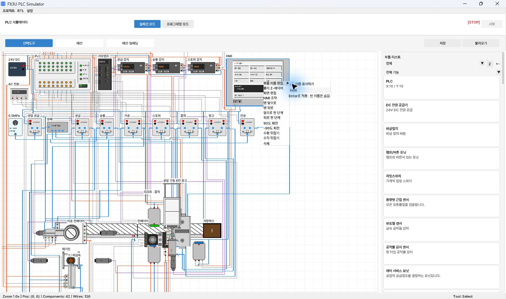

[使い方の目次](README.ja.md) · [← 2. プロジェクトの保存と読み込み](02-projects.ja.md) · [4. 電気・空圧・光の配線 →](04-wiring.ja.md)

# 3. 部品の検索・配置・名前表示

部品は右側の一覧で探します。フィルターは **資格** と **機能** に分かれています。
配置後は選択ツールで位置を調整します。

## 必要な部品を探す

1. 一覧上部の資格フィルターを開きます。
2. 一般実習は **すべて**、試験練習は **自動化設備産業技師** など該当する項目を選びます。
3. その下の機能フィルターを開きます。
4. 電源・制御・空圧・センサーなど、必要な項目に絞ります。
5. 部品が見つからなければ、両方のフィルターを **すべて／全機能** に戻します。

*資格フィルターを開く画面*

## 部品の配置と移動

1. 一覧の部品カードをキャンバスへドラッグします。
2. **選択ツール** を押します。配線ツールのままピンをクリックすると接続操作が始まる場合があります。
3. 部品の本体をクリックして選択し、ドラッグで移動します。
4. 空白部分で長方形をドラッグすると複数の部品を選択できます。
5. Ctrlを押しながら部品をクリックすると、選択を追加・解除できます。
6. 選択した部品を移動します。配線済みの場合は移動後の接続経路も確認します。

PLC・電源・駆動部を密集させると、ピンの選択や動作の観察が難しくなります。
電源・PLCは上、駆動部は下に置き、ホースや配線を通す余白を確保します。

## 拡大・縮小と画面移動

| 操作 | 結果 |
| --- | --- |
| マウスホイール／トラックパッドのピンチ | 拡大・縮小 |
| 中ボタンを押してドラッグ | 画面移動 |
| Alt＋右ボタンドラッグ | 画面移動 |
| Shift＋ホイール | 横方向に移動 |
| トラックパッドの2本指スクロール | 画面移動 |

ピンを選ぶ際は名前が読める倍率まで拡大します。トラックパッドの2本指スクロールは
ホイールの拡大とは別の移動操作になる場合があるため、画面下部のZoom値を確認します。

## 回転・反転・削除

1. 選択ツールで部品を選びます。
2. `R` は90度回転、`Shift+R` は逆方向に回転します。
3. 本体のダブルクリックメニューでも回転・左右反転・上下反転を選べます。
4. 削除するには部品を選び、`Delete` を押します。
5. 編集を戻すには `Ctrl+Z`、やり直すには `Ctrl+Y` または `Ctrl+Shift+Z` を押します。

*PLC部品を選び、R・Shift+Rで回転*

回転するとロッドの向きとピン位置も変わるため、配線と機械動作の方向を再確認します。

## キャンバスに文字を表示する

部品の説明用ラベルには **部品名表示** を使います。

1. 選択ツールで部品の本体をダブルクリックします。
2. **部品名を編集** を開きます。
3. `供給シリンダー`、`加工検出 X2` などの名前を入力します。
4. Enterで適用します。
5. 同じメニューで **名前を表示** をオンにします。
6. 名前を空にするか表示チェックを外すと、ラベルを非表示にできます。

*部品名編集の名前表示。産業技師設備のメニュー例*

HMI画面内の文字は、別途 **画面編集 → ＋固定文字** で作ります。
部品名とHMIウィジェットの文字は別々の設定です。

---

[使い方の目次](README.ja.md) · [← 2. プロジェクトの保存と読み込み](02-projects.ja.md) · [4. 電気・空圧・光の配線 →](04-wiring.ja.md)
