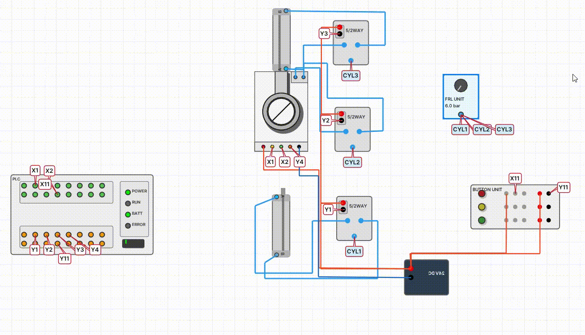

[사용법 목차](README.md) · [← 3. 부품 찾기·배치·이름 표시](03-components.md) · [5. 첫 실습: 버튼으로 램프 켜기 →](05-first-practice.md)

# 4. 전기·공압·광 배선

도구는 **배선** 하나입니다. **시작 핀에 따라 전기선·공압 호스·광 연결 타입이 자동으로 정해집니다.**
선 색상보다 핀 이름과 연결 타입을 먼저 확인합니다.

## 선 한 가닥 연결

1. **실배선 모드 → 배선**을 선택합니다.
2. 시작 핀을 클릭합니다. 핀이 밀집한 부품은 먼저 확대합니다.
3. 선을 꺾을 위치의 빈 공간을 클릭해 경유점을 만듭니다.
4. 다음 경유점도 같은 방식으로 만듭니다.
5. 도착 핀을 클릭해 연결을 완료합니다.
6. 잘못된 핀으로 시작했다면 연결 중 오른쪽 클릭으로 취소하고 다시 시작합니다.
7. 양 끝의 핀 이름과 경로를 확인합니다.

*24V → 버튼 COM 연결: 시작 핀·경유점 두 개·도착 핀의 실제 조작 단계*

경유점은 지나갈 길입니다. 다른 선과 화면에서 교차했다고 접속점이 만들어지지는 않습니다.
실제 연결은 부품 핀의 연결 관계로 확인합니다.

## 전원과 제어선을 분리해서 작업

| 단계 | 연결 예 | 확인할 점 |
| --- | --- | --- |
| 전원 | DC 24V → 센서 24V, DC 0V → 센서 0V | 두 선을 모두 연결 |
| 입력 | 센서 SIG/FWD/REV → PLC X | 실제 래더의 입력 주소와 일치 |
| 출력 | PLC Y → 밸브 코일/드라이버 제어 핀 | 구동 전원과 귀환선도 필요 |
| 공압 | FRL OUT → 밸브 P → 실린더 A/B | 공급·작동·배기 핀 구분 |
| 광 | 증폭부 TX/RX → 송신/수신 헤드 | 전기 SIG와 광 포트를 구분 |

*24V와 0V를 각각 연결한 실제 전원 배선 예*

*사진의 대상은 서보앰프입니다. 다른 부품도 24V와 0V를 각각 확인하는 순서는 같습니다.*

## PLC 입력·출력 모드 확인

1. 선택도구에서 PLC 몸체를 더블클릭합니다.
2. 입력 모드 **Sink / Source**, 출력 모드를 확인합니다.
3. 선택한 모드에 맞춰 공급 전압과 귀환 경로를 연결합니다.
4. 출력 모드를 바꾸면 밸브·램프·드라이버 배선도 함께 검토합니다.

아래 첫 실습은 **입력 Sink / 출력 Source** 기준입니다. 모드가 다른 상태에서 같은 배선을
그대로 따라 하면 입력 또는 출력이 동작하지 않을 수 있습니다.

## 배선 정돈과 태그

전원선은 위쪽, 제어선은 PLC 주변, 공압 호스는 구동부 아래쪽처럼 경로를 나누면 읽기 쉽습니다.
부품 본체와 이름표를 가로지르는 긴 대각선보다 여백을 이용한 직각 경로를 사용합니다.

긴 연결을 줄여 표시하려면 **배선 임베딩**을 선택하고 기존 배선을 클릭합니다.
태그 이름과 색상을 설정합니다. 태그는 기존 연결의 표시 방법이며 별도의 전원이나 신호를 생성하지 않습니다.
태그 제거는 해당 태그/배선에서 **Alt + 오른쪽 클릭**을 사용할 수 있습니다.
실제 연결 경로를 확인할 때는 태그를 풀어 확인합니다.

*배선 임베딩으로 긴 연결을 간단히 표시하기*

## 수정 후 확인

선택·삭제·실행 취소로 잘못된 연결을 정리합니다. 핀 옆에 다른 핀이 붙어 있으면
클릭이 이웃 핀에 잡힐 수 있으므로, 선 끝이 어느 핀에 닿았는지 확대해 확인합니다.

---

[사용법 목차](README.md) · [← 3. 부품 찾기·배치·이름 표시](03-components.md) · [5. 첫 실습: 버튼으로 램프 켜기 →](05-first-practice.md)
