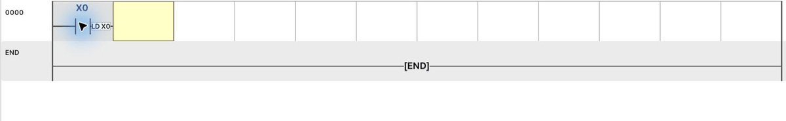

[使い方の目次](README.ja.md) · [← 5. 最初の実習：ボタンでランプを点灯](05-first-practice.ja.md) · [7. モニターでラダー動作を確認 →](07-monitoring.ja.md)

# 6. ラダーの作成と編集

ラダーは **左側の条件が成立すると右側の出力を実行する** と読みます。
直列は「かつ」、並列は「または」、斜線付き接点は「OFFのときに通る」です。

## アドレスの読み方

| 表記 | 用途 | 例 |
| --- | --- | --- |
| X | 物理入力 | `X0`：ボタンやセンサー |
| Y | 物理出力 | `Y0`：ランプ・バルブ・ドライバー |
| M | 内部状態 | `M100`：HMI要求、`M200`：運転状態 |
| D | 数値データ | `D100`：速度設定値 |
| T / C | タイマー／カウンター | 完了接点と現在値を使用 |
| K | 10進定数 | `K10`：数値10 |

X/Yは8進アドレスです。`X7` の次は `X10` で、`X8` は使いません。
MとDは10進アドレスです。画面上の物理ピンの範囲と内部メモリーの範囲は区別します。

## 接点の入力

1. **編集（F3）** でセルをクリックします。
2. a接点は `F5`、b接点は `F6` を押します。
3. アドレスを入力し、Enterで確定します。
4. 同じ行の次のセルに条件を入れると直列条件になります。
5. 既存の命令を選びEnterを押すと修正できます。

*F5を押し、X0を入力してEnterを押します。*

## コイル・応用命令の入力

空のセルで `F7` → `Y0` → Enterと操作してコイルを入力します。
応用命令は `F8` → 命令とオペランドを空白で区切って入力 → Enterです。

例えば `OUT T0 K10` は1秒待つタイマーです。
`OUT`、`T0`、`K10` の間に空白を入れます。実習は [1秒後にランプを点灯](reference-basic-circuits.ja.md#2-1초-뒤-램프-켜기) を参照してください。

*F8を押し、OUT T0 K10を入力してEnterを押します。*

*X0接点の後にタイマーを入力し、下の行にT0接点とY0コイルを入れます。*

## 状態を保持する場合

| 命令 | 動作 | 用途 |
| --- | --- | --- |
| OUTコイル | 毎スキャンの条件に従いON/OFF | ボタンを押している間だけ出力 |
| `SET M200` | 条件成立でONを保持 | 自動運転開始 |
| `RST M200` | ON状態を解除 | 停止・初期化 |
| `MOV K100 D100` | 数値をコピー | 速度・状態値の設定 |

SETには解除条件も設計します。同じY出力を複数のOUTコイルで制御すると、
後の回路が前の結果を上書きする場合があるため、出力条件をまとめます。

## 行・セル・分岐の編集

1. `Insert` でENDの前に回路を追加します。
2. セルをクリックするか方向キーで移動します。右側の **カーソル情報** で選択位置を確認します。
3. 長方形のドラッグで複数セルを選択します。回路番号部分は行の選択に使います。
4. `Ctrl+C / Ctrl+V` で選択範囲をコピー・貼り付けします。
5. `Delete` で選択範囲を消します。ENDは最後の終了回路として残します。
6. 行番号をドラッグして選択した行の順序を変更できます。
7. `Ctrl+Z / Ctrl+Y` で編集を戻す・やり直す操作を行います。

**F9は横接続線、Shift+F9は縦接続の追加です。**
横接続線は長さを入力し、縦接続は選択列から下へつなぐ回路数を入力します。
縦接続は最初の列やENDには追加しません。接続先の下側の回路を先に作ります。

並列回路は両端の接続を確認します。別の行に条件を書いても縦接続がなければ、
同じOR分岐にはなりません。実際の並列回路は [産業技師のラダー画像](../exam03/logic-02-manual.ja.md) を参照してください。

## 回路メモ

回路を選び、バッククォートキー `` ` `` でメモ画面を開きます。
`供給前進完了 → 加工開始` など、条件と目的を書いておくと大きなプログラムも読み返しやすくなります。
メモはプロジェクトと一緒に保存されます。

## コンパイル

1. 修正後に **コンパイル** を押します。編集モードでは `F4` でもコンパイルできます。
2. 失敗したら最初のエラーの命令・アドレス・オペランドを確認します。
3. 修正して再コンパイルします。
4. 成功を確認し、**実行** を押します。

*1行目は1秒待機、2行目は待機完了後にY0をオンにします。*

**次の練習：** [開始・停止の保持、タイマー、カウンター、HMI設定値変更](reference-basic-circuits.ja.md) を
1回路ずつ入力して確認してください。

---

[使い方の目次](README.ja.md) · [← 5. 最初の実習：ボタンでランプを点灯](05-first-practice.ja.md) · [7. モニターでラダー動作を確認 →](07-monitoring.ja.md)
