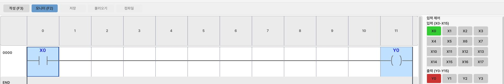
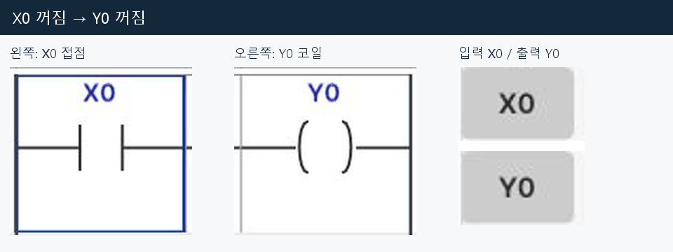
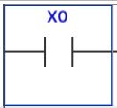
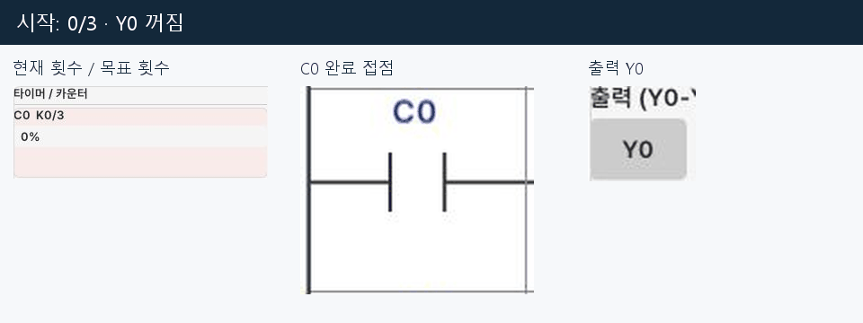

[사용법 목차](README.md) · [← 6. 래더 작성과 편집](06-programming.md) · [8. HMI 조작과 화면 편집 →](08-hmi.md)

# 7. 모니터로 래더 동작 보기

**모니터는 내가 만든 래더에서 어떤 입력과 출력이 켜졌는지 보는 화면입니다.**
처음에는 X0 하나로 Y0를 켜는 회로부터 살펴봅니다. ON은 켜짐, OFF는 꺼짐입니다.

## 1. 배선 없이 한 줄 회로 시험하기

현재 프로젝트가 있다면 먼저 저장하고 별도 실습으로 진행하세요.
이 단계에서는 부품이나 배선 없이 **래더만** 시험합니다.

1. **프로그래밍 모드 → 작성(F3)**을 누릅니다.
2. 왼쪽 첫 칸을 선택하고 **F5 → X0 → Enter**로 접점을 넣습니다.
   END만 있는 화면에서도 END의 왼쪽 첫 칸에서 F5를 누르면 새 회로가 생깁니다.
3. 다음 빈 칸에서 **F7 → Y0 → Enter**로 코일을 넣습니다.
4. **컴파일**을 누릅니다. 아래에 **CONVERTED**가 나오면 준비된 것입니다.
5. 오른쪽 위는 **STOP**으로 두고 **모니터(F2)**를 누릅니다.

*왼쪽 X0는 입력 조건, 오른쪽 Y0는 출력입니다. 오른쪽 ‘입력 제어’에서 시험할 X를 누릅니다.*

6. 오른쪽 **입력 제어**에서 **X0**를 한 번 클릭합니다.
7. X0 접점과 Y0 코일에 연한 파란색이 생기고, 오른쪽 **Y0**가 빨강으로 바뀝니다.
8. **X0**를 다시 클릭합니다. X0와 Y0가 꺼집니다.

**오른쪽 X 버튼은 한 번 클릭하면 켜지고, 다시 클릭하면 꺼집니다.**
누른 채로 유지할 필요가 없습니다. Y 버튼은 결과를 보여주는 표시입니다.
Y0를 클릭해 출력을 켜는 방식은 아닙니다.

*같은 화면의 접점·코일·입출력 표시를 각각 확대했습니다.*

## 2. 화면에서 무엇을 읽어야 하나요?

| 위치 | 읽는 방법 |
| --- | --- |
| 접점·코일의 연한 파란색 배경 | 그 조건이나 출력이 활성화된 상태 |
| 오른쪽 입력 X의 초록색 | 입력 ON. 회색이면 OFF |
| 오른쪽 출력 Y의 빨간색 | 출력 ON. 회색이면 OFF |
| 진한 파란색 테두리의 네모 | 지금 선택한 칸. 클릭하거나 방향키로 이동 |

**선택 네모와 켜짐 표시는 다릅니다.**
X0를 꺼도 선택한 칸의 테두리는 남습니다. 테두리만 보고 ON이라고 판단하지 마세요.
마우스를 올린 버튼은 색이 달라 보일 수 있으니, 마우스를 옆으로 옮겨서 읽습니다.

*선택 테두리는 있지만 안쪽 배경은 흰색입니다. X0는 OFF입니다.*

오른쪽 목록이 길어지면 **오른쪽 창 안에서 스크롤**합니다.
아래쪽 회로를 보려면 **가운데 래더 영역 안에서 스크롤**합니다.

## 3. 타이머 값 읽기

[1초 뒤 램프 켜기](reference-basic-circuits.md#2-1초-뒤-램프-켜기)의 두 줄 회로를 입력합니다.
**컴파일 → 모니터(F2)**를 누르고, 오른쪽 X0를 켭니다.

오른쪽 위 **타이머 / 카운터**에서 T0를 봅니다.
`T0 K0/10`은 **현재 0, 목표 10**이라는 뜻입니다.
이 예제의 T0는 0.1초씩 세므로, 10이 되면 1초가 지난 것입니다.

*시작 전은 0/10과 0%, 완료 후는 10/10과 100%입니다. 막대는 진행 정도입니다.*

1. X0를 켜두면 숫자와 진행 막대가 올라갑니다.
2. 목표 10에 도달하면 아래 줄의 **T0 접점**과 **Y0**가 켜집니다.
3. X0를 끄면 T0 값이 0으로 돌아가고 Y0도 꺼집니다.

코일 아래의 `T0=10 K10=10`도 **현재값 10, 설정값 10**을 보여줍니다.
숫자를 클릭해서 시간을 바꾸는 것은 아닙니다. 작성 모드에서 명령을 수정합니다.

## 4. 카운터 값 읽기

[세 번 입력하면 램프 켜기](reference-basic-circuits.md#3-세-번-입력하면-램프-켜기)의 세 줄 회로를 입력합니다.
**컴파일 → 모니터(F2)**를 누릅니다.

1. X0를 켰다가 끕니다. 오른쪽 C0가 **1/3**이 됩니다.
2. 다시 켰다가 끕니다. **2/3**이 됩니다.
3. 세 번째로 켜면 **3/3**이 되고 **Y0**가 켜집니다.
4. X0를 끕니다. 카운터는 횟수를 기억하므로 Y0는 계속 켜져 있습니다.
5. X1을 켜면 **0/3**으로 초기화되고 Y0가 꺼집니다. X1도 다시 꺼둡니다.

**X0를 계속 켜두면 한 번만 셉니다.** 다음 횟수를 세려면 껐다가 다시 켜야 합니다.

*현재 횟수와 Y0를 함께 보세요. 세 번이면 Y0가 켜지고, X1으로 초기화하면 꺼집니다.*

## 5. 배선한 버튼·센서의 상태 보기

앞에서는 오른쪽 X 버튼으로 래더만 시험했습니다.
[버튼·램프 실배선 실습](05-first-practice.md)을 만들었다면 다음 순서로 실제 부품을 시험합니다.

1. 래더를 컴파일하고 오른쪽 위 **시작**을 누릅니다. **RUN**이 표시됩니다.
2. **실배선 모드 → 선택도구**에서 배선한 버튼을 누릅니다.
3. **프로그래밍 모드 → 모니터(F2)**에서 X0와 Y0를 읽습니다.
4. 이때 오른쪽 X 버튼은 비활성화됩니다. 실배선의 버튼·센서에서 입력을 바꿉니다.

| 표시 | 이번 실습에서의 뜻 |
| --- | --- |
| STOP + 모니터(F2) | 오른쪽 X 버튼으로 래더만 시험 |
| RUN + 모니터(F2) | 실제 배선된 부품의 입력·출력 관찰 |
| 작성(F3) | 래더 입력·수정 |

래더만 시험할 때는 캔버스의 실물 램프까지 켜지는지 보는 단계가 아닙니다.
실물 램프 동작은 배선을 마치고 RUN에서 확인하세요.

## 6. 수정하고 다시 시험하기

1. RUN 중이라면 오른쪽 위 **중지**를 누릅니다.
2. **작성(F3)**을 누릅니다. 래더만 시험 중이었다면 이 버튼으로 시험을 끝냅니다.
3. 수정할 접점이나 명령을 선택하고 **Enter**를 누릅니다.
4. 값을 수정하고 Enter로 확정한 뒤 **다시 컴파일**합니다.
5. 래더만 시험할 때는 모니터(F2), 실배선을 시험할 때는 시작을 누릅니다.

## 7. 반응이 없으면 이 순서로 보기

| 증상 | 먼저 할 일 |
| --- | --- |
| 오른쪽 입력 제어가 안 보임 | 모니터(F2)를 누르고 오른쪽 창을 스크롤 |
| X0 버튼을 눌러도 안 바뀜 | RUN이면 실배선 버튼으로 입력. 래더만 시험하려면 중지 |
| X0는 켜지는데 Y0가 안 켜짐 | 주소 X0·Y0와 최신 회로의 컴파일 여부 확인 |
| T0 숫자가 계속 0 | X0를 켠 채로 유지. OUT T0 K10 입력 여부 확인 |
| C0가 한 번만 올라감 | X0를 껐다가 다시 켜기 |
| 초기화 후 카운터가 안 셈 | X1을 꺼둔 뒤 X0 시험 |
| Y0는 켜지는데 실물 램프가 안 켜짐 | RUN과 Y0→램프 배선 확인 |

HMI 편집이나 Z 창에서 일시정지한 상태라면 편집창을 닫거나 일시정지를 해제합니다.
HMI 편집 전부터 STOP이었다면 창을 닫아도 자동으로 RUN이 되지 않습니다.

M·D를 쓰는 회로에서는 오른쪽에 해당 항목도 나타납니다.
M은 기억한 ON/OFF 상태, `D100 = 100`은 D100에 들어 있는 숫자입니다.
처음에는 위의 X0·Y0·T0·C0 실습부터 익히세요.

---

[사용법 목차](README.md) · [← 6. 래더 작성과 편집](06-programming.md) · [8. HMI 조작과 화면 편집 →](08-hmi.md)
