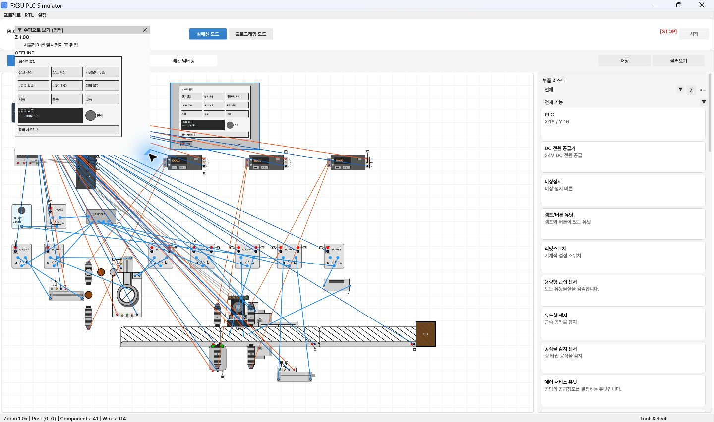
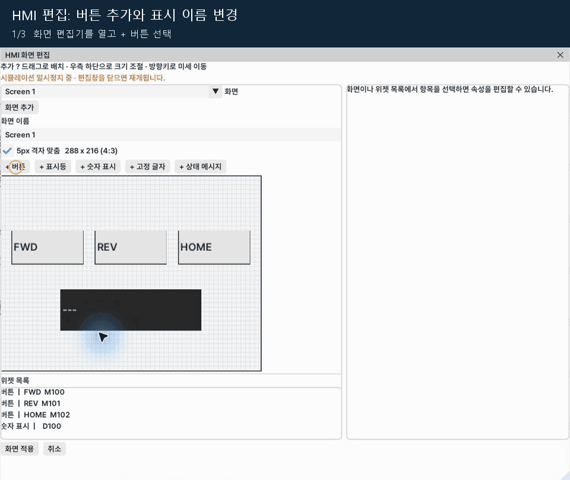
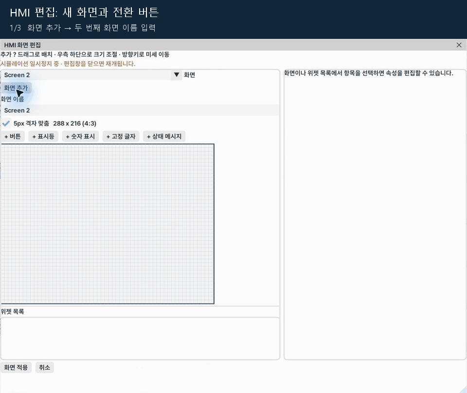

[User guide contents](README.en.md) · [← 7. Observing ladder operation in Monitor](07-monitoring.en.md) · [9. Z layers: physical height and travel range →](09-z-layers.en.md)

# 8. HMI operation and screen editing

HMI separates **using buttons in the operation window** from **creating widgets in the screen editor**.
Do not draw a PLC communication wire. **Connect 24V/0V power** and place one PLC in the exercise.
With two or more PLCs, the current HMI cannot determine its connection target.

## Opening and resizing the operation window

1. Select the **Select** in Wiring.
2. Double-click the HMI body.
3. Select **Operate HMI**.
4. Drag a window edge or the bottom-right corner to resize it.
5. The HMI screen fits inside the resized window while retaining a **4:3** ratio.
6. Press buttons to test them. Momentary buttons are ON only while held.

*Dedicated HMI operation and screen editing menu*

*Enlarged HMI operation window with industrial engineer example widgets*

There is no need to look for ‘Horizontal view’ on the HMI. Use **Operate HMI**.
If buttons do not work, check HMI power, one PLC, compilation, RUN, and editing pause state.

## Opening the screen editor

1. Double-click HMI → **Edit screen**.
2. You can also use **Edit screen** in the HMI operation window.
3. Check that the simulation pause notice appears.
4. Drag the editor's edges to a comfortable size.
5. The preview is on the left, widget list below, and selected widget properties on the right.

*HMI screen editor and pause notice*

Screen coordinates are **288×216**. Resizing the editor does not change widget coordinates.
One HMI currently supports **up to 8 screens and 32 widgets across all screens**.

## Creating a button

1. Select **+ Button** at the top.
2. Select the new widget.
3. Set its label to `Run request` and PLC address to `M100`.
4. Enable **Momentary buttons** (ON only while pressed).
5. Drag it in the preview to position it. Resize with the bottom-right handle.
6. Adjust position/size numerically and use 5px grid snapping.
7. Select **Apply screen**.
8. Add a ladder contact reading M100 and compile before use.

*Selected button properties on the right*

HMI operation buttons use **M addresses**. Give different buttons different M addresses.
Duplicating M addresses for ordinary buttons, even across screens, fails validation.
Use momentary buttons for JOG so releasing the button clears the request.
Buttons send M requests for ladder logic to handle; they do not directly control Y outputs.

*Add a button, select properties, and rename it. M103 is used because other buttons already exist*

## Display widgets

| Widget | Example setting | Role |
| --- | --- | --- |
| Indicator lamp | `M200` or `Y0` | Display a bit's ON/OFF state |
| Numeric display | `D100`, unit `mm/min` | Read numeric data |
| Static text | `Automatic operation` | Display titles/descriptions |
| Status message | Messages corresponding to `D103` | Display text for each status number |

Numeric displays are currently **display-only**. Clicking a value does not enter a new speed.
To change speed, handle an M button request and update D with MOV or another ladder instruction.
**Show when bit is ON** accepts an M/X/Y condition; leave it empty for always visible.

## Second screen and navigation buttons

1. Select **Add screen**.
2. Rename the screen to `Manual operation`.
3. Add a button and enable **Screen switch button**.
4. Select the first screen under **Target screen**.
5. Enter `<- Automatic operation` as the label.
6. On the first screen, create a `Manual operation ->` button targeting the second screen.
7. Apply and test navigation both ways in the HMI operation window.

*Selecting a target screen for navigation*

Navigation buttons use a target screen, so do not assign an M address as for ordinary operation buttons.
Test screen navigation with the HMI connected and ready for operation.

*Adding a second screen and selecting its navigation target*

## Apply, cancel, and save

**Apply screen** updates the HMI. **Cancel** discards the current edits.
Closing the editor releases the editing pause. Save the project separately to keep changes in a file.
After duplicating buttons/lamps, recheck their addresses and positions.

---

[User guide contents](README.en.md) · [← 7. Observing ladder operation in Monitor](07-monitoring.en.md) · [9. Z layers: physical height and travel range →](09-z-layers.en.md)
