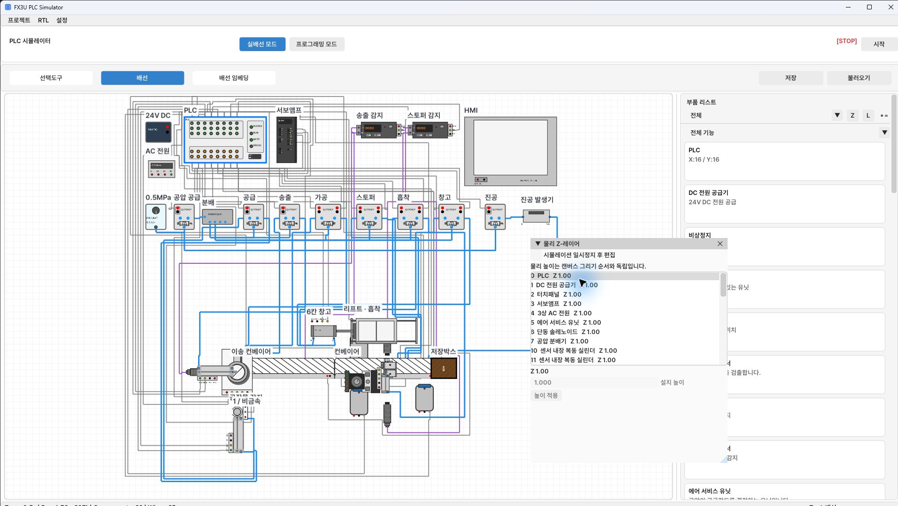

[User guide contents](README.en.md) · [← 8. HMI operation and screen editing](08-hmi.en.md) · [10. L layers: order, groups, and opacity →](10-render-layers.en.md)

# 9. Z layers: physical height and travel range

**Z is physical height.** Overlapping on screen does not cause collision, detection, or storage unless contact heights match.
To change only drawing order, use **L render layers** in the next chapter.

## Opening settings

1. Select **Z** beside the Wiring component list.
2. Select a component in the list.
3. Enable **Pause simulation to edit**. Fields may be disabled until this is checked.
4. Set **installation height** for fixed parts, or **minimum/maximum/initial height** for moving parts.
5. Select **Apply height**.
6. Uncheck pause after editing and test the movement.
7. Save the project.

*Z layer window and installation height*

*The photo shows a fixed-height PLC. Selecting a moving part shows its height range and axis settings.*

You can also open Z settings from a component's double-click menu to edit that component directly.
Values such as `Z 1.00` in the list indicate the current contact height.

## Example ranges

| Component | Minimum | Maximum | Meaning |
| --- | --- | --- | --- |
| Workpiece on conveyor | 1 | 1 | Moves and is detected at Z1 |
| Processing cylinder | 1 | 2 | Lower working height and upper standby height |
| Servo lift | 1 | 3 | Changes between Z1 and Z3 with travel |
| Six-slot storage rack | 1 | 3 | Two slots at each height |

These are **example exercise settings**. Components do not all have to start at absolute Z1.
Set minimum ≤ initial ≤ maximum, and align the heights of interacting workpieces, sensors, and actuators.
Travel includes intermediate heights within the range, not only integer layers.

## Storage slots and height

For a rack set to Z1–3, **slots 1/2 are Z1, 3/4 are Z2, and 5/6 are Z3**.
Raise the lift to the correct level and align horizontally before placing the workpiece.
Screen overlap alone does not place a workpiece on every level at once.

## Servo axis settings

Select a servo lift or another supported component to edit its axis settings.

| Setting | Meaning | When to check |
| --- | --- | --- |
| Pulses per revolution | Pulses for one motor revolution | Pulse count and travel do not match |
| Lead mm/revolution | Linear travel per ball-screw revolution | Speed/distance conversion |
| Stroke mm | Axis travel range | Target position is out of range |
| Maximum speed rev/s | Rotation speed limit | Excessive speed or unexpected travel time |
| Acceleration rev/s² | Rotational acceleration | Starting/stopping behavior |

Height and axis settings have separate Apply buttons. HMI values in mm/min
are not numerically equivalent to rev/s. Align homing and movement command references too.

---

[User guide contents](README.en.md) · [← 8. HMI operation and screen editing](08-hmi.en.md) · [10. L layers: order, groups, and opacity →](10-render-layers.en.md)
