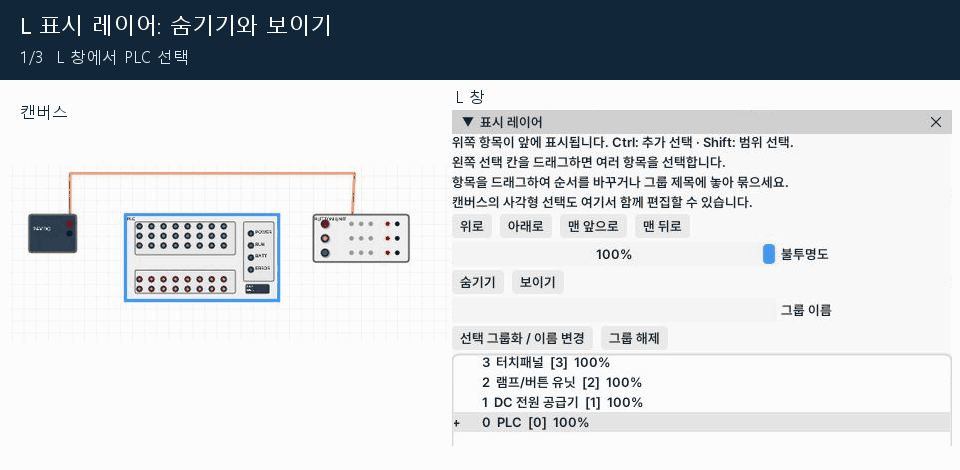

[使い方の目次](README.ja.md) · [← 9. Zレイヤー：実際の高さと移動範囲](09-z-layers.ja.md) · [11. センサー・空圧・モーター・ワーク実習 →](11-mechanics.ja.md)

# 10. Lレイヤー：表示順・グループ・不透明度

**Lは描画順** です。駆動部が他の部品の後ろに隠れる場合に使います。
非表示・不透明度・グループは、物理動作や電気接続を変更しません。

## 画面を開く・選択する

1. 部品一覧の **Zの右にあるL** を押します。
2. 一覧が読みやすいようにウィンドウを移動・拡大します。
3. 対象部品の行をクリックします。
4. Ctrl＋クリックは選択の追加・解除、Shift＋クリックは範囲選択です。
5. 左側の選択欄を上下にドラッグして複数行を選ぶこともできます。
6. キャンバスで長方形選択した複数部品も、この画面でまとめて編集できます。

*L表示レイヤー画面の順序・不透明度・グループ*

一覧の上にある部品が前に描画されます。グループ見出しはまとまりの名前で、
実際の前後関係は部品の順序と行で確認します。

## 前後の順序を変える

1. 前に表示したい部品を選びます。
2. **上へ／下へ** で1段移動するか、**最前面へ／最背面へ** を使います。
3. 行を他の部品の行の前へドラッグして順序を変えることもできます。
4. キャンバスで動作部とワークが見えることを確認します。

例えばコンベヤーの下の光センサーはコンベヤーの後ろに送り、
動作を見たいシリンダーロッドやワークは必要な順序で前に置きます。
複数部品をまとめて移動しても、それらの間の順序は維持されます。

## グループ化してまとめて調整

1. シリンダー・ソレノイド・関連センサーをまとめて選びます。
2. グループ名に `供給部` を入力します。
3. **選択をグループ化／名前変更** を押します。
4. グループ見出しを押すと、含まれる部品がすべて選択されます。
5. グループ全体に順序・不透明度・表示設定を適用します。
6. 選択行を別のグループ見出しへドラッグすると、そのグループに入ります。
7. **グループ解除** は選択した部品だけをグループから外します。

同じ名前を入力すると既存グループに合流します。グループは表示編集用のまとまりです。
機械的につながって一緒に動く軸や部品を作る機能ではありません。

## 不透明度と非表示の復元

**不透明度100%** は通常表示、**0%** は完全透明です。
非表示または不透明度0%の部品は、キャンバスでクリックできません。

1. 消えた部品の行をL画面で探します。
2. 選択して **表示** を押します。
3. 不透明度を100%に上げます。
4. 他の部品の後ろなら表示順も調整します。

*L画面でPLCを非表示・再表示*

非表示の部品も接続と物理動作は維持され、**配線自体は表示されます**。
部品の非表示は配線を隠す機能ではありません。
順序・表示の変更は元に戻せます。プロジェクト保存で保管します。

---

[使い方の目次](README.ja.md) · [← 9. Zレイヤー：実際の高さと移動範囲](09-z-layers.ja.md) · [11. センサー・空圧・モーター・ワーク実習 →](11-mechanics.ja.md)
