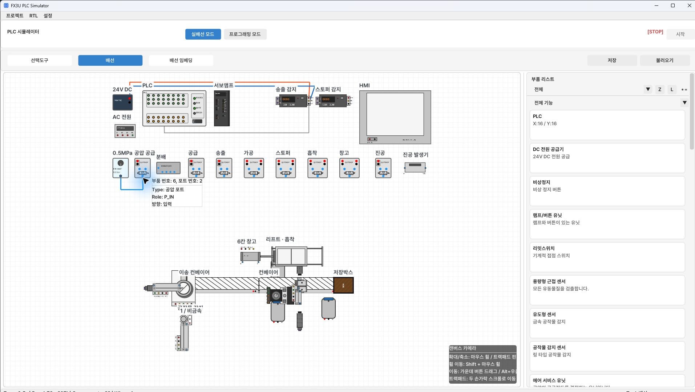

[사용법 목차](README.md) · [← 10. L 레이어: 표시 순서·그룹·투명도](10-render-layers.md) · [12. RTL 부품 만들기와 사용 →](12-rtl.md)

# 11. 센서·공압·모터·공작물 실습

기계 부품은 배선·신호 조건과 함께 **실제 위치, 방향, 높이**를 맞춰야 동작합니다.
한 동작을 확인한 뒤 다음 구동부를 연결하면 자동 시퀀스를 만들 때 원인을 찾기 쉽습니다.

## 공압 공급과 복동실린더

1. 에어 서비스 유닛(FRL), 솔레노이드, 복동실린더를 배치합니다.
2. FRL의 압력을 설정합니다. 산업기사 예시 사진은 0.5MPa 공급입니다.
3. FRL OUT을 솔레노이드 P에 연결합니다.
4. 솔레노이드 A/B를 실린더 A/B에 연결합니다.
5. 솔레노이드 코일의 전원·PLC 제어선·0V를 연결합니다.
6. 한 방향 출력만 켜서 전진·후진을 각각 확인합니다.
7. 내장 센서가 있으면 24V·0V와 FWD/REV를 PLC X로 연결합니다.

*FRL 공급과 솔레노이드 P를 연결한 실제 공압 배선 예*

솔레노이드의 공압 기호로 작동 포트와 공급·배기 경로를 읽습니다.
실린더 A/B를 뒤집으면 기대한 출력과 로드 방향이 반대가 될 수 있습니다.
서로 반대 코일을 동시에 켜는 회로는 피하고 방향별 인터록을 만듭니다.

## 센서와 광화이버

일반 센서는 먼저 전원을 연결하고 신호 핀을 X로 보냅니다.
유도형은 금속 검출, 용량형은 검출 대상 범위가 다르므로 부품 설명을 읽습니다.
센서를 공작물 경로에 너무 밀집시키면 여러 센서가 동시에 잡혀 순서가 불분명해질 수 있습니다.

광화이버는 **증폭부 + 송신 헤드 + 수신 헤드**를 함께 사용합니다.

1. 증폭부에 24V·0V를 연결합니다.
2. 광 TX와 송신 헤드, RX와 수신 헤드를 연결합니다.
3. 증폭부 SIG를 PLC X에 연결합니다.
4. 헤드 사이 검출 경로에 공작물이 들어가도록 위치·방향을 맞춥니다.
5. 센서와 공작물의 Z 높이를 확인합니다.
6. 증폭부 수치·표시 상태와 X 입력이 함께 변하는지 확인합니다.

증폭부가 계속 0000이면 전원, 두 광 링크, 헤드 배치부터 확인합니다.
표시가 변하는데 PLC X만 안 변하면 SIG 배선·입력 모드·주소를 확인합니다.

## DC 모터 드라이버: PLC 속도 제어

| 드라이버 핀 | 연결 대상 / 역할 |
| --- | --- |
| 24V / 0V | 드라이버 전원 |
| EN | PLC 운전 허가 출력 |
| DIR | PLC 방향 출력 |
| BRK | PLC 브레이크 출력 |
| PWM | PLC PWM 출력 |
| M+ / M− | DC 모터의 + / − |

1. 모터를 드라이버 M+·M−에 연결합니다.
2. 24V·0V 전원을 연결합니다.
3. EN·DIR·BRK를 선택한 PLC 출력에 연결합니다.
4. PWM 핀은 **Y0~Y3 중 한 출력**에 연결합니다.
5. 래더에서 PWM을 내보냅니다. 예: 조건이 ON일 때 `PWM K5 K10 Y0`은
   ON 시간 5ms / 주기 10ms, 듀티 50%입니다.
6. EN을 켜고 BRK를 해제한 뒤 방향과 속도를 확인합니다.

EN·DIR·BRK가 모두 Y0에 고정된 것은 아닙니다. 다만 **PWM에는 Y0~Y3만 사용할 수 있습니다.**
한 PWM 핀에 여러 출력을 겹쳐 연결하지 않습니다.
PWM 전용 명령이 없고 해당 Y만 ON이면 100%, OFF이면 0%로 처리됩니다.
가변저항을 돌리는 실습이 아니며 PWM 제어에는 별도 아날로그 출력 모듈이 필요하지 않습니다.
같은 Y에 PWM과 일반 OUT 또는 서보 모션 명령을 동시에 할당하지 않습니다.

## 서보 리프트와 원점

서보 모터는 **U/V/W·PE·ENC** 핀을 사용합니다. 스테핑 모터의 A+/A−/B+/B−와 혼동하지 않습니다.
앰프 전원과 SON·펄스·방향·관련 상태 신호, 모터 구동·ENC 링크를 핀 이름에 맞춰 연결합니다.

리프트는 회전 운동을 볼스크류의 선형 이동으로 바꿉니다. 축 설정은 [Z·서보 축 설정](09-z-layers.md)을 따릅니다.
먼저 원점 복귀와 짧은 JOG를 확인한 뒤 자동 위치 이동을 만듭니다.
중간에서 JOG하고도 이전 자동 단계 M이나 좌표 기준을 그대로 두면 다음 이동이 잘못될 수 있습니다.

## 흡착·스토퍼

흡착실린더는 로드 이동과 진공 발생을 함께 확인합니다. 패드가 실제 공작물 위치·높이에 있어야 합니다.
진공 제어만 ON이라고 떨어진 공작물이 자동으로 붙지는 않습니다.

스토퍼는 컨베이어 경로에 핀이 걸리는 높이에서 공작물을 막습니다.
실물처럼 비활성 높이에서는 보이지 않는 핀을 평면에서 억지로 튀어나온 로드로 읽지 않습니다.
스토퍼 작동 높이와 컨베이어·공작물 높이를 맞추고, ON/OFF의 통과·정지를 확인합니다.

## 공작물 공급·보관

공작물 감지 센서 위에 공작물을 올려 공급 스택을 만듭니다.
첫 공작물은 첫 작업 높이, 대기 공작물은 위 높이에 머물다가 첫 공작물이 빠지고
관련 구동 요소가 멈추면 다음 공작물이 내려오는 방식입니다. 별도 매거진이 들어 올리는 동작으로 구성하지 않습니다.

저장박스는 같은 작업 높이에서 들어온 여러 공작물을 내부에 정렬해 보관합니다.
6칸 저장창고는 층별 두 칸을 사용하며 마우스 오버 등의 슬롯 미리보기로 적재 상태를 확인합니다.
공작물을 꺼낼 때는 선택도구에서 공작물을 드래그합니다. 선택이 안 되면 L 숨김·불투명도·앞에 있는 부품을 확인합니다.

창고의 좌우 이동을 만들려면 **서보 구동 창고** 등 해당 구동 부품을 사용합니다.
공압 구동 창고는 A/B 압력으로 실린더가 움직이는 다른 모델입니다.
정적 창고에 신호선만 연결해 이동한다고 생각하지 않습니다.

전체 설비를 연결하는 예는 [산업기사 3번 실습 가이드](../exam03/GUIDE.md)를 이어서 읽으세요.

---

[사용법 목차](README.md) · [← 10. L 레이어: 표시 순서·그룹·투명도](10-render-layers.md) · [12. RTL 부품 만들기와 사용 →](12-rtl.md)
