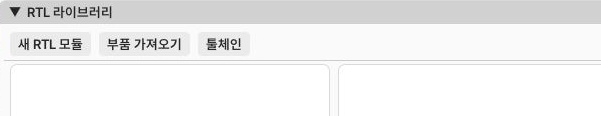
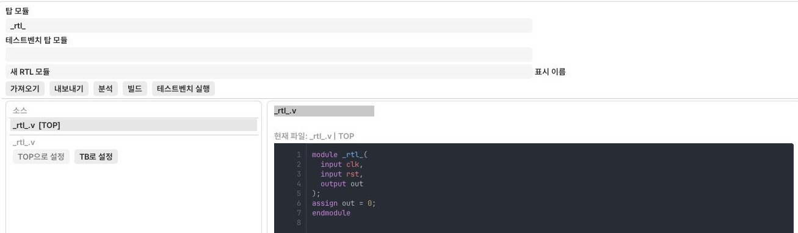
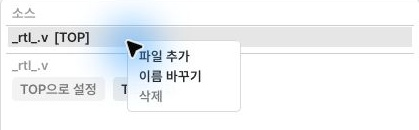
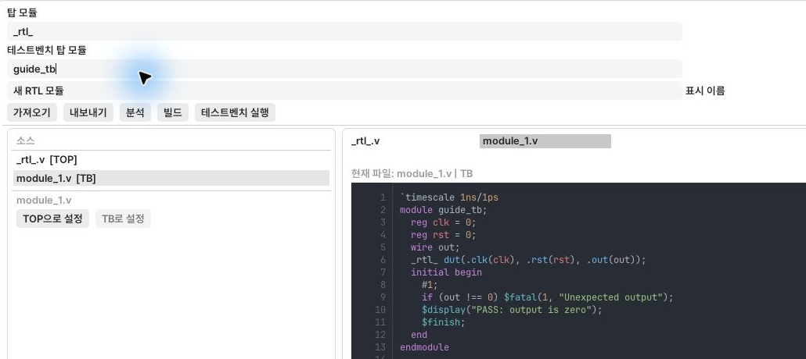
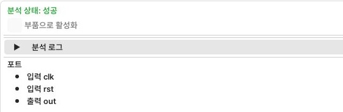
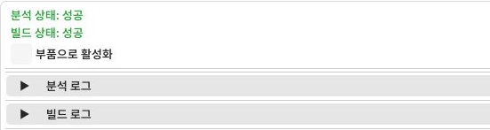
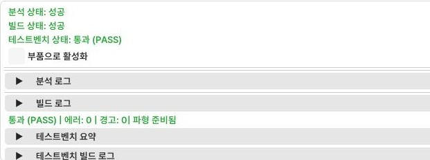

[使い方の目次](README.ja.md) · [← 11. センサー・空圧・モーター・ワーク実習](11-mechanics.ja.md) · [13. 設定・ショートカット・問題解決 →](13-settings-shortcuts.ja.md)

# 12. RTL部品の作成と使用

RTLはVerilogで作った回路を実配線部品として有効にする機能です。
基本ラダー実習には不要なので、基本実習を終えてから進めても構いません。

配置と配線の例は [Full Adder実配線実習](rtl-full-adder.ja.md) を参照してください。
ソースコードから電源・入出力接続、ボタン操作、真理値表まで説明します。

## 先にビルド環境を準備する

**RTL → ツールチェーン** でWSL2を診断します。
初回インストールとエラー別の対処は [Tool Doctor](rtl-tool-doctor.ja.md) を参照してください。
すべての診断項目が「検出済み」になったら、以下の部品作成へ進みます。

新しい部品のビルド・テストにはWSL2が必要です。
ビルド済み部品はWSLをインストールせずに使えます。

## 手順1：RTLモジュールの準備

*RTL → RTLライブラリを開き、左上の「新規RTLモジュール」を押します。*

1. **RTL → RTLライブラリ** を開きます。
2. **新規RTLモジュール** を押し、分かりやすい名前で作ります。
3. 新しいソースは **ソース一覧を右クリック → ファイル追加** で作ります。
   既存の `.v` は編集領域の上の **インポート** から読み込みます。
4. ファイルを選び **TOPに設定** します。TOPモジュール名をソースのmodule名に合わせます。
5. テストベンチがあれば追加し、**TBに設定** します。
   上部の **テストベンチトップモジュール** にも、そのソースのmodule名を入力します。
6. ソースを編集し、**解析** を実行します。
7. エラーがなければ **ビルド** を実行します。

*左はファイル選択、右はソース編集です。[TOP]は部品にするファイルです。*

*「ファイル追加」はソース一覧の右クリックメニューにあります。空ファイルを作ってコードを入力します。*

*TBソースの `module guide_tb` と「テストベンチトップモジュール」の `guide_tb` を合わせます。*

*解析後、下に「解析状態：成功」と入出力ポートが表示されます。*

解析はソースとポートを確認し、ビルドは実行する部品を作ります。
解析成功だけでは新しい実行ファイルは作られていません。

*「ビルド状態：成功」は実行ファイルが作られた状態です。
下の「コンポーネントとして有効化」は実配線一覧に登録する設定です。*

## 手順2：テストと実配線での使用

1. TBを指定した場合は **テストベンチ実行** を押します。
2. PASS/FAIL/TIMEOUTとテストベンチログを確認します。
3. 波形が生成されたら **波形を開く** で信号の変化を確認します。
4. ビルド済みモジュールの **コンポーネントとして有効化** をオンにします。
5. 実配線の部品一覧から、そのRTL部品を配置します。
6. 入出力ポートを接続して動作を確認します。
7. プロジェクト全体を `.plcproj` で保存します。

*PASSはテスト合格です。結果が切れる場合は下側のパネル内でスクロールしてください。*

ソース変更後は再解析・再ビルドします。NOT RUNはテスト合格ではありません。
GUIのポート名と実際のTOPの入出力が一致することを確認します。

## 部品の共有と再編集

| 目的 | 保存方法 |
| --- | --- |
| 別プロジェクトで再利用 | 部品をエクスポート → `.plccomp` |
| 受け取った人がソース修正・再ビルド | エクスポート時にソースを含める |
| 実行専用で配布 | ランタイム専用パッケージ |
| 配線・ラダー・RTLを一緒に保存 | `.plcproj` 統合保存 |

ライブラリの **部品インポート** で `.plccomp` を開きます。
ビルドフォルダーのworker EXEを、新しいRTLモジュールとして再インポートしません。
ソースなしのランタイムパッケージは使えますが、ソース編集・再ビルドはできません。

ビルド済みWindows部品EXEを含むパッケージは、実行時にWSLを使いません。
新しい部品のビルドやテストベンチ実行にはWSL2を準備します。

環境の問題は [Tool Doctorの問題解決](rtl-tool-doctor.ja.md) を参照してください。

---

[使い方の目次](README.ja.md) · [← 11. センサー・空圧・モーター・ワーク実習](11-mechanics.ja.md) · [13. 設定・ショートカット・問題解決 →](13-settings-shortcuts.ja.md)
