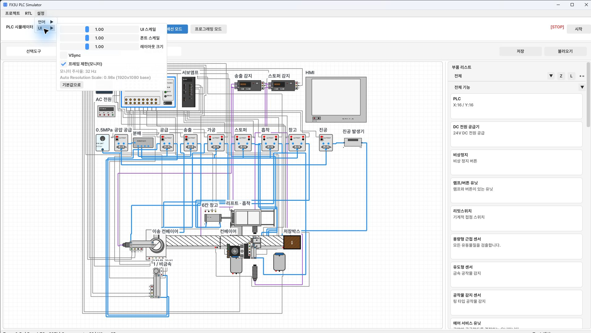

[使い方の目次](README.ja.md) · [← 12. RTL部品の作成と使用](12-rtl.ja.md)

# 13. 設定・ショートカット・問題解決

画面や文字が小さい場合は、キャンバス倍率とUI設定をそれぞれ調整します。
キャンバスZoomは部品の倍率、UIスケールはメニューやウィンドウの大きさです。

## 言語とUIサイズ

1. **設定 → 言語** で韓国語・英語・日本語を選びます。
2. **設定 → UI** を開きます。
3. **UIスケール** で全体の倍率を調整します。
4. **フォントスケール** で文字の大きさを調整します。
5. **レイアウトサイズ** で余白やウィンドウ構成を調整します。
6. 再起動の案内が出たら作業を保存して再起動します。
7. サイズを戻すには **デフォルト** を使います。

*UI・フォント・レイアウト・フレーム設定*

UI・フォント・レイアウトの倍率は現在0.75～1.5で、再起動が必要です。
**VSync** と **フレーム制限（モニター）** は描画の設定です。
フレーム制限はサーボ速度やPLCタイマーの設定ではありません。

## 共通ショートカット

| キー | 動作 |
| --- | --- |
| Tab | 実配線／プログラミング切り替え |
| Ctrl+S | 統合プロジェクト保存画面 |
| Ctrl+, / Ctrl+/ | ヘルプ・ユーザーガイド |
| Ctrl+Z | 元に戻す |
| Ctrl+Y / Ctrl+Shift+Z | やり直し |

テキスト欄やポップアップの編集中は、キーが入力用になったりショートカットが制限されたりします。
ショートカットが効かない場合は入力を確定して画面を閉じ、キャンバスやラダーを選び直します。

## 実配線ショートカット

| キー／操作 | 動作 |
| --- | --- |
| Q | 選択 → 配線 → 配線埋め込みを切り替え |
| R / Shift+R | 90度／逆方向回転 |
| Delete | 選択を削除 |
| Ctrl＋クリック | 部品の選択追加・解除 |
| 空白部分をドラッグ | 長方形で複数選択 |
| 接続中に右クリック | 接続を取り消し |
| Alt＋右クリック | 配線タグ解除 |

## プログラミングショートカット

| キー | 動作 |
| --- | --- |
| F2 / F3 | モニター／編集 |
| F4 | コンパイル（編集モード） |
| F5 / F6 | a接点／b接点 |
| F7 | 出力コイル |
| F8 | 応用命令 |
| Shift+F7 / Shift+F8 | 立ち上がり／立ち下がりパルス接点 |
| Enter | 命令編集・入力確定 |
| Insert | 回路追加 |
| Delete | 選択範囲を削除 |
| Ctrl+C / Ctrl+V | 選択行・セルをコピー／貼り付け |
| 方向キー | 選択セルを移動 |
| Shift＋上・下 | 行選択の範囲を拡張 |
| バッククォート | 回路メモ画面 |

横線は **F9**、縦接続は **Shift+F9** で追加します。
接続方法は [分岐編集](06-programming.ja.md) を確認してください。

## 症状別の確認順

| 症状 | 確認順 | 詳細 |
| --- | --- | --- |
| 開始不可・コンパイル警告 | 編集 → エラー修正 → コンパイル → 開始 | [ラダー](06-programming.ja.md) |
| 部品が見つからない | 資格・機能フィルターを両方すべてに | [部品](03-components.ja.md) |
| ピンを選びにくい | 拡大 → ピン名 → 線の終点 | [配線](04-wiring.ja.md) |
| YがONでも動かない | 電源・0V → 出力モード → バルブ／ドライバー → 物理条件 | [機械](11-mechanics.ja.md) |
| センサーが検出しない | 電源 → 対象 → 位置・方向 → Z → SIG/X | [センサー](11-mechanics.ja.md) |
| 部品が消えた | Lの表示・不透明度・順序 → キャンバス位置 | [L](10-render-layers.ja.md) |
| 重なっても格納・衝突しない | 接触Z・作業位置・機械動作 | [Z](09-z-layers.ja.md) |
| HMIボタンが効かない | 24V・0V → PLC1台 → RUN → 一時停止 → Mアドレス | [HMI](08-hmi.ja.md) |
| HMIの数値を変更できない | 数値表示は読み取り専用。Mボタンとラダーで変更 | [HMI](08-hmi.ja.md) |
| 保存後にラダー・配線がない | JSON/CSVだけの保存か確認 → 統合プロジェクト保存 | [ファイル](02-projects.ja.md) |
| 自動動作が途中停止 | 要求 → 段階M → 命令 → 駆動 → 完了入力 | [モニター](07-monitoring.ja.md) |
| RTL解析・ビルド失敗 | 保存した配布版 → Doctor失敗項目 → ビルドログ | [RTL](12-rtl.ja.md) |

問題を伝える際は、バージョン、プロジェクト名、RUN/STOP、最後の正常動作、
停止した部品、X/Y/M状態、エラー文、画面を添えると確認しやすくなります。

## 次の実習

基本操作を覚えたら [産業技師問題3ガイド](../exam03/GUIDE.ja.md) の
**部品配置 → 電源配線 → 制御配線 → HMI → ラダー** の順で進めてください。

## プログラム内でガイドを読む

**Ctrl+,** でヘルプを開き、**操作ガイドを開く** を押します。ヘルプは基本操作とショートカットを探す画面、ガイドは写真・GIFで詳しく学ぶ別ウィンドウです。

- ガイドを開いたまま実配線・ラダーの編集や運転を続けられます。自動で一時停止はしません。
- ウィンドウの端でサイズを変え、プログラムの横へ移動できます。
- 左側の目次で章を選ぶか、検索語を入力します。
- 上部の前・次ボタンで読んだ文書へ戻ります。A−・A+は本文の文字サイズを変えます。
- 画像・GIFを押すと拡大できます。文書と実習画像はインターネットなしで読めます。
- ガイドを閉じてもプログラムは動き続けます。ヘルプから再度開けます。

ガイドが開かない場合は、インストール先の `resources/help` とMicrosoft Edge WebView2 Runtimeを確認します。
---

[使い方の目次](README.ja.md) · [← 12. RTL部品の作成と使用](12-rtl.ja.md)
