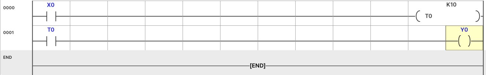
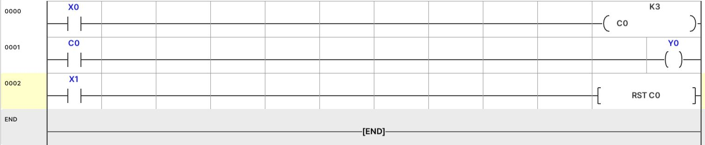

[使い方の目次](README.ja.md) · [ラダーの入力方法](06-programming.ja.md) · [モニターの確認方法](07-monitoring.ja.md)

# 基本回路を1つずつ練習する

表の **左側の条件** は接点、**右側の命令** はコイルまたは応用命令です。
表の1行を1回路として入力し、最後のENDを残します。
各例は別々の実習です。同じY0を使う例をすべて1つのプログラムにまとめないでください。

接点はF5/F6、応用命令はF8、確定はEnterです。
基本OUTはF7も使えます。入力後にコンパイルしてRUNで確認します。

配線なしでラダーだけを練習する場合は、**STOPでモニター（F2）** を開き、右側のXボタンで試せます。
入力ボタンと現在値の読み方は [基本モニター実習](07-monitoring.ja.md) を参照してください。

## 1. 開始・停止を保持する回路

ボタンは押している間だけ入力を作ります。運転を続けるにはMに状態を保持します。
X0は開始、X1は停止ボタンの **NO信号** とします。
実機の非常停止配線設計とは区別した、シミュレーターの基本練習です。

| 回路 | 左側の条件 | 右側の命令 |
| --- | --- | --- |
| 1 | X0 a接点 | `SET M200` |
| 2 | X1 a接点 | `RST M200` |
| 3 | M200 a接点 | `OUT Y0` |

1. 最初の回路にF5でX0を入れ、次のセルにF8で `SET M200` を入力します。
2. 新しい回路にX1と `RST M200` を入力します。
3. 最後の回路にM200とY0コイルを入力します。
4. コンパイルして開始します。
5. X0を押して離してもM200・Y0がONのままか確認します。
6. X1を押すとオフになるか確認します。

この順序では同じスキャンで両入力がONになると、後のRSTが状態を解除します。
停止を実際のNC配線に変えるとX1の通常・押下状態が変わるため、条件も書き直します。

## 2. 1秒後にランプを点灯

| 回路 | 左側の条件 | 右側の命令 |
| --- | --- | --- |
| 1 | X0 a接点 | `OUT T0 K10` |
| 2 | T0 a接点 | `OUT Y0` |

1. X0接点を入力し、次のセルでF8 → `OUT T0 K10` → Enterと操作します。
2. 次の回路にT0接点とY0コイルを入力します。
3. コンパイル・開始後、X0を押して維持します。
4. T0が10に達したら、T0完了接点とY0がONか確認します。
5. X0を解除すると現在値・完了接点・Y0が解除されるか確認します。

T0のK10は **1秒** です。この実習ではT0だけを使ってください。

1行目：X0ボタンを押している間、T0が時間を数えます。
2行目：1秒後にT0接点がONになり、Y0ランプが点灯します。
ボタンを離すとタイマーとランプがオフになります。

## 3. 3回入力したらランプを点灯

| 回路 | 左側の条件 | 右側の命令 |
| --- | --- | --- |
| 1 | X0 a接点 | `OUT C0 K3` |
| 2 | C0 a接点 | `OUT Y0` |
| 3 | X1 a接点 | `RST C0` |

1. X0と `OUT C0 K3` を入力します。
2. C0とY0を入力します。
3. X1と `RST C0` を入力します。
4. コンパイルして開始し、X0を押して離す動作を3回繰り返します。
5. 3回目でY0が点灯します。押し続けても1回しか数えません。
6. X1を押してC0とY0が解除されるか確認します。

1行目：X0ボタンを押すたびに1回数えます。
2行目：3回になるとY0ランプが点灯します。
3行目：X1を押すと回数が0に戻り、ランプも消灯します。

## 4. HMIボタンで設定値を変更

HMIの数値は表示専用なので、ボタン要求をラダーで数値に変えます。

| HMIウィジェット | アドレス | 設定 |
| --- | --- | --- |
| 低速ボタン | M100 | 瞬時動作 |
| 高速ボタン | M101 | 瞬時動作 |
| 速度の数値表示 | D100 | 実習に合う単位を入力 |

| 回路 | 左側の条件 | 右側の命令 |
| --- | --- | --- |
| 1 | M100 a接点 | `MOV K100 D100` |
| 2 | M101 a接点 | `MOV K500 D100` |

HMIを適用し、2回路をコンパイルします。RUNで低速・高速を押し、
D100表示がそれぞれ100・500に変わるか確認します。
この回路だけではモーター速度は変わりません。ドライバー・PWMや移動命令がD100を使うよう別途接続します。

## 5. 直列条件を確認

「運転要求M200がON、加工検出X2がON、停止要求M201がOFFのときY1」は、
M200 a接点 → X2 a接点 → M201 b接点 → Y1コイルです。

1. 同じ行にF5 M200、F5 X2、F6 M201の順に入力します。
2. 最後にF7 Y1を入力します。
3. モニターで条件を左から順に読みます。
4. Y1がOFFなら、どの接点で条件が切れるか確認します。

並列の「または」条件は [ラダー編集](06-programming.ja.md) の分岐説明と、
[実際の並列回路画像](../exam03/logic-02-manual.ja.md) を合わせて確認します。

---

[使い方の目次](README.ja.md) · [ラダーの入力方法](06-programming.ja.md) · [モニターの確認方法](07-monitoring.ja.md)
