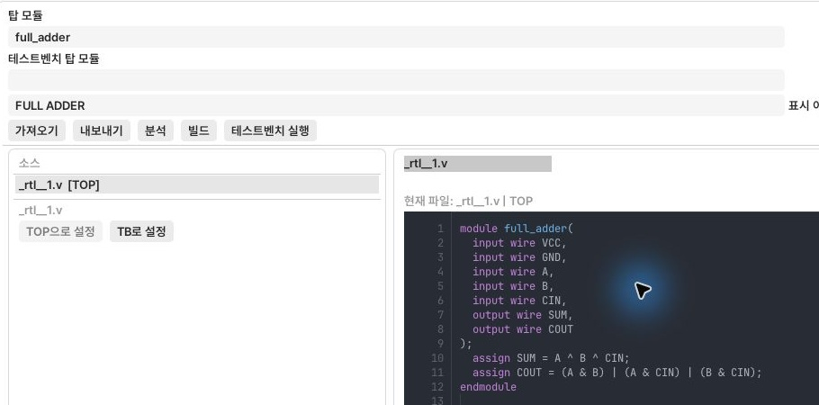
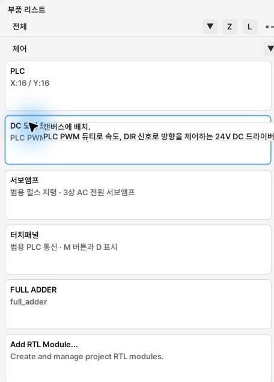
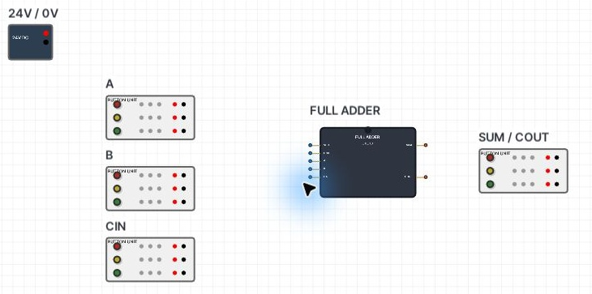
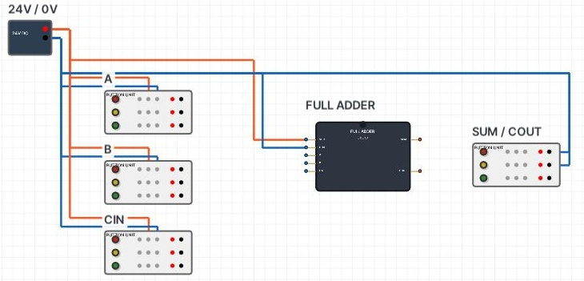
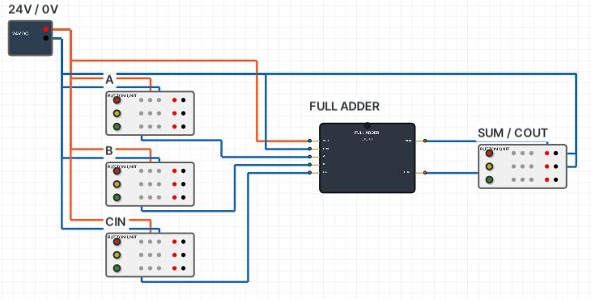
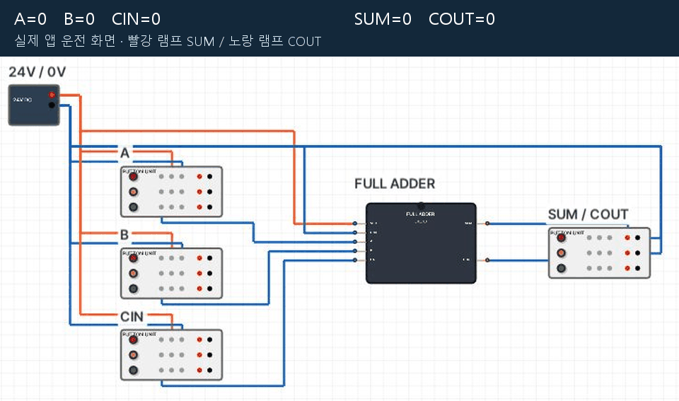

<a id="full-adder-rtl-부품-배치배선사용-실습"></a>

# Full Adder：RTL部品の配置・配線・使用実習

[使い方の目次](README.ja.md) · [RTL作成の基本操作](12-rtl.ja.md)

**自作のFull Adderを実配線キャンバスに置き、ボタンで入力を変え、2つのランプで結果を読みます。**
A・B・CINは1ビット入力です。SUMは和の下位ビット、COUTは桁上がりです。
例えば `1 + 1 + 0 = 2` ならSUM=0、COUT=1です。

<a id="1-full-adder-만들기"></a>

## 1. Full Adderを作る

1. [Tool Doctor](rtl-tool-doctor.ja.md) でビルド環境を準備します。
2. **RTL → RTLライブラリ → 新規RTLモジュール** を押します。
3. **表示名** を `FULL ADDER`、**トップモジュール** を `full_adder` にします。
4. 自動生成された[TOP]ファイルを選び、右側のエディターに以下のコードを入力します。

```verilog
module full_adder(
  input wire VCC,
  input wire GND,
  input wire A,
  input wire B,
  input wire CIN,
  output wire SUM,
  output wire COUT
);
  assign SUM = A ^ B ^ CIN;
  assign COUT = (A & B) | (A & CIN) | (B & CIN);
endmodule
```



*プログラムに入力したFull Adderです。ファイル名とトップモジュール名を区別してください。*

VCC・GNDは電源を接続するピンです。この実習は **産業用24Vロジック** を使います。
各ポートは上のコードのように1行ずつ宣言します。
ファイル名は自動生成名でも構いません。**トップモジュール** は `module full_adder` に合わせます。

5. **解析** を押し、入力VCC・GND・A・B・CINと出力SUM・COUTを確認します。
6. **ビルド** を押し、「ビルド状態：成功」を待ちます。
7. 下の結果領域で **コンポーネントとして有効化** をオンにし、RTL画面を閉じます。


*ビルド成功後に「コンポーネントとして有効化」をチェックした画面です。*

<a id="2-캔버스에-배치하기"></a>

## 2. キャンバスに配置

| 部品 | 数量 | 用途 |
| --- | --- | --- |
| DC電源 | 1 | 24V・0V供給 |
| FULL ADDER | 1 | 作成したRTL部品 |
| ランプ／ボタンユニット | 3 | A・B・CIN入力。各ユニットの3番目の緑ボタンを使用 |
| ランプ／ボタンユニット | 1 | 1番目のランプはSUM、2番目はCOUT |

1. **配線** に移り、フィルターを **すべて／全機能** にします。
2. 下へスクロールして `FULL ADDER` を探します。**すべて／制御** に絞ることもできます。
3. **カードをキャンバス中央にドラッグ** します。ライブラリで名前を選ぶだけでは配置されません。
4. 電源を左上、入力3台を左に縦並び、出力ユニットを右に置きます。
5. 入力名をA・B・CIN、出力名をSUM / COUTにし、**名前を表示** をオンにします。
6. FULL ADDERをダブルクリックし、**RTLランタイム → ロジックファミリー → 産業用24V** を確認します。
   電源はVCC、接地はGNDです。この組み合わせ回路にはクロック・リセットを指定しません。



*上は資格「すべて」、下は機能「制御」です。カード名はFULL ADDERです。*



*左がA・B・CIN、中央がFULL ADDER、右がSUM / COUTです。*

一覧にない場合は、ライブラリで **解析成功 → ビルド成功 → コンポーネントとして有効化** を確認します。
部品フィルターがRTL部品を隠していないかも確認してください。

<a id="3-전원-배선"></a>

## 3. 電源配線

**配線** を選びます。電気ピン同士は電気配線になります。
開始ピン → 必要な経由点 → 終点ピンの順にクリックします。

| 開始ピン | 終点ピン |
| --- | --- |
| DC 24V | FULL ADDER VCC |
| DC 0V | FULL ADDER GND |
| DC 24V | A・B・CIN各入力ユニットの **3段目NO** |
| DC 0V | A・B・CIN各入力ユニットの **3段目NC** |
| DC 0V | 出力ユニットの **1段目LAMP_0V** |
| DC 0V | 出力ユニットの **2段目LAMP_0V** |

NO・NCはボタン接点、LAMP_24V・LAMP_0Vはランプのピンです。
この実習では入力ユニットのランプや出力ユニットのボタン接点は配線しません。



*先に電源配線を終えた画面です。信号線は次の手順で接続します。*

<a id="4-신호-배선"></a>

## 4. 信号配線

| 開始ピン | 終点ピン |
| --- | --- |
| A入力ユニット3段目 **COM** | FULL ADDER **A** |
| B入力ユニット3段目 **COM** | FULL ADDER **B** |
| CIN入力ユニット3段目 **COM** | FULL ADDER **CIN** |
| FULL ADDER **SUM** | 出力ユニット1段目 **LAMP_24V** |
| FULL ADDER **COUT** | 出力ユニット2段目 **LAMP_24V** |

ボタンがONならCOMはNOの24Vにつながって入力1、
OFFならCOMはNCの0Vにつながって入力0になります。
**COMを入力につなぎ、NO・NCで2つの電圧を選びます。**
24Vと0Vを同じピンへ直接接続しません。



*3入力のCOMは左側入力ピンへ、右側のSUM・COUTは出力ユニットのランプへ接続します。*

<a id="5-운전하고-결과-읽기"></a>

## 5. 運転と結果の確認

1. **プログラミング** でENDだけの実習プログラムを **コンパイル** します。
   この実習にはX/Yを制御するラダー回路は不要です。
2. 右上の **実行** を押し、**実配線 → 選択ツール** に戻ります。
3. 各入力ユニットの **3番目の緑ボタンをダブルクリック** して切り替えます。
   3番目のボタンは状態を保持します。上の赤・黄は押している間だけなので使いません。
4. 出力ユニットの **1番目の赤ランプ＝SUM**、**2番目の黄ランプ＝COUT** を読みます。

| A | B | CIN | SUM：1番目のランプ | COUT：2番目のランプ |
| --- | --- | --- | --- | --- |
| 0 | 0 | 0 | OFF | OFF |
| 0 | 0 | 1 | ON | OFF |
| 0 | 1 | 0 | ON | OFF |
| 0 | 1 | 1 | OFF | ON |
| 1 | 0 | 0 | ON | OFF |
| 1 | 0 | 1 | OFF | ON |
| 1 | 1 | 0 | OFF | ON |
| 1 | 1 | 1 | ON | ON |

入力状態はボタンが押された形で読みます。
入力ユニットの緑 **ランプ** は未配線なので、明るさで入力状態を判断しません。



*上の入力値と右のSUM・COUTランプを一緒に見てください。*

<a id="안-될-때"></a>

## 動作しない場合

| 症状 | 確認箇所 |
| --- | --- |
| 開始できない | ラダーのコンパイル成功 |
| 両ランプが常にOFF | RUN、VCC・GND、産業用24V設定、ビルド成功 |
| 特定の入力が変わらない | 3段目COM・NO・NCと緑ボタンのダブルクリック |
| 結果が逆 | NO=24V、NC=0V、SUM/COUTのランプ段が逆でないか |
| ソース変更後も古い動作 | 停止して再解析・再ビルド後に開始 |

最後に **プロジェクト → プロジェクトを保存…** で `.plcproj` として保存します。
この形式で配線・プログラム・RTL部品をまとめて保存します。

[使い方の目次](README.ja.md) · [RTL作成の基本操作](12-rtl.ja.md)
